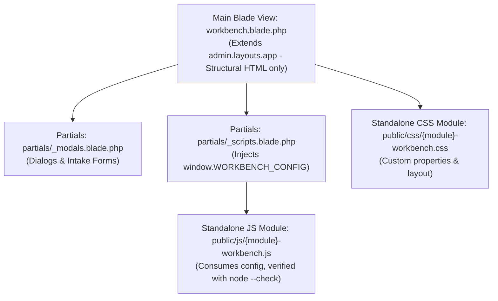

# Modular Workbench & Core Application Architecture

CoreHealth v2 is engineered as a monolithic Laravel 8 fullstack web application following a modular workbench design pattern.

---

## 1. Modular Workbench Architecture Pattern

To prevent unmaintainable monolithic Blade files (which historically exceeded 15,000 lines), all hospital workbenches strictly enforce a 4-part modular structure:



### Constraints:
1. **No Inline Scripts or Styles exceeding 10 lines**: Any `<style>` or `<script>` block in a Blade file must not exceed 10 lines. Front-end logic belongs in standalone modules under `public/js/` and styles in `public/css/`.
2. **Dynamic Hospital Theme Variables**: Colors are defined in the master layout (`resources/views/admin/layouts/app.blade.php`) and referenced via CSS variables:
   - `var(--hospital-primary, #011b33)`
   - `rgba(var(--hospital-primary-rgb, 1, 27, 51), 0.1)`
   - Never place unparsed Blade syntax (e.g. <span v-pre><code>{{ $hosColor }}</code></span>) inside static `.css` files.
3. **Zero-Scroll Viewport Locking**: Workbenches declare `@section('is_workbench', true)` and `@section('body_class', 'is-workbench has-workbench')` to lock the outer desktop viewport to `100vh` and suppress standard headers and marketing footers.

---

## 2. Directory Layout & Key Namespaces

```
app/
├── Console/Commands/     # Domain CLI commands (sync-prices, corehms:backfill)
├── Contracts/            # Typed event & sync interfaces (CoreHms, WeCare)
├── Events/               # Clinical and financial domain events
├── Helpers/              # Utilities (ClinicalSearchHelper, BatchHelper)
├── Http/Controllers/     # Domain controllers partitioned by role/module
├── Jobs/                 # Queued jobs (DispatchCoreHmsSyncJob)
├── Models/               # 199 Eloquent models
├── Observers/            # 46+ observers executing double-entry side effects
└── Services/             # Business logic & payment services
```

---

## 3. Base Controllers & Inheritance

- Workbenches share repetitive datatable, stamping, and filter logic via Base Controllers (such as `OpsAuditBaseController`).
- Child controllers define module mappings (`$modelMap`) and invoke shared parent pipeline methods.
