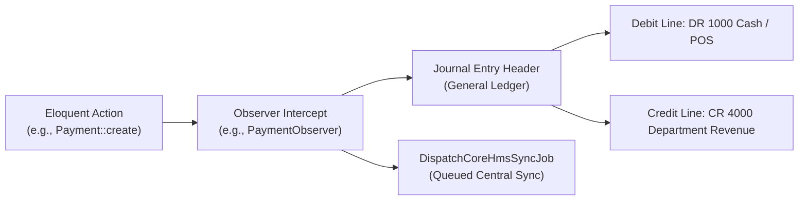

# Database Engine, Compatibility & Observers Ledger

CoreHealth v2 manages mission-critical clinical records and a multi-currency double-entry General Ledger.

---

## 1. Database Compatibility (MySQL 8.0 & MariaDB)

The production stack targets **MySQL 8.0** and **MariaDB 10.5+**.
- **Do NOT use PostgreSQL functions**: Never use `ILIKE`, `NOW() - INTERVAL '1 DAY'`, or postgres date formatters.
- **Date Functions**: Always use `CURDATE()`, `NOW()`, and `DATEDIFF()`.
- **String Matching**: Use standard SQL `LIKE '%term%'` or use `ClinicalSearchHelper` for multi-token keyword resolution.
- **JSON Syntax**: Ensure JSON column queries use MariaDB-compatible syntax (e.g. `JSON_UNQUOTE(JSON_EXTRACT(...))`).

---

## 2. Observer Side-Effects & Double-Entry Financial Governance

The system relies on **46+ Eloquent Observers** to generate double-entry Journal Entries (JEs), inventory sync, and tariff price propagation.

### Critical Architectural Rule:
> [!CAUTION]
> **NEVER BYPASS OBSERVERS WITH RAW DB QUERIES**  
> Running `DB::table('payments')->insert(...)` or `DB::table('stocks')->update(...)` bypasses Eloquent events! This breaks double-entry balancing and prevents stock batch synchronization. Always use Eloquent models (`Payment::create(...)`) when operating on entities watched by observers.

### Key Observers Table:
| Observer Class | Target Entity | Core Side Effects |
|---|---|---|
| `PaymentObserver` | `Payment` | Multi-leg split debit/credit JEs, wallet balance update, department revenue tagging |
| `ProductOrServiceRequestObserver` | `ProductOrServiceRequest` | Department ID auto-stamping, HMO claim journal entries |
| `StockBatchObserver` | `StockBatch` | Three-tier FIFO sync: `stock_batches` $\rightarrow$ `store_stocks` $\rightarrow$ `stocks` |
| `DamageReportObserver` | `DamageReport` | Expense JEs (DR 5000 Inventory Loss, CR 1200 Inventory Asset) |
| `PatientObserver` | `Patient` | Queued sync dispatch to CoreHMS SuperAdmin |
| `PriceObserver` | `Price` | Synchronizes hospital price lists and HMO tariff schedules |

