# Multi-Standard 5-Level Architecture & Grounded Equivalency Registry

> **Comparative Framework**: Mapping HL7 FHIR R4, openEHR, OpenEMR, and NDPA 2023 Across the 5 Official Health Information Architecture Levels  
> **Core Principle**: **Implement Only What Each Standard Core Needs** — Unified via the CoreHealth v2 Translation & Compatibility Layer  
> **Core Database Invariant**: **Zero Core Table Schema Changes**  

---

## 1. The 5-Level Architecture Matrix

Every international health informatics standard and privacy regulation addresses healthcare data through five layered tiers of abstraction. The table below maps **HL7 FHIR R4**, **openEHR**, **OpenEMR**, and the **Nigeria Data Protection Act (NDPA 2023)** side-by-side, detailing the exact equivalent specifications, official documentation links, and CoreHealth Translation Layer components:

```mermaid
flowchart TD
    subgraph Level_5["Level 5: Clinical Reasoning, Governance & Decision Support"]
        F5["FHIR: Clinical Reasoning<br/>(PlanDefinition, GuidanceResponse, Measure)"]
        O5["openEHR: CDS & Guidelines<br/>(GDL2, Task Planning TP)"]
        E5["OpenEMR: Clinical Rules<br/>(CDR Engine, CQM Quality Measures)"]
        N5["NDPA: Governance & DPIA<br/>(DPO Appointment, Annual NDPC Audit)"]
    end

    subgraph Level_4["Level 4: Clinical Record-Keeping, Orders, Diagnostics & Finance"]
        F4["FHIR: Clinical, Diag, Meds, Workflow, Finance<br/>(Condition, Observation, MedRequest, Claim)"]
        O4["openEHR: Compositions & Entries<br/>(encounter.v1, lab_result.v1, med_order.v3)"]
        E4["OpenEMR: Clinical Tables & C-CDA<br/>(form_encounter, form_vitals, prescriptions, ar)"]
        N4["NDPA: Data Subject Rights<br/>(Access, Rectification, Pseudo-Erasure, Portability)"]
    end

    subgraph Level_3["Level 3: Administration & Real-World Entities"]
        F3["FHIR: Administration<br/>(Patient, Practitioner, Location, Organization)"]
        O3["openEHR: Demographic Model<br/>(PARTY, PERSON, ORGANISATION, ROLE)"]
        E3["OpenEMR: Demographic Schema<br/>(patient_data, users, facility)"]
        N3["NDPA: Controller & Subject<br/>(Data Controller, Processor, Privacy Notice)"]
    end

    subgraph Level_2["Level 2: Implementation, Security, Terminology & Binding"]
        F2["FHIR: Sec, Conformance, Term, Exchange<br/>(AuditEvent, Consent, CapabilityStatement, REST)"]
        O2["openEHR: Archetype Formalisms & REST<br/>(ADL2, AOM2, CKM, AQL Query API, OPT2)"]
        E2["OpenEMR: Auth, Scopes & Audit<br/>(OAuth2 SMART on FHIR, log audit table)"]
        N2["NDPA: Lawful Bases & Cross-Border<br/>(Section 30 Sensitive Data, Sec 41-43 CBDTIs)"]
    end

    subgraph Level_1["Level 1: Foundation, Base Types & Information Models"]
        F1["FHIR: Foundation & Primitives<br/>(JSON/XML, Data Types, Extensions)"]
        O1["openEHR: Reference Model (RM)<br/>(Base Types, Data Types DV_*, ITEM_TREE)"]
        E1["OpenEMR: Database Foundation<br/>(MySQL 8 / MariaDB, OpenAPI 3.0)"]
        N1["NDPA: Fundamental Principles<br/>(Section 24: Lawfulness, Minimization, Integrity)"]
    end

    Level_1 --> Level_2
    Level_2 --> Level_3
    Level_3 --> Level_4
    Level_4 --> Level_5
```

---

## 2. Level 1: Foundation, Base Types & Information Models

The foundational layer defines data primitives, serializations, and core processing principles upon which all clinical statements are constructed.

### 2.1 Standard-by-Standard Grounded Specifications:
- **HL7 FHIR R4**:
  - [FHIR Foundation Module](https://hl7.org/fhir/R4/foundation-module.html)
  - [FHIR Base Documentation](https://hl7.org/fhir/R4/documentation.html)
  - [JSON Specification](https://hl7.org/fhir/R4/json.html) & [XML Specification](https://hl7.org/fhir/R4/xml.html)
  - [Data Types](https://hl7.org/fhir/R4/datatypes.html): Primitives (`boolean`, `string`, `uri`, `code`, `dateTime`, `decimal`), Complex (`Identifier`, `HumanName`, `Address`, `ContactPoint`, `Quantity`, `CodeableConcept`, `Period`, `Reference`).
  - [Extensibility](https://hl7.org/fhir/R4/extensibility.html): `Extension` element with `url` and `value[x]`.
- **openEHR Specifications (Release 1.1.0+)**:
  - [Base Types](https://specifications.openehr.org/releases/RM/latest/base_types.html): Object ID (`UID_BASED_ID`), `HIER_OBJECT_ID`, `OBJECT_REF`.
  - [Data Types](https://specifications.openehr.org/releases/RM/latest/data_types.html): Text (`DV_TEXT`, `DV_CODED_TEXT`), Quantities (`DV_QUANTITY`, `DV_COUNT`, `DV_ORDINAL`, `DV_PROPORTION`), Date/Time (`DV_DATE_TIME`, `DV_DURATION`), Encapsulated (`DV_MULTIMEDIA`, `DV_PARSABLE`), Identification (`DV_IDENTIFIER`).
  - [Data Structures](https://specifications.openehr.org/releases/RM/latest/data_structures.html): `ITEM_TREE`, `ITEM_LIST`, `ITEM_TABLE`, `ITEM_SINGLE`, `HISTORY`, `POINT_EVENT`, `INTERVAL_EVENT`.
- **OpenEMR (v7.0+)**:
  - MySQL 8.0 & MariaDB 10.5+ relational tables.
  - OpenAPI 3.0 / Swagger JSON specifications.
- **NDPA 2023 / NDPR**:
  - [Part V, Section 24: Principles of Personal Data Processing](https://ndpc.gov.ng): Lawfulness, Fairness & Transparency; Purpose Limitation; Data Minimization; Accuracy; Storage Limitation; Integrity & Confidentiality.

### 2.2 CoreHealth v2 Translation Layer Mapping:
- **Location**: `app/Interoperability/Contracts/` & `app/Interoperability/Transformers/Fhir/Base/`
- **Implementation**:
  - Maps internal PHP scalar types to FHIR data types (`CodeableConcept`, `Quantity`, `Reference`).
  - Maps to openEHR Reference Model primitives (`DV_QUANTITY` with UCUM units, `DV_TEXT`, `DV_CODED_TEXT`).
  - Enforces NDPA Section 24 Data Minimization: only returns the exact parameters requested by API scopes.

---

## 3. Level 2: Implementation, Security, Terminology & Conformance

This layer governs authentication, auditability, vocabulary binding, and external API transport protocols.

### 3.1 Standard-by-Standard Grounded Specifications:
- **HL7 FHIR R4**:
  - [Implementer Support](https://hl7.org/fhir/R4/implsupport-module.html) & [Downloads](https://hl7.org/fhir/R4/downloads.html).
  - [Security & Privacy](https://hl7.org/fhir/R4/secpriv-module.html): [Security](https://hl7.org/fhir/R4/security.html) (SMART on FHIR OAuth 2.0 / OpenID Connect), [Consent](https://hl7.org/fhir/R4/consent.html), [Provenance](https://hl7.org/fhir/R4/provenance.html), [AuditEvent](https://hl7.org/fhir/R4/auditevent.html).
  - [Conformance](https://hl7.org/fhir/R4/conformance-module.html): [CapabilityStatement](https://hl7.org/fhir/R4/capabilitystatement.html) (declares server capabilities), [StructureDefinition](https://hl7.org/fhir/R4/structuredefinition.html) (resource profiling).
  - [Terminology](https://hl7.org/fhir/R4/terminology-module.html): [CodeSystem](https://hl7.org/fhir/R4/codesystem.html), [ValueSet](https://hl7.org/fhir/R4/valueset.html), [ConceptMap](https://hl7.org/fhir/R4/conceptmap.html) (LOINC, SNOMED CT, ICD-10, RxNorm).
  - [Exchange](https://hl7.org/fhir/R4/exchange-module.html): [RESTful API](https://hl7.org/fhir/R4/http.html) (`GET`, `POST`, `PUT`, `DELETE`), [Search](https://hl7.org/fhir/R4/search.html) (`_id`, `patient`, `date`, `code`).
- **openEHR Specifications**:
  - [Archetype Model (AM)](https://specifications.openehr.org/releases/AM/latest/): Archetype Definition Language ([ADL 2](https://specifications.openehr.org/releases/AM/latest/ADL2.html)), Archetype Object Model ([AOM 2](https://specifications.openehr.org/releases/AM/latest/AOM2.html)).
  - [openEHR CKM](https://ckm.openehr.org): International clinical archetype knowledge base.
  - [Operational Templates (OPT 2)](https://specifications.openehr.org/releases/AM/latest/OPT2.html): Bundles archetypes into concrete clinical use-case forms.
  - [ITS-REST API Specifications](https://specifications.openehr.org/releases/ITS-REST/latest/):
    - [EHR API](https://specifications.openehr.org/releases/ITS-REST/latest/ehr.html) (`POST /ehr`, `GET /ehr/{ehr_id}`).
    - [AQL Query API](https://specifications.openehr.org/releases/ITS-REST/latest/query.html) (`POST /query/aql` with Archetype Query Language).
- **OpenEMR**:
  - OAuth 2.0 / OpenID Connect authorization server (`oauth2-server`).
  - SMART on FHIR scopes: `openid api:fhir`, `patient/Patient.rs`, `patient/Encounter.rs`, `patient/Observation.rs`.
  - Audit logging via central `log` table.
- **NDPA 2023 / NDPR**:
  - [Part VI, Section 30: Processing of Sensitive Personal Data](https://ndpc.gov.ng): Strict lawful bases (explicit consent, medical treatment by bound healthcare professionals, vital interests).
  - [Part VIII, Sections 41–43: Cross-Border Transfers of Personal Data](https://ndpc.gov.ng): Adequacy decisions (Sec 42), Cross-Border Data Transfer Instruments CBDTIs (Sec 43), explicit risk-warned consent, and PII de-identification.

### 3.2 CoreHealth v2 Translation Layer Mapping:
- **Location**: `app/Interoperability/Http/Middleware/` & `app/Interoperability/Services/`
- **Implementation**:
  - `SmartOnFhirAuthMiddleware`: Validates OAuth2 bearer tokens and enforces SMART clinical scopes (`patient/*.read`, `user/*.read`).
  - `TerminologyMappingService`: Resolves LOINC, SNOMED, and ATC codes via isolated `interop_terminology_maps` table without touching `services` or `products`.
  - `NdprSanitizerService`: Intercepts cloud AI requests (Google Gemini), scrubbing direct PII before cross-border transmission to satisfy NDPA Sections 41–43.
  - `FhirCapabilityStatementController`: Serves `/api/fhir/r4/metadata` declaring server conformance.

---

## 4. Level 3: Administration & Real-World Healthcare Entities

This layer models the people, roles, teams, physical facilities, and service units involved in healthcare delivery.

### 4.1 Standard-by-Standard Grounded Specifications:
- **HL7 FHIR R4**:
  - [FHIR Administration Module](https://hl7.org/fhir/R4/administration-module.html)
  - [Patient](https://hl7.org/fhir/R4/patient.html): Demographics, identifiers (MRN, NIN), contacts, gender, birth date.
  - [Practitioner](https://hl7.org/fhir/R4/practitioner.html) & [PractitionerRole](https://hl7.org/fhir/R4/practitionerrole.html): Healthcare professionals, credentials, specialties, clinic roles.
  - [Organization](https://hl7.org/fhir/R4/organization.html): Hospital, HMO payors, external referral centers.
  - [Location](https://hl7.org/fhir/R4/location.html): Wards, consulting rooms, beds, operating rooms.
  - [CareTeam](https://hl7.org/fhir/R4/careteam.html): Multidisciplinary clinical teams.
  - [HealthcareService](https://hl7.org/fhir/R4/healthcareservice.html): Clinical department service offerings.
- **openEHR Specifications**:
  - [Demographic Information Model](https://specifications.openehr.org/releases/RM/latest/demographic.html):
    - `PERSON` (Patient and staff identity).
    - `ORGANISATION` (Hospital, HMOs, laboratories).
    - `ROLE` (Doctor, Nurse, Phlebotomist, Cashier).
    - `PARTY_IDENTITY` (Official names, legal aliases).
    - `PARTY_RELATIONSHIP` (Next-of-kin, family principal/beneficiary).
- **OpenEMR**:
  - `patient_data`: Demographics (pid, pubpid, fname, lname, DOB, sex, street, phone_cell).
  - `users`: Clinical staff (id, username, fname, lname, specialty, facility_id, authorized).
  - `facility`: Physical hospital sites, clinical rooms, service centers.
- **NDPA 2023 / NDPR**:
  - Data Controller (Hospital) vs Data Processor (CoreHealth / Cloud host).
  - Patient Identity Governance & Reception Privacy Notice Modal.

### 4.2 CoreHealth v2 Translation Layer Mapping:
- **Location**: `app/Interoperability/Transformers/Fhir/Administration/`
- **Source Models**: `Patient`, `User`, `Staff`, `Ward`, `Bed`, `Hmo`
- **Implementation**:
  - `PatientTransformer`: Merges `Patient` and `User` into standard FHIR `Patient` and openEHR `PERSON`.
  - `PractitionerTransformer`: Serializes `Staff` and `User` with MDCN/NMCN license numbers and specialization.
  - `LocationTransformer`: Projects `Ward` and `Bed` into hierarchical FHIR `Location` entities.

---

## 5. Level 4: Clinical Record-Keeping, Diagnostics, Orders & Billing

The core operational tier recording observations, clinical decisions, diagnostic investigations, pharmacy orders, surgical notes, bed stays, and financial billing.

### 5.1 Standard-by-Standard Grounded Specifications:
- **HL7 FHIR R4**:
  - **Clinical**:
    - [AllergyIntolerance](https://hl7.org/fhir/R4/allergyintolerance.html): Patient drug and food allergies.
    - [Condition](https://hl7.org/fhir/R4/condition.html): ICD-10 medical problems, provisional/confirmed diagnoses.
    - [Procedure](https://hl7.org/fhir/R4/procedure.html): Surgical and minor clinical procedures.
    - [CarePlan](https://hl7.org/fhir/R4/careplan.html) & [Goal](https://hl7.org/fhir/R4/goal.html): Longitudinal treatment plans.
    - [ServiceRequest](https://hl7.org/fhir/R4/servicerequest.html): Diagnostic, surgical, and specialist referral orders.
  - **Diagnostics**:
    - [Observation](https://hl7.org/fhir/R4/observation.html): Vital signs profile (LOINC 85354-9, 8480-6, 8462-4, 8867-4, 8310-5, 59408-5), lab analytes.
    - [DiagnosticReport](https://hl7.org/fhir/R4/diagnosticreport.html): Signed lab results (category: `LAB`) and imaging scans (category: `RAD`).
    - [Specimen](https://hl7.org/fhir/R4/specimen.html): Phlebotomy and sample accessioning metadata.
    - [ImagingStudy](https://hl7.org/fhir/R4/imagingstudy.html): Radiology study instance and series attachments.
  - **Medications**:
    - [Medication](https://hl7.org/fhir/R4/medication.html) & [MedicationRequest](https://hl7.org/fhir/R4/medicationrequest.html): Prescriptions with pipe-parsed dosage instructions.
    - [MedicationDispense](https://hl7.org/fhir/R4/medicationdispense.html): FIFO batch tracking and pharmacist sign-off.
    - [Immunization](https://hl7.org/fhir/R4/immunization.html): Childhood vaccines, lot numbers, cold-chain VVM stage.
  - **Workflow**:
    - [Encounter](https://hl7.org/fhir/R4/encounter.html): Ambulatory (`AMB`) and Inpatient (`IMP`) episodes.
    - [Appointment](https://hl7.org/fhir/R4/appointment.html) & [Schedule](https://hl7.org/fhir/R4/schedule.html): OPD clinic bookings.
  - **Financial**:
    - [Invoice](https://hl7.org/fhir/R4/invoice.html) & [PaymentReconciliation](https://hl7.org/fhir/R4/paymentreconciliation.html): Multi-tender split payments and receipts.
    - [Coverage](https://hl7.org/fhir/R4/coverage.html) & [Claim](https://hl7.org/fhir/R4/claim.html): HMO insurance claims and tariffs.
- **openEHR Specifications**:
  - `openEHR-EHR-COMPOSITION.encounter.v1`: Consultation notes, ROS, physical examination.
  - `openEHR-EHR-OBSERVATION.blood_pressure.v2`: Systolic (`at0004`), Diastolic (`at0005`), MAP (`at1006`).
  - `openEHR-EHR-OBSERVATION.pulse.v2` & `body_temperature.v2`: Heart rate and temperature.
  - `openEHR-EHR-OBSERVATION.laboratory_test_result.v1`: Specimen results and pathologist sign-offs.
  - `openEHR-EHR-INSTRUCTION.medication_order.v3` & `ACTION.medication.v1`: Prescriptions and dispensing.
  - `openEHR-EHR-ACTION.procedure.v1`: Intra-operative surgical records.
  - `openEHR-EHR-OBSERVATION.antenatal_examination.v0` & `growth_anthro.v1`: Antenatal visits and child growth z-scores.
- **OpenEMR**:
  - `form_encounter`, `form_vitals`, `procedure_order`, `procedure_report`, `prescriptions`, `billing`, `ar_activity`, `claims`.
  - C-CDA XML Clinical Summary Generator.
- **NDPA 2023 / NDPR**:
  - Sections 34–38: Patient Rights (Access, Rectification, Portability, Pseudo-Erasure with MDCN 6–10 yr retention).
  - Section 40: 72-Hour Security Breach Notification.

### 5.2 CoreHealth v2 Translation Layer Mapping:
- **Location**: `app/Interoperability/Transformers/Fhir/Clinical/` & `Transformers/OpenEhr/`
- **Source Models**: `Encounter`, `VitalSign`, `LabServiceRequest`, `ImagingServiceRequest`, `ProductRequest`, `Procedure`, `AdmissionRequest`, `AncVisit`, `ImmunizationRecord`, `Payment`
- **Safe Inbound Writes Rule**: External write APIs route through standard Eloquent models (`VitalSign::create()`, `ProductRequest::create()`), ensuring all **46+ double-entry observers** execute without bypass.

---

## 6. Level 5: Clinical Reasoning, Governance & Decision Support

The highest tier provides automated decision support, clinical quality measurement, and statutory privacy governance.

### 6.1 Standard-by-Standard Grounded Specifications:
- **HL7 FHIR R4**:
  - [Clinical Reasoning Module](https://hl7.org/fhir/R4/clinicalreasoning-module.html)
  - [PlanDefinition](https://hl7.org/fhir/R4/plandefinition.html): Standard clinical order sets and protocols.
  - [GuidanceResponse](https://hl7.org/fhir/R4/guidanceresponse.html): Clinical decision support alerts (e.g. drug-allergy interactions).
  - [Measure](https://hl7.org/fhir/R4/measure.html) & [MeasureReport](https://hl7.org/fhir/R4/measurereport.html): Epidemiological indicators and clinical quality metrics.
- **openEHR Specifications**:
  - [Guideline Definition Language (GDL / GDL2)](https://github.com/openEHR/gdl-tools): Computable decision logic for alerts and risk calculators.
  - [Task Planning Specification (TP)](https://specifications.openehr.org/releases/PROC/latest/task_planning.html): Complex clinical pathway orchestration.
- **OpenEMR**:
  - Clinical Decision Rules (CDR) engine (`clinical_rules` table).
  - Automated CQM (Clinical Quality Measures) calculation.
- **NDPA 2023 / NDPR**:
  - [Section 28: Data Protection Impact Assessment (DPIA)](https://ndpc.gov.ng): Mandatory assessment before deploying automated clinical AI systems.
  - [Section 32: Designation of Data Protection Officer (DPO)](https://ndpc.gov.ng): Certified internal DPO overseeing clinical data governance.
  - Annual Compliance Audit filing with the Nigeria Data Protection Commission (NDPC).

### 6.2 CoreHealth v2 Translation Layer Mapping:
- **Location**: `app/Interoperability/Services/` & `app/Services/OrderCatalogRegistryService.php`
- **Implementation**:
  - Drug-Allergy Safety Cross-Checking: Automatically evaluates prescribed medications against `patient.allergies`.
  - Ambient AI Documentation Governance: Immutable audit recording in `AiScribeAudit` (`app/Models/AiScribeAudit.php`), tracking model version, original audio transcript, and signed manifest.
  - DPIA Compliance Module: Verifies that patient data processed by external AI providers is filtered through `NdprSanitizerService`.

