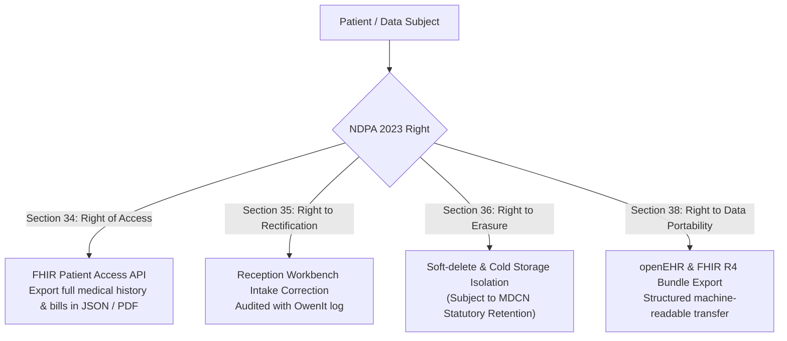

# Nigeria Data Protection Act (NDPA 2023) & Health Data Privacy Specifications

> **Statute**: Nigeria Data Protection Act 2023 (Enacted June 12, 2023)  
> **Regulatory Authority**: Nigeria Data Protection Commission (NDPC)  
> **Subject**: Sensitive Health Data Governance, Cross-Border Cloud AI, and Patient Rights  
> **Target Interoperability Facade**: CoreHealth v2 Translation & Compatibility Layer  

---

## 1. Statutory Foundations & Classification

### 1.1 Health Status as Sensitive Personal Data (Section 30)
Under **NDPA Section 30**, health status, biometric data, and genetic information are classified as **Sensitive Personal Data**. Processing is prohibited by default unless one of the statutory legal bases in Section 30(1) applies:
1. **Explicit Consent**: The data subject has given explicit, informed, and unwithdrawn consent.
2. **Medical Treatment by Health Professionals**: Necessary for medical diagnosis, health treatment, or the provision/management of healthcare services by a licensed medical practitioner or healthcare professional bound by statutory duty of confidentiality (MDCN, NMCN, PCN).
3. **Vital Interests**: Necessary to protect the life or physical integrity of the individual when physically or legally incapable of giving consent (Emergency / Red Triage).
4. **Public Health**: Necessary for reasons of public interest in public health (epidemiological reporting to NCDC / DHIS2).

---

## 2. Cross-Border Data Transfers & Cloud AI (Sections 41–43)

When CoreHealth v2 transmits clinical data or dictation transcripts to external AI services (e.g. Google Gemini in US cloud regions), it constitutes a **Cross-Border Transfer of Personal Data** under Part VIII of the NDPA.

### 2.1 Statutory Conditions for Cross-Border Flow:
- **Section 42 (Adequacy Decision)**: Transfer is lawful if the destination country provides an adequate level of data protection recognized by the NDPC.
- **Section 43 (Transfer Instruments & Derogations)**: In the absence of an adequacy decision, cross-border transmission is lawful ONLY if:
  1. An approved **Cross-Border Data Transfer Instrument (CBDTI)** is in place (e.g., Standard Contractual Clauses with the cloud provider).
  2. The data subject has given **explicit informed consent** after being explicitly warned of the potential risks of cross-border transfers.
  3. The data has been **de-identified or pseudonymized** such that it no longer constitutes personal data under Section 1.

---

## 3. CoreHealth v2 NDPR PII De-Identification Pipeline

To guarantee 100% compliance with NDPA Section 43 without compromising AI clinical accuracy, the **Translation Layer** incorporates an on-the-fly de-identification pipeline before sending prompts to external LLMs.

### 3.1 PII Scrubbing Rules:
| Patient Attribute | Relational Model Field | Scrubbing Action Before LLM Transmission | Re-Identification Token |
|---|---|---|---|
| **Patient Full Name** | `user.surname`, `firstname`, `othername` | Replaced with synthetic token `[PATIENT_RECORD]` | Stored in local transient cache |
| **Hospital File No / MRN** | `patient.file_no` | Replaced with masked token `[ID_REDACTED]` | Mapped in session memory |
| **Date of Birth** | `patient.dob` | Converted to Age in years and months only | Re-calculated locally |
| **Phone Number** | `patient.phone_no` | Stripped completely | Never sent to LLM |
| **Street Address** | `patient.address` | Stripped completely; State/Region retained if clinically relevant | Never sent to LLM |
| **Next-of-Kin Details** | `patient.next_of_kin_*` | Stripped completely | Never sent to LLM |
| **National Identity No (NIN)**| `patient.misc['nin']` | Stripped completely | Never sent to LLM |

### 3.2 Clinical Facts Retained (Zero Clinical Loss):
- Gender / Biological Sex (essential for clinical dosages and reference ranges)
- Age (vital for pediatric, obstetric, and geriatric calculations)
- Genotype and Blood Group (critical for sickle cell and transfusion safety)
- Known Drug & Food Allergies (critical for cross-checking contraindications)
- Spoken Symptoms, Onset Timelines, Vital Signs, and Physical Exam Findings
- Historical Diagnoses and Chronic Disease Records (e.g. Hypertension, Diabetes)

---

## 4. Patient Rights & Statutory Implementation

### 4.1 Statutory Medical Record Retention vs Right to Erasure
> [!IMPORTANT]
> Under Nigerian medical law (Medical and Dental Council of Nigeria - MDCN guidelines) and hospital operational standards, medical records must be retained for a **minimum of 6 to 10 years** for adults and until age 25 for pediatric patients.  
> Therefore, a patient request for "erasure" under NDPA Section 36 does **not** permit immediate dropping of medical rows from MySQL. Instead, CoreHealth v2 executes **Cryptographic Pseudo-Erasure**:
> 1. Patient identity is soft-deleted and unlinked from active search indexes.
> 2. Clinical records are locked in an immutable cold-storage audit archive accessible only under court subpoena or statutory regulatory inspection.

---

## 5. Security & Breach Notification (Section 40)
- **72-Hour Notification Invariant**: In the event of a security incident or unauthorized clinical data exposure, the hospital Data Protection Officer (DPO) must be alerted immediately, and the NDPC notified within **72 hours**.
- **Audit Logging Invariant**: All external API reads, FHIR queries, and administrative data exports are immutably logged to `App\Models\OpsAudit` and `App\Models\AiScribeAudit` with IP address, user agent, staff ID, and timestamp.

