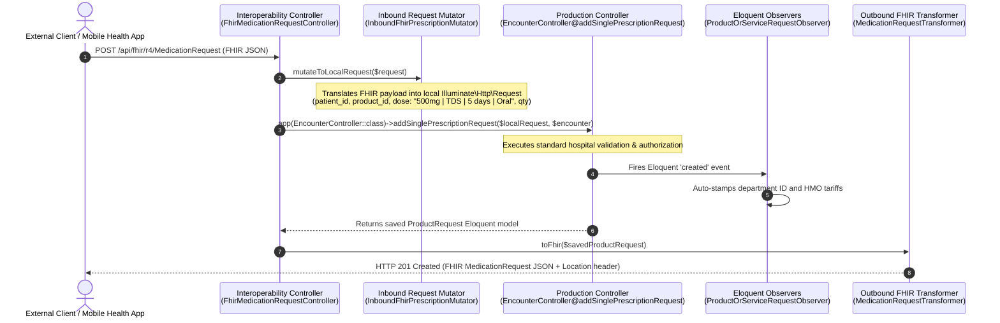

# Comprehensive REST API CRUD & Inbound Mutation Registry

> **Scope**: Full Lifecycle Specification of Inbound `POST`, `PUT`, `PATCH`, and `GET` Endpoints Across HL7 FHIR R4, openEHR REST API, OpenEMR Facade, and NDPA 2023 Governance  
> **Core Architectural Invariant**: **Proxy to Existing Production Controllers (Local Work Parity)** — Inbound standards requests are interpreted and mutated to invoke existing CoreHealth production controller methods (`PatientController@store`, `EncounterController@addSinglePrescriptionRequest`, `NursingWorkbenchController@updateVital`, `LabWorkbenchController@storeLabRequest`, `PharmacyWorkbenchController@dispenseMedicationWithBatch`, `BillingWorkbenchController@processPayment`) so that external calls work **EXACTLY LIKE LOCAL WORK**  
> **Observer Invariant**: Guarantees that all **46+ Eloquent Observers** fire, General Ledger journal entries balance, and FIFO inventory syncs without code duplication  

---

## Detailed Endpoint References by Standard

For granular REST schemas, request payload parameters, HTTP headers, and JSON/XML return models, consult the standard-specific guides:

- [HL7 FHIR R4 Endpoints Reference](fhir-r4-endpoints-reference.md) — Levels 1–4 REST API (`/api/fhir/r4/*`): CapabilityStatement, Patient, Practitioner, Observation, Encounter, MedicationRequest, ServiceRequest, DiagnosticReport, Invoice.
- [openEHR REST Endpoints Reference](openehr-rest-endpoints-reference.md) — EHR status (`/api/openehr/v1/ehr`), clinical compositions (`/api/openehr/v1/ehr/{ehr_id}/composition`), and AQL queries (`/api/openehr/v1/query/aql`).
- [OpenEMR Compatibility & C-CDA XML Reference](openemr-ccda-endpoints-reference.md) — OpenEMR table-parity endpoints (`/apis/default/api/*`), HL7 CDA R2 Continuity of Care Document XML generation, and OpenEMR FHIR proxying.
- [NDPA 2023 & NDPR Consent Reference](ndpa-consent-endpoints-reference.md) — Consent recording, retrieval, and revocation (`/api/ndpa/v1/consent`), `CheckNdpaConsent` middleware, and PII sanitization / pseudonymization via `NdprSanitizerService`.

---

## Detailed Endpoint References by Standard

For granular REST schemas, request payload parameters, HTTP headers, and JSON/XML return models, consult the standard-specific guides:

- [HL7 FHIR R4 Endpoints Reference](fhir-r4-endpoints-reference.md) — Levels 1–4 REST API (`/api/fhir/r4/*`): CapabilityStatement, Patient, Practitioner, Observation, Encounter, MedicationRequest, ServiceRequest, DiagnosticReport, Invoice.
- [openEHR REST Endpoints Reference](openehr-rest-endpoints-reference.md) — EHR status (`/api/openehr/v1/ehr`), clinical compositions (`/api/openehr/v1/ehr/{ehr_id}/composition`), and AQL queries (`/api/openehr/v1/query/aql`).
- [OpenEMR Compatibility & C-CDA XML Reference](openemr-ccda-endpoints-reference.md) — OpenEMR table-parity endpoints (`/apis/default/api/*`), HL7 CDA R2 Continuity of Care Document XML generation, and OpenEMR FHIR proxying.
- [NDPA 2023 & NDPR Consent Reference](ndpa-consent-endpoints-reference.md) — Consent recording, retrieval, and revocation (`/api/ndpa/v1/consent`), `CheckNdpaConsent` middleware, and PII sanitization / pseudonymization via `NdprSanitizerService`.

---

## 1. The Controller Proxy & Mutation Pattern (Local Work Parity)

Rather than writing duplicate database mutation logic in separate API controllers (which inevitably drifts from the real workbench workflows), CoreHealth v2 implements an **Inbound Request Mutation Proxy**:



---

## 2. Inbound Mutation Mapping to Existing Production Controllers

The table below maps every inbound mutation endpoint to its **exact production controller method** in the CoreHealth v2 codebase:

| External Endpoint | HTTP Verb | Standard | Inbound Mutator Class | Target Production Controller Method | Core Model Mutated | Observers Triggered |
|---|---|---|---|---|---|---|
| `/api/fhir/r4/Patient` | `POST` | FHIR R4 | `InboundFhirPatientMutator` | `PatientController@store` (`app/Http/Controllers/PatientController.php`) | `Patient`, `User` | `PatientObserver` (Central sync dispatch) |
| `/api/fhir/r4/Patient/{id}` | `PUT` | FHIR R4 | `InboundFhirPatientMutator` | `PatientController@update` (`app/Http/Controllers/PatientController.php`) | `Patient`, `User` | `PatientObserver` (Update sync dispatch) |
| `/api/fhir/r4/Observation` | `POST` | FHIR R4 | `InboundFhirObservationMutator` | `VitalSignController@store` (`app/Http/Controllers/VitalSignController.php`) | `VitalSign` | Vitals threshold alert checks |
| `/api/fhir/r4/Encounter` | `POST` | FHIR R4 | `InboundFhirEncounterMutator` | `EncounterController@store` (`app/Http/Controllers/EncounterController.php`) | `Encounter`, `DoctorQueue` | Queue notification observers |
| `/api/fhir/r4/Encounter/{id}` | `PUT` | FHIR R4 | `InboundFhirEncounterMutator` | `EncounterController@finalizeEncounter` (`app/Http/Controllers/EncounterController.php`) | `Encounter` | Chart locking & audit lock |
| `/api/fhir/r4/Condition` | `POST` | FHIR R4 | `InboundFhirConditionMutator` | `EncounterController@saveDiagnosis` (`app/Http/Controllers/EncounterController.php`) | `TreatmentPlan` | Problem list sync observers |
| `/api/fhir/r4/ServiceRequest` (Lab) | `POST` | FHIR R4 | `InboundFhirServiceRequestMutator` | `EncounterController@addSingleLabRequest` (`app/Http/Controllers/EncounterController.php`) | `LabServiceRequest`, `ProductOrServiceRequest` | `ProductOrServiceRequestObserver` (Dept stamping & HMO tariff) |
| `/api/fhir/r4/ServiceRequest` (Imaging)| `POST` | FHIR R4 | `InboundFhirServiceRequestMutator` | `EncounterController@addSingleImagingRequest` (`app/Http/Controllers/EncounterController.php`) | `ImagingServiceRequest` | Radiology queue dispatch |
| `/api/fhir/r4/DiagnosticReport/{id}` (Sign) | `PUT` | FHIR R4 | `InboundFhirDiagnosticReportMutator` | `LabWorkbenchController@approveResult` (`app/Http/Controllers/LabWorkbenchController.php`) | `LabServiceRequest` | Consultant approval audit stamp |
| `/api/fhir/r4/MedicationRequest` | `POST` | FHIR R4 | `InboundFhirPrescriptionMutator` | `EncounterController@addSinglePrescriptionRequest` (`app/Http/Controllers/EncounterController.php`) | `ProductRequest` | Dispensary queue notification |
| `/api/fhir/r4/MedicationDispense` | `POST` | FHIR R4 | `InboundFhirDispenseMutator` | `PharmacyWorkbenchController@dispenseMedicationWithBatch` (`app/Http/Controllers/PharmacyWorkbenchController.php`) | `ProductRequest`, `StockBatch` | `StockBatchObserver` (Three-tier FIFO inventory decrement) |
| `/api/fhir/r4/Procedure` | `POST` | FHIR R4 | `InboundFhirProcedureMutator` | `EncounterController@addSingleProcedureRequest` (`app/Http/Controllers/EncounterController.php`) | `Procedure` | Surgical schedule observer |
| `/api/fhir/r4/Immunization` | `POST` | FHIR R4 | `InboundFhirImmunizationMutator` | `NursingWorkbenchController@administerImmunization` (`app/Http/Controllers/NursingWorkbenchController.php`) | `ImmunizationRecord` | Vaccine store stock auto-deduct |
| `/api/fhir/r4/PaymentReconciliation` | `POST` | FHIR R4 | `InboundFhirPaymentMutator` | `BillingWorkbenchController@processPayment` (`app/Http/Controllers/BillingWorkbenchController.php`) | `Payment`, `PaymentSplit` | `PaymentObserver` (**Double-Entry General Ledger journal entries**) |
| `/api/openehr/v1/ehr/{ehr_id}/composition` | `POST` | openEHR | `InboundOpenEhrCompositionMutator` | `VitalSignController@store` / `EncounterController@store` | `VitalSign`, `Encounter` | Standard clinical observers |
| `/api/ndpa/v1/consent` | `POST` | NDPA 2023 | Direct Model Execution | `PatientConsentController@store` (`app/Interoperability/Http/Controllers/PatientConsentController.php`) | `PatientConsent` | NDPA Section 30 audit log |

---

## 3. Concrete Inbound Mutation Logic Examples

### 3.1 Patient Registration Mutation (`POST /api/fhir/r4/Patient` $\to$ `PatientController@store`)
When a FHIR `Patient` JSON is received, `InboundFhirPatientMutator` translates it into the exact request structure expected by `PatientController@store` (`app/Http/Controllers/PatientController.php`):

```php
// InboundFhirPatientMutator.php
public function mutateToLocalRequest(Request $fhirRequest): Request
{
    $data = $fhirRequest->json()->all();
    
    $surname = $data['name'][0]['family'] ?? '';
    $given = $data['name'][0]['given'] ?? [];
    $firstname = $given[0] ?? '';
    $othername = $given[1] ?? null;

    $phone = null;
    $email = null;
    foreach ($data['telecom'] ?? [] as $tel) {
        if (($tel['system'] ?? '') === 'phone' && empty($phone)) $phone = $tel['value'];
        if (($tel['system'] ?? '') === 'email' && empty($email)) $email = $tel['value'];
    }

    $mrn = null;
    foreach ($data['identifier'] ?? [] as $id) {
        if (($id['type']['coding'][0]['code'] ?? '') === 'MR') $mrn = $id['value'];
    }

    $localPayload = [
        'surname' => $surname,
        'firstname' => $firstname,
        'othername' => $othername,
        'phone_no' => $phone,
        'email' => $email ?? (strtolower($firstname . '.' . $surname . '.' . rand(100,999) . '@patient.internal')),
        'gender' => ucfirst(strtolower($data['gender'] ?? 'unknown')),
        'dob' => $data['birthDate'] ?? null,
        'address' => $data['address'][0]['line'][0] ?? null,
        'file_no' => $mrn,
        'registration_workbench' => 'interop_fhir_api',
    ];

    $localRequest = new Request();
    $localRequest->merge($localPayload);
    return $localRequest;
}
```

### 3.2 Prescription Mutation (`POST /api/fhir/r4/MedicationRequest` $\to$ `EncounterController@addSinglePrescriptionRequest`)
The mutator decomposes FHIR `dosageInstruction` components into the CoreHealth pipe-separated standard:

```php
// InboundFhirPrescriptionMutator.php
public function mutateToLocalRequest(Request $fhirRequest): Request
{
    $data = $fhirRequest->json()->all();

    // Resolve local product_id from terminology map or catalog lookup
    $atcCode = $data['medicationCodeableConcept']['coding'][0]['code'] ?? null;
    $productName = $data['medicationCodeableConcept']['text'] ?? '';
    $productId = app(TerminologyMappingService::class)->resolveLocalProductId($atcCode, $productName);

    // Reconstruct CoreHealth pipe format: <dose> | <freq> | <dur> | <route>
    $dosage = $data['dosageInstruction'][0] ?? [];
    $doseValue = $dosage['doseAndRate'][0]['doseQuantity']['value'] ?? '';
    $doseUnit = $dosage['doseAndRate'][0]['doseQuantity']['unit'] ?? 'mg';
    $freq = $dosage['timing']['repeat']['frequency'] ?? 1;
    $freqCode = match((int)$freq) { 1 => 'OD', 2 => 'BD', 3 => 'TDS', 4 => 'QDS', default => 'TDS' };
    $duration = ($dosage['timing']['repeat']['duration'] ?? 5) . ' days';
    $route = $dosage['route']['coding'][0]['display'] ?? 'Oral';

    $pipeDose = "{$doseValue}{$doseUnit} | {$freqCode} | {$duration} | {$route}";
    $qty = $data['dispenseRequest']['quantity']['value'] ?? 1;

    $localRequest = new Request();
    $localRequest->merge([
        'product_id' => $productId,
        'dose' => $pipeDose,
        'qty' => $qty,
    ]);

    return $localRequest;
}
```

### 3.3 Cashier Payment Mutation (`POST /api/fhir/r4/PaymentReconciliation` $\to$ `BillingWorkbenchController@processPayment`)
Translates inbound payments to invoke `BillingWorkbenchController@processPayment` (`app/Http/Controllers/BillingWorkbenchController.php`), triggering `PaymentObserver` (`app/Observers/PaymentObserver.php`) for double-entry General Ledger balancing:

```php
// InboundFhirPaymentMutator.php
public function mutateToLocalRequest(Request $fhirRequest): Request
{
    $data = $fhirRequest->json()->all();

    $total = $data['paymentAmount']['value'] ?? 0;
    $patientRef = $data['requestor']['reference'] ?? '';
    $patientId = (int) str_replace(['Patient/', 'ch2-pat-'], '', $patientRef);
    
    // Extract multi-tender split legs
    $splits = [];
    foreach ($data['allocation'] ?? [] as $leg) {
        $splits[] = [
            'payment_method' => $leg['type']['coding'][0]['code'] ?? 'Cash',
            'amount' => $leg['amount']['value'] ?? 0,
            'bank_id' => $leg['extension']['bank_id'] ?? null,
        ];
    }

    $localRequest = new Request();
    $localRequest->merge([
        'patient_id' => $patientId,
        'total' => $total,
        'splits' => $splits,
        'payment_method' => count($splits) > 1 ? 'Split' : ($splits[0]['payment_method'] ?? 'Cash'),
    ]);

    return $localRequest;
}
```

---

## 4. Observer Execution Guarantee

By delegating inbound mutations directly to existing controllers:
1. **Double-Entry Ledger Balancing**: `Payment::create()` executed within `BillingWorkbenchController@processPayment` triggers `PaymentObserver`, posting DR Cash / CR Revenue journal entries to the General Ledger.
2. **Three-Tier Stock Sync**: `PharmacyWorkbenchController@dispenseMedicationWithBatch` triggers `StockBatchObserver`, decrementing `stock_batches`, updating `store_stocks`, and recalculating parent `stocks`.
3. **Audit Immutability**: All actions are audited via standard OwenIt traits and stamped with the authenticated user ID and IP address.
4. **Transaction Integrity**: Controller methods are automatically wrapped in `DB::transaction(...)`. Any failure rolls back both the CoreHealth entities and auxiliary mappings atomically.

---

## 5. Authentication & Authorization Architecture Across Standards

Every interoperability standard connects to CoreHealth's unified identity and access management system, enforcing granular permissions and statutory privacy controls:

| Standard / Pipeline | Primary Auth Mechanism | Header Format | Token Issuance / Credentials | Authoritative Guard | Statutory Privacy Check |
|---|---|---|---|---|---|
| **HL7 FHIR R4** | SMART on FHIR / OAuth 2.0 Bearer Token | `Authorization: Bearer <token>` | Issued via `/oauth/token` or Sanctum API token | Spatie RBAC (`DOCTOR`, `NURSE`, `PHARMACIST`, etc.) | NDPA Section 30 Consent Gatekeeper |
| **openEHR ITS-REST** | Bearer Token or Session Token | `Authorization: Bearer <token>` or `Ehr-Session: <token>` | Clinician login or automated integration credential | Spatie RBAC (`DOCTOR`, `RECORD_OFFICER`) | Subject EHR identifier resolution |
| **OpenEMR REST Facade** | Bearer Token / Session Cookie | `Authorization: Bearer <token>` | API token or session cookie | Web session / API token guard | OpenEMR ACL compatibility |
| **NDPA 2023 Consent** | Authenticated User Token | `Authorization: Bearer <token>` | Clinician / Records Officer login | `CheckNdpaConsent` Middleware | Statutory consent audit ledger |

### 5.1 SMART on FHIR OAuth 2.0 Scopes
External clinical apps request standardized OAuth 2.0 scopes aligned with Spatie user roles:
- `patient/*.read` / `patient/*.write`: Restricts data access strictly to the authenticated patient's compartment.
- `user/Patient.read`, `user/Observation.write`: Clinician-level operations audited under `auth()->id()`.
- `system/*.read`: Machine-to-machine integrations requiring static API tokens.

### 5.2 NDPA 2023 Consent Verification (`CheckNdpaConsent`)
Requests to patient clinical endpoints automatically evaluate active consent in `patient_consents`. The middleware injects:
- `X-NDPA-Consent-Status: CONSENT_VERIFIED` — Explicit affirmative consent found.
- `X-NDPA-Consent-Status: DEFAULT_VITAL_INTEREST` — Emergency care default legal basis applied under NDPA Section 30(2).
