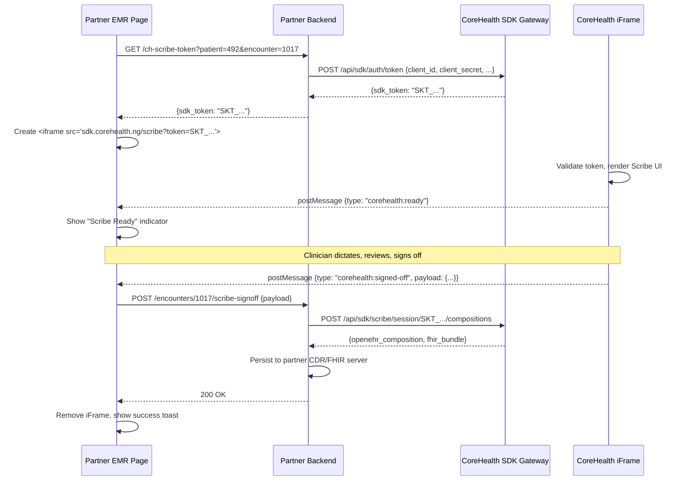

# CoreHealth Scribe SDK — iFrame Track Integration Guide

> Use this guide when your EMR enforces a strict **Content Security Policy (CSP)** that blocks custom HTML elements, or when you prefer a fully sandboxed, origin-isolated widget approach.

---

## When to Use This Track

| Situation | Use iFrame? |
|---|---|
| Your EMR has `script-src 'self'` or `default-src` CSP restrictions | ✅ Yes |
| Your team prefers strict origin isolation | ✅ Yes |
| You can relax CSP for the CoreHealth domain | Use Web Component track instead |
| Performance is critical (iFrames add ~50 ms mount overhead) | Consider Web Component track |

---

## How the iFrame Track Works



---

## Step 1 — Backend: Issue a Session Token

Identical to the Web Component track. Your backend exchanges credentials for a short-lived `SKT_` token.

**Request**
```
POST /api/sdk/auth/token
Content-Type: application/json
```
```json
{
  "client_id":     "partner-emr-dev",
  "client_secret": "YOUR_CLIENT_SECRET",
  "patient_id":    492,
  "encounter_id":  1017,
  "clinician_id":  38,
  "scope":         "scribe:process scribe:sign interop:compositions"
}
```

**Response — 200 OK**
```json
{
  "sdk_token": "SKT_eyJ0eXAiOiJKV1Qi...",
  "expires_in": 3600
}
```

**Next step:** Return `sdk_token` to your frontend page. Do not store in `localStorage`.

---

## Step 2 — Frontend: Mount the iFrame

```html
<!DOCTYPE html>
<html lang="en">
<head>
  <meta charset="UTF-8">
  <!-- CSP: allow iFrame from CoreHealth SDK domain only -->
  <meta http-equiv="Content-Security-Policy"
        content="frame-src 'self' https://sdk.corehealth.ng;">
</head>
<body>
  <div id="scribe-mount" style="width:100%;min-height:600px;"></div>

  <script>
  (async () => {
    // 1. Fetch token from your backend (never hardcode here)
    const { sdk_token } = await fetch('/my-backend/ch-scribe-token?patient_id=492&encounter_id=1017')
      .then(r => r.json());

    // 2. Build iFrame URL with query params
    const params = new URLSearchParams({
      token:  sdk_token,
      locale: 'en-NG',
      theme:  'light'
    });

    const frame = document.createElement('iframe');
    frame.src = `https://sdk.corehealth.ng/scribe?${params}`;
    frame.setAttribute('allow', 'microphone');
    frame.setAttribute('title', 'CoreHealth AI Scribe');
    frame.style.cssText = 'width:100%;height:600px;border:none;border-radius:8px;';
    frame.setAttribute('sandbox', 'allow-scripts allow-same-origin allow-forms allow-microphone');

    document.getElementById('scribe-mount').appendChild(frame);
  })();
  </script>
</body>
</html>
```

**Next step:** Listen for `postMessage` events from the iFrame.

---

## Step 3 — Listen for postMessage Events

```js
const ALLOWED_ORIGIN = 'https://sdk.corehealth.ng'; // change for on-prem

window.addEventListener('message', async (event) => {

  // ALWAYS verify origin first — never skip this check
  if (event.origin !== ALLOWED_ORIGIN) return;

  const { type, payload } = event.data;

  switch (type) {
    case 'corehealth:ready':
      console.log('Scribe widget ready for patient', payload.patient_id);
      showIndicator('🎙 Scribe Ready — click microphone to begin');
      break;

    case 'corehealth:recording-started':
      showIndicator('● Recording…');
      break;

    case 'corehealth:processing':
      showIndicator('⏳ Processing note…');
      break;

    case 'corehealth:signed-off':
      showIndicator('✓ Signing note…');
      await saveSignedNote(payload);
      removeScribeFrame();
      showSuccessToast('Consultation note saved to your records.');
      break;

    case 'corehealth:error':
      console.error('Scribe error:', payload.code, payload.message);
      showErrorToast(`Scribe error: ${payload.message}`);
      break;
  }
});

async function saveSignedNote(payload) {
  await fetch('/my-backend/encounters/1017/scribe-signoff', {
    method: 'POST',
    headers: { 'Content-Type': 'application/json' },
    body: JSON.stringify(payload)
  });
}

function removeScribeFrame() {
  document.getElementById('scribe-mount').innerHTML = '';
}
```

**Next step:** Your backend receives the payload and optionally calls CoreHealth to fetch enriched compositions.

---

## Step 4 — Backend: Persist the Compositions

```
POST /api/sdk/scribe/session/{sdk_token}/compositions
Authorization: Basic base64(client_id:client_secret)
Content-Type: application/json

{ "cross_border": false }
```

**Response — 200 OK**
```json
{
  "openehr_composition": {
    "archetypeId": "openEHR-EHR-COMPOSITION.encounter.v1",
    "content": [ "... vital signs, medications, SOAP note ..." ]
  },
  "fhir_bundle": {
    "resourceType": "Bundle",
    "type": "transaction",
    "entry": [ "... Encounter, MedicationRequest, ServiceRequest ..." ]
  },
  "transcript_summary": "Patient presented with...",
  "signed_at": "2026-11-13T15:42:00+01:00"
}
```

> Persist `openehr_composition` → your openEHR CDR (`POST /ehr/{ehr_id}/composition`)  
> Persist `fhir_bundle` → your FHIR server (`POST /fhir/Bundle`)

---

## Full postMessage Event Reference

| `event.data.type` | Direction | Payload |
|---|---|---|
| `corehealth:ready` | iFrame → Parent | `{ patient_id, encounter_id, locale }` |
| `corehealth:resize` | iFrame → Parent | `{ height }` — for dynamic height adjustment |
| `corehealth:recording-started` | iFrame → Parent | — |
| `corehealth:recording-stopped` | iFrame → Parent | `{ seconds_recorded }` |
| `corehealth:processing` | iFrame → Parent | — |
| `corehealth:note-ready` | iFrame → Parent | `{ soap_note, orders }` — before sign-off |
| `corehealth:signed-off` | iFrame → Parent | Full payload (see integration guide §6) |
| `corehealth:error` | iFrame → Parent | `{ code, message }` |
| `corehealth:close` | Parent → iFrame | — — parent requests close |

---

## CSP Configuration for On-Prem Deployments

If CoreHealth is deployed on-prem inside Partner EMR's network:

```
# Replace sdk.corehealth.ng with your on-prem hostname
Content-Security-Policy: frame-src 'self' https://phc-node-01.partner-emr.org;
```

> [!IMPORTANT]
> The `ALLOWED_ORIGIN` constant in Step 3 must exactly match the `src` origin of the iFrame. For on-prem, that is your internal hostname, not `sdk.corehealth.ng`.

---

## Troubleshooting

| Problem | Cause | Fix |
|---|---|---|
| iFrame shows blank / white page | Invalid or expired `sdk_token` in URL | Re-fetch token from backend before mounting |
| postMessage events not received | Origin mismatch | Match `ALLOWED_ORIGIN` to exact iFrame `src` origin |
| Microphone not working in iFrame | Missing `allow="microphone"` attribute | Add `allow="microphone"` to `<iframe>` tag |
| iFrame blocked by browser | Missing `sandbox` attribute values | Add `allow-scripts allow-same-origin allow-forms` |
| CSP violation in browser console | `frame-src` missing CoreHealth domain | Add `frame-src https://sdk.corehealth.ng` to your CSP header |

