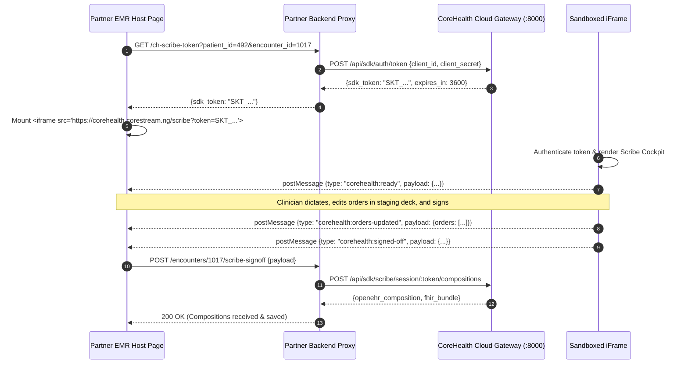

# CoreHealth Scribe SDK — iFrame Track Integration Guide

> **Who is this for?** Partner EMR engineering teams operating in environments that enforce a strict **Content Security Policy (CSP)** (such as `script-src 'self'`) or that require origin isolation via sandboxed iframes.

---

## 1. Overview & When to Choose Track B

Track B delivers the entire CoreHealth AI Scribe Studio inside a high-security origin-isolated `<iframe>`. Communication with the host EMR occurs through a bidirectional `window.postMessage` bridge.

| Architectural Criteria | Track A (Web Component) | Track B (Sandboxed iFrame) |
|---|---|---|
| **CSP Requirements** | Allows host DOM injection | Works with strict `script-src 'self'` |
| **Isolation Barrier** | Shadow DOM CSS encapsulation | Separate browser browsing context & origin |
| **Data Exchange** | Direct JS callbacks & DOM events | Cryptographically verifiable `postMessage` |
| **Mount Overhead** | Instant (~5 ms) | Minimal (~35–50 ms) |

---

## 2. Sandboxed Studio Workflow & UI Controls

The screenshot below displays the consultation workflow running inside the sandboxed iFrame:


### Key Clinical UI Controls in the iFrame:
- **Progressive Stepper Navigation**: Guides clinicians sequentially: `1: Start Dictation or Load Sample` &rarr; `2: Process Note & Extract Orders` &rarr; `3: Review, Adjust & Sign`.
- **Crisp Inline SVG Controls**: Microphones, AI structuring sparkle, sample loading, copy, reset, and sign-off buttons use clean vector SVGs.
- **Dictation Timer & Waveform Feedback**: Real-time timer (`00:00` &rarr; `00:15`) and audio state feedback directly beside the microphone button.
- **Vanilla Order Staging Modal**: Clinicians can click `+ Add Order` to open an inline modal overlay with category dropdown (`Medication`, `Lab`, `Imaging`, `Procedure`, `Nursing`), item name, dosage, instructions, and tariff fields — without crude browser `prompt()` dialogs.
- **One-Click Order Removal**: Every staged item includes a dedicated trash-can SVG button with instant recalculation of total estimated tariffs.
- **Bulk Selection Control**: The table header checkbox toggles all staged items simultaneously, synchronizing with the parent EMR.

---

## 3. Communication Architecture



---

## 4. Frontend Implementation

### Step 1 — Embed the iFrame

```html
<!DOCTYPE html>
<html lang="en">
<head>
  <meta charset="UTF-8">
  <!-- CSP Header: allow framing from CoreHealth Cloud -->
  <meta http-equiv="Content-Security-Policy"
        content="frame-src 'self' https://corehealth.corestream.ng;">
</head>
<body>
  <div id="scribe-mount" style="width:100%;min-height:680px;"></div>

  <script>
  (async () => {
    // 1. Fetch short-lived session token from your backend proxy
    const { sdk_token } = await fetch('/my-backend/ch-scribe-token?patient_id=492&encounter_id=1017')
      .then(r => r.json());

    // 2. Build iFrame URL
    const params = new URLSearchParams({
      token:    sdk_token,
      locale:   'en-NG',
      role:     'doctor',    // 'doctor' | 'nurse' | 'maternity'
      taxonomy: 'soap',      // 'soap' | 'clerking' | 'pomr'
      theme:    'light'
    });

    const frame = document.createElement('iframe');
    frame.src = `https://corehealth.corestream.ng/scribe?${params}`;
    frame.setAttribute('allow', 'microphone');
    frame.setAttribute('title', 'CoreHealth AI Scribe Studio');
    frame.style.cssText = 'width:100%;height:680px;border:none;border-radius:8px;';
    frame.setAttribute('sandbox', 'allow-scripts allow-same-origin allow-forms allow-popups allow-modals');

    document.getElementById('scribe-mount').appendChild(frame);
  })();
  </script>
</body>
</html>
```

---

### Step 2 — Handle Bidirectional postMessage Events

```javascript
const ALLOWED_ORIGIN = 'https://corehealth.corestream.ng';

window.addEventListener('message', async (event) => {
  // 1. ALWAYS verify origin to prevent cross-origin injection attacks
  if (event.origin !== ALLOWED_ORIGIN) return;

  const { type, payload } = event.data;

  switch (type) {
    case 'corehealth:ready':
      console.log('Scribe Studio initialized for encounter', payload.encounter_id);
      break;

    case 'corehealth:recording-started':
      console.log('Clinician began audio dictation');
      break;

    case 'corehealth:processing':
      console.log('NLP structuring note and clinical orders');
      break;

    case 'corehealth:orders-updated':
      // Emitted when clinician edits dosage, toggles checkboxes, or adds/removes items
      console.log('Staged orders updated:', payload.orders);
      break;

    case 'corehealth:signed-off':
      // Clinician reviewed and accepted the note & approved orders
      console.log('Consultation accepted. Forwarding to backend:', payload);
      await fetch('/my-backend/encounters/1017/scribe-signoff', {
        method: 'POST',
        headers: { 'Content-Type': 'application/json' },
        body: JSON.stringify(payload)
      });
      break;

    case 'corehealth:error':
      console.error('Scribe error:', payload.code, payload.message);
      break;
  }
});
```

---

## 5. Bidirectional Event Reference

| Event Type | Direction | Payload Structure | Trigger Condition |
|---|---|---|---|
| `corehealth:ready` | iFrame &rarr; Host | `{ patient_id, encounter_id, locale, role, taxonomy }` | Widget mounted and token validated |
| `corehealth:recording-started` | iFrame &rarr; Host | `{}` | Clinician clicked Start Dictation |
| `corehealth:processing` | iFrame &rarr; Host | `{}` | Dictation ended or Process Note clicked |
| `corehealth:note-ready` | iFrame &rarr; Host | `{ formatted_markdown, structured_sections, orders }` | NLP structuring complete |
| `corehealth:orders-updated` | iFrame &rarr; Host | `{ orders: [...] }` | Orders staged, modified, added, or deleted |
| `corehealth:signed-off` | iFrame &rarr; Host | `{ final_signed_note, approved_orders, audit_id }` | Clinician clicked Accept & Sign |
| `corehealth:set-catalog` | Host &rarr; iFrame | `{ custom_catalog: [...] }` | Host injects CSCP formulary dynamically |
| `corehealth:error` | iFrame &rarr; Host | `{ code, message }` | Audio or API error encountered |

---

## 6. CSP Configuration for On-Premise Deployments

For self-hosted hospital deployments behind a corporate reverse proxy, update your host application's CSP header:

```http
Content-Security-Policy: frame-src 'self' https://corehealth.hospital-internal.org;
```

---

## 7. Support & Public CDN

- **Public Production Endpoint**: `https://corehealth.corestream.ng/scribe`
- **Technical Inquiries**: Contact CoreHealth Engineering at `hello@corestream.ng`.
