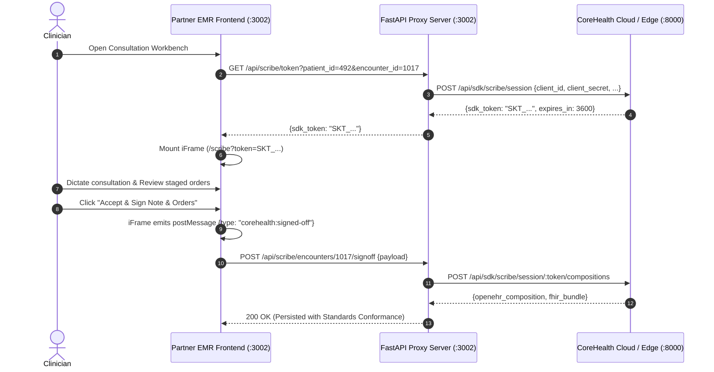

# CoreHealth AI Scribe — Python & FastAPI Reference Demo Walkthrough

> **Who is this for?** Partner EMR software engineers and backend architects building Python-powered healthcare applications (FastAPI, Django, Flask) who want an authoritative, turnkey reference integration for the CoreHealth AI Scribe SDK.

---

## 1. Overview & Architecture

The Python SDK reference integration implements the **Backend Proxy Architecture (Backend Proxy + Ephemeral JWT Session Token)**. In this design:

1. **Frontend Client (`index.html`)**: Standard web application running in modern browsers. It embeds the Sandboxed Scribe Studio iFrame via a cryptographically validated session token, receives real-time `postMessage` events (`corehealth:ready`, `corehealth:signed-off`), and dispatches signed notes to the local backend.
2. **Backend Proxy (`main.py`)**: A lightweight FastAPI service that securely holds partner credentials (`CH_CLIENT_ID` and `CH_CLIENT_SECRET`) in an isolated environment (`.env`), mounts the turnkey `create_scribe_router` proxy router, mints ephemeral `SKT_` session tokens via `/api/sdk/scribe/session`, and persists signed clinical notes with openEHR and FHIR R4 enrichment.



---

## 2. Live Clinical Encounter Workflow & UI Walkthrough

The reference application embeds the high-security sandboxed iFrame bridge, providing complete origin isolation and strict Content Security Policy (CSP) compatibility:

### Initial Embedded Studio Mount


- **One-Click Token Minting**: On page load, the frontend requests an ephemeral `SKT_` token from the FastAPI proxy and embeds the Scribe Studio with zero manual configuration.
- **Microphone & Speech Cockpit**: Supports continuous speech dictation with real-time audio waveform visualizer and multi-dialect Nigerian localization (`en-NG`, `pcm-NG`, `ha-NG`, `yo-NG`, `ig-NG`).
- **Sample Consultation Dictation**: Clicking **Load Sample** immediately injects a representative 4-paragraph clinical dictation covering presenting complaints, vital signs, physical exam findings, provisional diagnoses, and recommended prescriptions.

---

### AI Structuring, Catalog Grounding & Signed Sign-Off


- **Gemini LLM Structuring**: In ~5 seconds, unformatted speech transcripts are parsed into canonical SOAP sections (`Subjective`, `Objective`, `Assessment`, `Plan`).
- **Super-Compressed Catalog Grounding (CSCP)**: Hospital formulary items and laboratory investigations are extracted, matched, and staged into the Suggested Orders Deck with piped dosages (e.g. `80/480mg | BD | 3 days | Oral`).
- **Interactive Staging**: Clinicians can check/uncheck items, add custom orders via clean modal overlays, or remove items with automatic estimated tariff recalculation.
- **Signed Payload Persisted by FastAPI**: When the clinician signs the encounter, the FastAPI proxy captures the event, enriches it with canonical **openEHR COMPOSITION.encounter.v1** and **HL7 FHIR R4 Transaction Bundle** structures, and displays the raw JSON response in the browser.

---

## 3. Directory Layout

The complete Python reference demo source is located in the repository under `sdks/python-scribe-sdk/examples/fastapi-integration/`:

```
sdks/python-scribe-sdk/examples/fastapi-integration/
├── index.html            # Standalone browser client embedding the iFrame bridge
├── main.py               # FastAPI proxy server using corehealth_sdk client & proxy router
├── requirements.txt      # Dependencies (fastapi, uvicorn, httpx, pydantic, python-dotenv)
├── test_live.py          # 6-step integration test verifying live backend connectivity
├── .env.example          # Environment configuration template
└── README.md             # Running instructions
```

---

## 4. Step-by-Step Running Guide

### Step 1: Create and Activate Virtual Environment (`venv`)

Always isolate dependencies in a dedicated Python virtual environment (Python 3.10+):

#### On Linux / macOS:
```bash
# Navigate to the reference example
cd sdks/python-scribe-sdk/examples/fastapi-integration

# Create a clean virtual environment
python3 -m venv venv

# Activate the virtual environment
source venv/bin/activate

# Upgrade pip
pip install --upgrade pip
```

#### On Windows (PowerShell):
```powershell
cd sdks\python-scribe-sdk\examples\fastapi-integration
python -m venv venv
.\venv\Scripts\Activate.ps1
python -m pip install --upgrade pip
```

---

### Step 2: Configure Environment (`.env`)

Copy the environment template:

```bash
cp .env.example .env
```

Open `.env` and verify your parameters. Partner client credentials are administered in **CoreHealth Admin &rarr; Hospital Configuration &rarr; AI Scribe & SDK** (`/hospital-config#sdk-settings`):

```ini
# CoreHealth Backend Base URL (Edge or Cloud)
CH_BASE_URL=http://127.0.0.1:8000

# Client Credentials (from CoreHealth Admin -> Hospital Configuration -> AI Scribe & SDK)
CH_CLIENT_ID=your_client_id_here
CH_CLIENT_SECRET=your_client_secret_here

# FastAPI Proxy Port
PORT=3002

# Consultation Context Defaults
CH_DEFAULT_LOCALE=en-NG
CH_DEFAULT_PATIENT_ID=492
CH_DEFAULT_ENCOUNTER_ID=1017
CH_DEFAULT_CLINICIAN_ID=38

# Token Time-to-Live (Seconds)
CH_TOKEN_TTL=3600
```

---

### Step 3: Install Dependencies

With the virtual environment active, install requirements:

```bash
pip install -r requirements.txt
```

---

### Step 4: Start the FastAPI Server

Launch the reference server using Uvicorn or the Python entrypoint:

```bash
# Using direct entrypoint
python main.py

# Or using Uvicorn directly:
uvicorn main:app --host 127.0.0.1 --port 3002 --reload
```

The server starts and logs:

```text
[CoreHealth FastAPI Proxy] Target CoreHealth Base: http://127.0.0.1:8000
[CoreHealth FastAPI Proxy] Client ID: partner-emr-dev
====================================================
FastAPI Scribe Reference Proxy running on: http://localhost:3002
Open http://localhost:3002 in your browser
====================================================
```

---

### Step 5: Verify Live Connection via Test Suite

Before opening the browser, verify all 6 SDK backend methods against your running CoreHealth instance:

```bash
python test_live.py
```

Expected output:
```text
=== CoreHealth AI Scribe Python SDK Live Test ===
Step 1: Testing token minting...
  ✓ Success! Token: SKT_eyJ0eXAi...
Step 2: Fetching categories...
  ✓ Success! Found 10 categories.
Step 3: Compressing catalog using CSCP...
  ✓ Success! CSCP payload generated.
Step 4: Processing dictation with grounded catalog...
  ✓ Success! Note structured & orders extracted.
Step 5: Converting note taxonomy (SOAP -> Clerking)...
  ✓ Success! Formats converted losslessly.
Step 6: Signing session & verifying compositions...
  ✓ Success! openEHR composition & FHIR bundle received.
=== All Live Tests Passed Successfully! ===
```

---

### Step 6: Open in Browser & Dictate

1. Navigate to `http://localhost:3002` in Chrome or any modern browser.
2. The page automatically fetches an ephemeral token from `/api/scribe/token` and renders the AI Scribe Studio.
3. Click **Load Sample** to inject clinical text, then click **Process Note**.
4. Review the structured SOAP sections and verify that recommended orders (e.g. *Artemether-Lumefantrine*, *Malaria Microscopy*, *FBC*) appear in the staging table.
5. Click **Accept & Sign Note & Orders**.
6. Observe the green confirmation banner and review the raw 3.4 KB JSON payload persisted by FastAPI containing the full clinical record and standards-compliant compositions!

---

## 5. Implementation Deep Dive: `main.py`

Integrating the CoreHealth AI Scribe SDK into your existing FastAPI application requires fewer than 25 lines of Python:

```python
import os
from fastapi import FastAPI
from fastapi.responses import FileResponse
from dotenv import load_dotenv
from corehealth_sdk.client import CoreHealthClient
from corehealth_sdk.fastapi_proxy import create_scribe_router

load_dotenv()

app = FastAPI(title="Partner EMR Consultation Workbench")

# 1. Initialize the CoreHealth SDK Client
client = CoreHealthClient(
    base_url=os.getenv("CH_BASE_URL", "http://127.0.0.1:8000"),
    client_id=os.getenv("CH_CLIENT_ID", "your_client_id_here"),
    client_secret=os.getenv("CH_CLIENT_SECRET", "your_client_secret_here")
)

# 2. Mount the turnkey Scribe Proxy Router under /api/scribe
app.include_router(create_scribe_router(client), prefix="/api/scribe")

# 3. Serve consultation frontend
@app.get("/")
def serve_index():
    return FileResponse("index.html")

if __name__ == "__main__":
    import uvicorn
    uvicorn.run("main:app", host="127.0.0.1", port=int(os.getenv("PORT", 3002)), reload=True)
```

---

## 6. Downstream Handover

Upon receiving the payload from the AI Scribe SDK:
- **openEHR CDRs**: Forward `openehr_composition` to your clinical data repository (`POST /ehr/{ehr_id}/composition`).
- **FHIR Repositories**: Dispatch `fhir_bundle` to your FHIR R4 server (`POST /fhir`).
- **Relational Databases**: Insert `final_signed_note` into your encounter table and dispatch `approved_orders` to pharmacy, laboratory, and radiology queues.

---

## 7. Support & Resources

- **GitHub Repository**: `sdks/python-scribe-sdk`
- **Technical Inquiries**: Contact CoreHealth Engineering at `hello@corestream.ng`.
