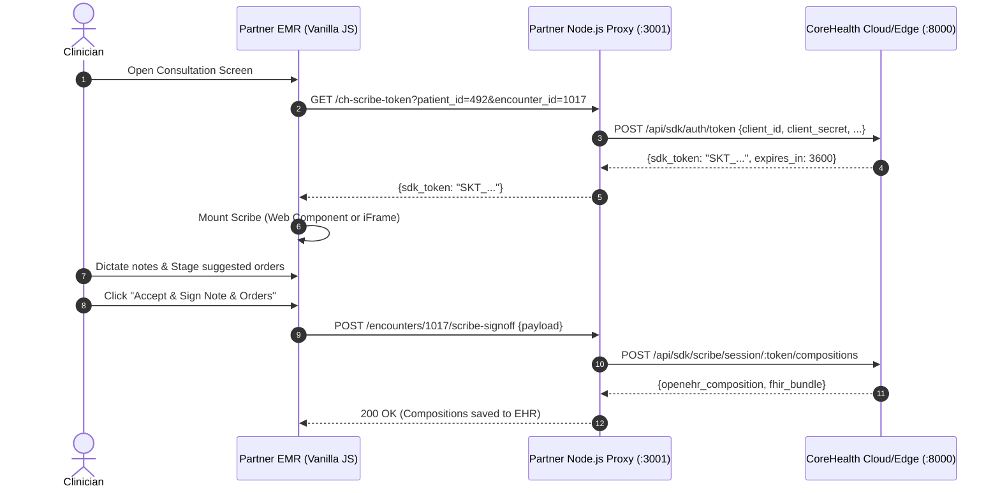

# CoreHealth AI Scribe — Reference Vanilla JS Demo Walkthrough

> **Who is this for?** Partner EMR software engineers looking for a lightweight, zero-framework reference integration demonstrating how to embed the CoreHealth AI Scribe into an existing clinical encounter interface using a local backend proxy.

---

## 1. Overview & Architecture

This reference integration demonstrates the **Backend Proxy Architecture (Backend Proxy + Ephemeral JWT Session Token)**. It operates in two isolated tiers:

1. **Frontend Client (`index.html`)**: Standard vanilla JavaScript running in modern browsers. It requests an ephemeral session token from the local backend proxy, mounts the AI Scribe UI (supporting both Track A and Track B), provides full dictation and order staging controls, and listens for the sign-off event.
2. **Backend Proxy (`server.js`)**: A lightweight Node.js/Express service that securely holds partner credentials (`client_id` and `client_secret`), mints short-lived `SKT_` session tokens via `/api/sdk/auth/token`, and persists signed clinical notes with openEHR and FHIR enrichment.



---

## 2. Clinical Encounter Workflow & UI Walkthrough

The reference integration provides dual-track switching to evaluate both embedding architectures side-by-side against the same clinical backend APIs.

### Track A — Web Component (Shadow DOM)


- **Encapsulated Scope**: Mounts `<corehealth-scribe-studio>` via Shadow DOM with zero styling or script leakage into the host EMR.
- **Progressive Clinical Flow**: Guides clinicians through three distinct phases: `1: Start Dictation or Load Sample` &rarr; `2: Process Note & Extract Orders` &rarr; `3: Review, Adjust & Sign`.
- **Dictation Cockpit**: Features live audio waveform feedback, real-time elapsed timer (`00:00` &rarr; `00:15`), and multi-dialect Nigerian speech recognition (`en-NG`, `pcm-NG`, `ha-NG`, `yo-NG`, `ig-NG`).
- **Interactive Suggested Orders Deck**: Categorizes clinical intent into prescriptions, laboratory, imaging, and procedures with inline dosage, frequency, and instructions editing.
- **Vanilla Order Modal**: Clicking `+ Add Order` opens a clean vanilla modal overlay allowing clinicians to stage custom orders with zero runtime dependencies or alert dialogs.
- **Instant Removal & Tariff Recalculation**: Clicking the trash-can SVG button on any row removes the item and immediately recalculates the total estimated tariff preview.

---

### Track B — Sandboxed iFrame (postMessage Bridge)


- **Complete Origin Isolation**: Sandboxed iframe with `allow="microphone"` communicates with the host application strictly via cryptographically validated `postMessage` events (`corehealth:ready`, `corehealth:orders-updated`, `corehealth:signed-off`).
- **CSP Parity**: Operates cleanly in environments enforcing strict `script-src 'self'` Content Security Policies.
- **Identical Feature Set**: Full parity across the progressive flow stepper, suggested orders deck, vanilla staging modal, live recording status, and taxonomy switching.

---

## 3. Directory Layout

The reference demo source is located in the SDK repository at `examples/vanilla-integration/`:

```
examples/vanilla-integration/
├── index.html            # Standalone browser client (zero npm build dependencies)
├── server.js             # Express backend proxy demonstrating token minting & handoff
├── package.json          # Dependencies for the backend proxy (express, cors)
├── .env.example          # Environment template
└── README.md             # Running instructions
```

---

## 4. Step-by-Step Running Guide

### Step 1: Configure Environment (`.env`)

Copy the provided `.env.example` template, or copy the pre-formatted `.env` snippet directly from **CoreHealth Admin &rarr; Hospital Configuration &rarr; AI Scribe & SDK** (`/hospital-config#sdk-settings`):

```bash
cd sdks/js-scribe-sdk/examples/vanilla-integration
cp .env.example .env
```

Verify or adjust parameters in `.env` (copy your client credentials from **CoreHealth Admin &rarr; Hospital Configuration &rarr; AI Scribe & SDK**):

```ini
CH_BASE_URL=http://127.0.0.1:8000
CH_CLIENT_ID=your_client_id_here
CH_CLIENT_SECRET=your_client_secret_here
PORT=3001
CH_DEFAULT_LOCALE=en-NG
CH_DEFAULT_PATIENT_ID=492
CH_DEFAULT_ENCOUNTER_ID=1017
CH_DEFAULT_CLINICIAN_ID=38
```

### Step 2: Start the Backend Proxy

```bash
node server.js
```

The server automatically loads `.env` and logs:

```text
[CoreHealth Proxy] Target CoreHealth Base: http://127.0.0.1:8000
[CoreHealth Proxy] Configured Client ID: partner-emr-dev
====================================================
[CoreHealth Scribe Reference Proxy]
Listening live on: http://localhost:3001
Open http://localhost:3001 in your browser
====================================================
```

### Step 3: Python Backend Alternative (FastAPI with `venv`)

If your EMR uses Python instead of Node.js, run the FastAPI reference server inside an isolated virtual environment:

```bash
# 1. Navigate to the Python example
cd sdks/python-scribe-sdk/examples/fastapi-integration

# 2. Create and activate virtual environment
python3 -m venv venv
source venv/bin/activate  # On Windows: .\venv\Scripts\Activate.ps1

# 3. Configure environment
cp .env.example .env

# 4. Install dependencies and start server
pip install -r requirements.txt
python main.py
```

The FastAPI proxy starts on `http://localhost:3002`.

### Step 4: Open in Browser & Dictate

1. Navigate to `http://localhost:3001` (or `http://localhost:3002`). Observe the status bar:
   - `GET /ch-scribe-token?patient_id=492&encounter_id=1017` executes.
   - An ephemeral `SKT_...` session token is returned and validated.
   - The AI Scribe Studio mounts cleanly.
2. Click **Load Sample Dictation** (or **Start Dictation** to speak).
3. Click **Process Dictation & Orders** (or **Process Note** in the cockpit).
4. The note is structured by `gemini-2.5-flash` into clinical sections and recommended orders are staged in the deck with piped dosages (e.g. `80/480mg | BD | 3 days | Oral`).
5. Click **+ Add Order** to stage an ad-hoc order via the clean vanilla modal.
6. Click the trash-can SVG icon on any row to test order deletion.
7. Toggle clinical taxonomy pills (e.g. from `SOAP` to `Clerking`) to witness lossless conversion.

### Step 5: Accept, Sign & Tabbed Interoperability Suite

1. Click **Accept & Sign Note & Orders**.
2. The signed note and approved orders are dispatched to `POST /encounters/1017/scribe-signoff`.
3. The proxy queries `/api/sdk/scribe/session/{token}/compositions`.
4. The results card renders the 4-tab clinical suite:
   - **All Overview**: KPI metrics grid, signed note preview, and standards conformance badges.
   - **HL7 FHIR R4**: Canonical Transaction Bundle in tabulated view with resource types and clinical concepts + raw JSON view.
   - **openEHR COMPOSITION**: Composition archetype hierarchy in tabulated view with observation entries + raw JSON view.
   - **Clinical Orders**: Staged and approved orders in tabulated view with category pills, piped dosages, tariffs, and queue routing + raw JSON view.
5. Toggle between `[ ▦ Tabulated View ]` and `[ < > Raw JSON ]` or use the 1-click **Copy JSON** button.


---

## 5. Downstream Handover

Upon receiving the payload from the AI Scribe SDK:
- **openEHR CDRs**: Post `openehr_composition` to your clinical repository (`POST /ehr/{ehr_id}/composition`).
- **FHIR Repositories**: Dispatch `fhir_bundle` to your FHIR R4 server (`POST /fhir`).
- **Relational Databases**: Insert `final_signed_note` into your encounter table and dispatch `approved_orders` to pharmacy, laboratory, and radiology worklists.

---

## 6. Support & Public CDN

- **Public Production CDN**: `https://corehealth.corestream.ng/js/corehealth-scribe-sdk.umd.js`
- **Technical Inquiries**: Contact CoreHealth Engineering at `hello@corestream.ng`.
