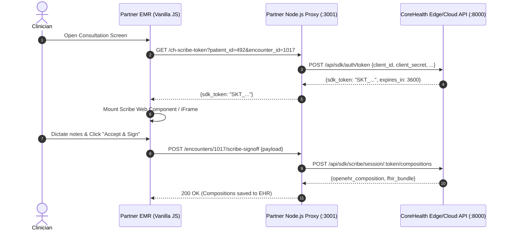

# CoreHealth AI Scribe — Vanilla JS Demo Walkthrough

> A lightweight, zero-framework reference integration demonstrating how to embed the CoreHealth AI Scribe  
> into an existing EMR web application using a local Node.js backend proxy.

---

## 1. Overview & Architecture

This reference integration implements **Backend Proxy Architecture (Backend Proxy + Ephemeral JWT Session Token)**.
It consists of two isolated parts:

1. **Frontend (`index.html`)**: Clean vanilla JavaScript running in any browser. It requests a session token from the local backend proxy, mounts the AI Scribe UI, and listens for the `onSignedOff` callback or `postMessage` event.
2. **Backend Proxy (`server.js`)**: A minimal Node.js/Express server that securely holds the `client_id` and `client_secret` (never exposed to browser clients), issues ephemeral `SKT_` session tokens via `/api/sdk/auth/token`, and persists signed clinical notes.



---

## 2. Directory Layout

The demo source code is located in the SDK repository at `examples/vanilla-integration/`:

```
examples/vanilla-integration/
├── index.html            # Standalone browser client (zero npm dependencies)
├── server.js             # Express backend proxy demonstrating token minting & handoff
├── package.json          # Dependencies for the backend proxy (express, cors)
├── .env.example          # Template for backend configuration
└── README.md             # Quick start instructions
```

---

## 3. Step-by-Step Walkthrough

### Step 1: Starting the Backend Proxy

Configure `.env` with your client credentials:
```bash
CH_BASE_URL=http://127.0.0.1:8000
CH_CLIENT_ID=partner-emr-dev
CH_CLIENT_SECRET=partner_dev_secret_2026
PORT=3001
```

Start the proxy server:
```bash
node server.js
# Output: [CoreHealth Scribe Proxy] listening on http://localhost:3001
```

### Step 2: Running the Browser Client

Serve `index.html` on any static port (e.g. 5173 or 8080):
```bash
npx serve . -p 5173
```
Open your browser at `http://localhost:5173`.

### Step 3: Observing the Token Exchange

In your browser's Developer Tools network tab, observe:
1. `GET http://localhost:3001/ch-scribe-token?patient_id=492&encounter_id=1017`
2. Response returns:
```json
{
  "sdk_token": "SKT_eyJ0eXAiOiJKV1QiLCJhbGciOiJIUzI1NiJ9...",
  "token_type": "Bearer",
  "expires_in": 3600,
  "scope": "scribe:process scribe:sign interop:compositions",
  "patient_id": 492,
  "encounter_id": 1017
}
```

### Step 4: Dictation and Clinical Structuring

1. Click **Start Dictation** and speak into the microphone (or type sample text in the textarea).
2. Click **Stop Dictation** — the SDK calls `/api/sdk/scribe/process` and populates the structured SOAP note and extracted prescription orders.

### Step 5: Acceptance, Sign-off & Interop Handoff

1. Click **Accept & Sign**.
2. The browser forwards the signed payload to `POST http://localhost:3001/encounters/1017/scribe-signoff`.
3. The proxy calls CoreHealth's `/api/sdk/scribe/session/{token}/compositions` endpoint.
4. The response displays the canonical **openEHR COMPOSITION.encounter.v1** alongside the **HL7 FHIR R4 Transaction Bundle** right in the browser pre-formatted output block.

---

## 4. Downstream Handover

Once the proxy receives the `openehr_composition` and `fhir_bundle`:
- In **openEHR environments** (Partner CDR): Forward `openehr_composition` to your central openEHR server via `POST /ehr/{ehr_id}/composition`.
- In **FHIR environments**: Post the `fhir_bundle` to your FHIR repository via `POST /fhir`.
- In **relational EMRs**: Extract the `final_signed_note` and `extracted_orders` JSON into your local encounter and pharmacy tables.

