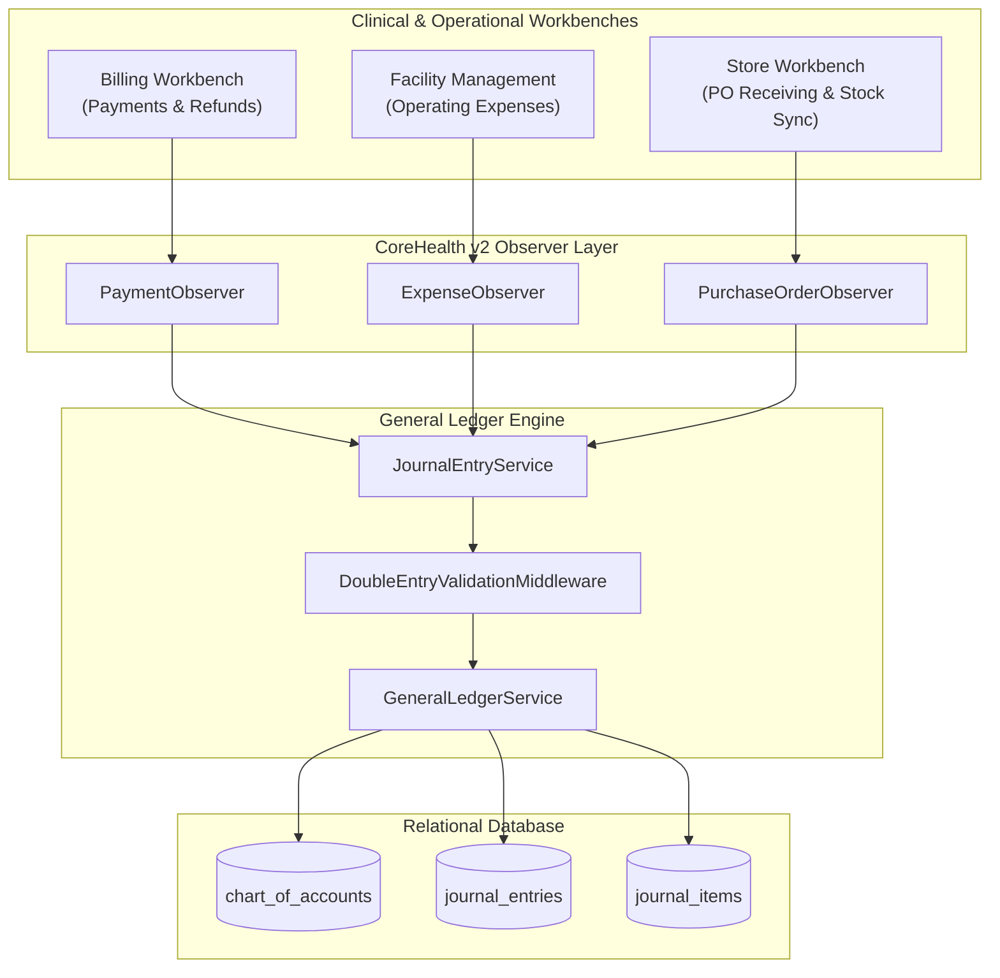

# Financial Accounting, General Ledger & Fund Governance Developer Reference

<span class="badge-role">AUTHORITATIVE ROLE GUARD: SUPERADMIN | ADMIN | super-admin | ACCOUNTS | AUDIT</span>

The **Accounting Workbench** is the central ledger engine of CoreHealth v2. It enforces real-time double-entry bookkeeping, maintains ledger invariants, automates revenue and expense attribution from clinical operations, and provides statutory financial reporting compliant with IFRS and SAS standards.

---

## 1. Architectural Overview & Service Layer

The accounting system is organized into decoupled controller pipelines, domain services, Eloquent observers, and repository services:



---

## 2. The Double-Entry Invariant & Observer Rules

### Absolute Rule: No Raw DB Bypasses
The accounting ledger relies on Eloquent model lifecycle hooks to ensure that every debit is matched by an equivalent credit:

$$\sum \text{Debits} \equiv \sum \text{Credits}$$

> [!CAUTION]
> **Double-Entry Invariant**: NEVER execute raw SQL queries (`DB::table('journal_entries')->insert(...)` or `DB::table('payments')->insert(...)`) on entities watched by accounting observers. Direct database insertions bypass `PaymentObserver`, `ExpenseObserver`, and `JournalEntryObserver`, causing unbalanced trial balances and audit failures. Always instantiate Eloquent models: `Payment::create(...)`, `Expense::create(...)`.

---

## 3. Core Controllers & Namespaces

The accounting modules reside primarily under `App\Http\Controllers\Accounting\`:

| Module | Controller Class | Authoritative Route Prefix | Middleware Guard |
| :--- | :--- | :--- | :--- |
| **Command Center** | `AccountingController` | `/accounting` | `role:SUPERADMIN\|ADMIN\|ACCOUNTS` |
| **Chart of Accounts** | `ChartOfAccountController` | `/accounting/chart-of-accounts` | `role:SUPERADMIN\|ADMIN\|ACCOUNTS` |
| **Journal Entries** | `JournalEntryController` | `/accounting/journal-entries` | `role:SUPERADMIN\|ADMIN\|ACCOUNTS` |
| **Fiscal Periods** | `FiscalYearController` | `/accounting/periods` | `role:SUPERADMIN\|ADMIN\|ACCOUNTS` |
| **Financial Reports** | `ReportController` | `/accounting/reports` | `role:SUPERADMIN\|ADMIN\|ACCOUNTS\|AUDIT` |
| **Bank Reconciliation**| `BankReconciliationController` | `/accounting/bank-reconciliation` | `role:SUPERADMIN\|ADMIN\|ACCOUNTS\|AUDIT` |
| **Inter-Bank Transfers**| `TransferController` | `/accounting/transfers` | `role:SUPERADMIN\|ADMIN\|ACCOUNTS` |
| **Petty Cash Float** | `PettyCashController` | `/accounting/petty-cash` | `role:SUPERADMIN\|ADMIN\|ACCOUNTS` |
| **Patient Deposits** | `PatientDepositController` | `/accounting/patient-deposits` | `role:SUPERADMIN\|ADMIN\|ACCOUNTS\|BILLER` |
| **Fixed Assets** | `FixedAssetController` | `/accounting/fixed-assets` | `role:SUPERADMIN\|ADMIN\|ACCOUNTS` |
| **IFRS 16 Leases** | `LeaseController` | `/accounting/leases` | `role:SUPERADMIN\|ADMIN\|ACCOUNTS` |
| **Cost Centers** | `CostCenterController` | `/accounting/cost-centers` | `role:SUPERADMIN\|ADMIN\|ACCOUNTS` |
| **CAPEX Projects** | `CapexController` | `/accounting/capex` | `role:SUPERADMIN\|ADMIN\|ACCOUNTS` |
| **Operating Budgets**| `BudgetController` | `/accounting/budgets` | `role:SUPERADMIN\|ADMIN\|ACCOUNTS` |
| **Financial KPIs** | `KpiController` | `/accounting/kpi` | `role:SUPERADMIN\|ADMIN\|ACCOUNTS\|AUDIT` |
| **Credit Notes** | `CreditNoteController` | `/accounting/credit-notes` | `role:SUPERADMIN\|ADMIN\|ACCOUNTS` |
| **Purchase Orders** | `PurchaseOrderController` | `/inventory/purchase-orders` | `role:SUPERADMIN\|ADMIN\|ACCOUNTS\|STORE` |
| **Expenses** | `ExpenseController` | `/inventory/expenses` | `role:SUPERADMIN\|ADMIN\|ACCOUNTS` |

---

## 4. Dedicated Developer Subpages

- 👉 **[Accounting API Contracts & Route Specifications](/developer/workbenches/accounting/api-contracts)**: Detailed JSON payloads, query parameters, DataTables response formats, and status codes across all 18 accounting modules.
- 👉 **[Accounting Database Schema, Models & Observers](/developer/workbenches/accounting/database-and-models)**: Entity-Relationship diagrams, database table structures, foreign key constraints, Eloquent model relationships, and observer triggers.

---

## 5. Automated Testing Contracts

Execute test suites inside the sandboxed environment against the live test database `_corehealth_db_v2_test`:

```bash
# Run Accounting & GL Feature Tests
vendor/bin/phpunit tests/Feature/Accounting/

# Run Banking & Reconciliation Tests
vendor/bin/phpunit tests/Feature/Accounting/BankReconciliationTest.php
vendor/bin/phpunit tests/Feature/Accounting/TransferTest.php

# Run Fixed Assets & Depreciation Engine Tests
vendor/bin/phpunit tests/Feature/Accounting/FixedAssetDepreciationTest.php
```

---

👉 **[Read Accounting User Guide](/user-guides/workbenches/accounting)**

