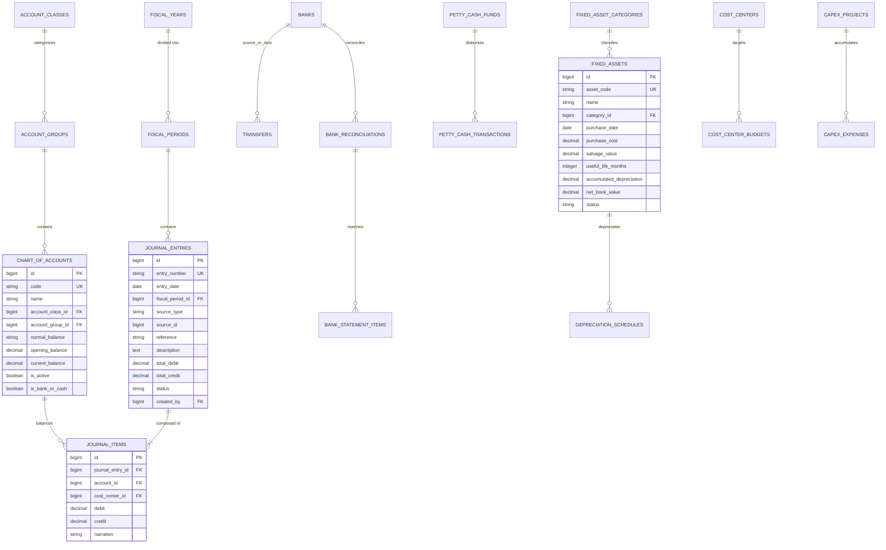

# Accounting Database Schema, Models & Observers

<span class="badge-role">AUTHORITATIVE ROLE GUARD: SUPERADMIN | ADMIN | super-admin | ACCOUNTS | AUDIT</span>

The Accounting subsystem relies on a relational schema engineered for transaction integrity, ACID compliance, strict double-entry balancing, and unalterable audit trails.

---

## 1. Entity-Relationship Architecture



---

## 2. Core Relational Schemas

### `chart_of_accounts`
Maintains the hospital master chart of accounts:
```sql
CREATE TABLE `chart_of_accounts` (
  `id` bigint unsigned NOT NULL AUTO_INCREMENT,
  `code` varchar(20) NOT NULL UNIQUE,
  `name` varchar(191) NOT NULL,
  `account_class_id` bigint unsigned NOT NULL,
  `account_group_id` bigint unsigned DEFAULT NULL,
  `normal_balance` enum('debit','credit') NOT NULL DEFAULT 'debit',
  `opening_balance` decimal(15,2) NOT NULL DEFAULT '0.00',
  `current_balance` decimal(15,2) NOT NULL DEFAULT '0.00',
  `is_active` tinyint(1) NOT NULL DEFAULT '1',
  `is_bank_or_cash` tinyint(1) NOT NULL DEFAULT '0',
  `created_at` timestamp NULL DEFAULT NULL,
  `updated_at` timestamp NULL DEFAULT NULL,
  PRIMARY KEY (`id`),
  INDEX `coa_code_idx` (`code`),
  INDEX `coa_class_idx` (`account_class_id`)
) ENGINE=InnoDB DEFAULT CHARSET=utf8mb4 COLLATE=utf8mb4_unicode_ci;
```

---

### `journal_entries` & `journal_items`
Stores double-entry transaction headers and atomic leg lines:
```sql
CREATE TABLE `journal_entries` (
  `id` bigint unsigned NOT NULL AUTO_INCREMENT,
  `entry_number` varchar(50) NOT NULL UNIQUE,
  `entry_date` date NOT NULL,
  `fiscal_period_id` bigint unsigned DEFAULT NULL,
  `source_type` varchar(100) DEFAULT NULL, -- 'Payment', 'Expense', 'PO_GRN', 'Manual'
  `source_id` bigint unsigned DEFAULT NULL,
  `reference` varchar(100) DEFAULT NULL,
  `description` text,
  `total_debit` decimal(15,2) NOT NULL DEFAULT '0.00',
  `total_credit` decimal(15,2) NOT NULL DEFAULT '0.00',
  `status` enum('draft','posted','reversed') NOT NULL DEFAULT 'posted',
  `created_by` bigint unsigned NOT NULL,
  `created_at` timestamp NULL DEFAULT NULL,
  PRIMARY KEY (`id`)
) ENGINE=InnoDB DEFAULT CHARSET=utf8mb4 COLLATE=utf8mb4_unicode_ci;

CREATE TABLE `journal_items` (
  `id` bigint unsigned NOT NULL AUTO_INCREMENT,
  `journal_entry_id` bigint unsigned NOT NULL,
  `account_id` bigint unsigned NOT NULL,
  `cost_center_id` bigint unsigned DEFAULT NULL,
  `debit` decimal(15,2) NOT NULL DEFAULT '0.00',
  `credit` decimal(15,2) NOT NULL DEFAULT '0.00',
  `narration` varchar(255) DEFAULT NULL,
  PRIMARY KEY (`id`),
  FOREIGN KEY (`journal_entry_id`) REFERENCES `journal_entries` (`id`) ON DELETE CASCADE,
  FOREIGN KEY (`account_id`) REFERENCES `chart_of_accounts` (`id`)
) ENGINE=InnoDB DEFAULT CHARSET=utf8mb4 COLLATE=utf8mb4_unicode_ci;
```

---

## 3. Eloquent Observers & Ledger Side Effects

The system relies on 46+ observers to keep clinical actions and financial ledgers permanently synchronized:

### 1. `PaymentObserver` (`App\Observers\PaymentObserver`)
- **Trigger**: Fired on `Payment::created` and `PaymentSplit::created`.
- **Side Effect**:
  - Identifies payment methods (Cash, POS, Wallet Prepayment, HMO claim, Corporate Retainership, Staff Advance).
  - Posts Debits to corresponding Asset / Prepayment accounts (`1010`, `1031`, `2050`, `1120`, `1130`, `1140`).
  - Credits Revenue accounts based on billed clinical bill items (`4010` Lab, `4020` Pharmacy, `4030` Consult, `4050` Surgery).
  - Guarantees: $\sum \text{Debits} == \sum \text{Credits}$.

### 2. `ExpenseObserver` (`App\Observers\ExpenseObserver`)
- **Trigger**: Fired on `Expense::updated` when `status` transitions to `APPROVED`.
- **Side Effect**:
  - Debits designated Expense Account (e.g. `5040 Power & Diesel`).
  - Credits Paying Bank Account (`1020 Zenith Bank`).

### 3. `PurchaseOrderObserver` (`App\Observers\PurchaseOrderObserver`)
- **Trigger**: Fired on `GoodsReceiveNote::created` during PO item reception.
- **Side Effect**:
  - Increments stock counts in destination store.
  - Automatically posts `DR 1210 Inventory`, `CR 2010 Accounts Payable`.

### 4. `JournalEntryObserver` (`App\Observers\JournalEntryObserver`)
- **Trigger**: Fired on `JournalEntry::saving`.
- **Side Effect**:
  - Enforces period lock validation: Throws an exception if `entry_date` belongs to a closed `fiscal_period`.
  - Enforces double-entry equality before allowing database write:
    ```php
    if (bccomp($entry->total_debit, $entry->total_credit, 2) !== 0) {
        throw new \DomainException("Unbalanced Journal Entry: Total Debits ({$entry->total_debit}) must strictly equal Total Credits ({$entry->total_credit})");
    }
    ```

---

## Developer Reference
👉 **[Read Accounting User Guide](/user-guides/workbenches/accounting)**  
👉 **[Read Accounting API Contracts](/developer/workbenches/accounting/api-contracts)**

