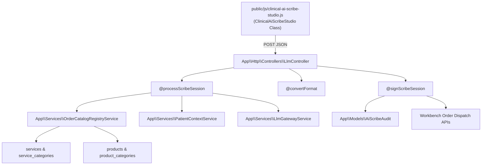

# Clinical AI Scribe Studio Developer API & Architecture Reference

**Date**: 2026-11-10  
**Git Release Tag**: `v2.6.0.68`  
**Domain**: Clinical AI, Speech Recognition, Order Grounding, Multi-Taxonomy LLM Engineering

---

## 1. Architectural Overview & Component Map

The Clinical AI Scribe Studio implements an ambient documentation studio with dual-pane layout, real-time Web Audio API visualization, multi-dialect Web Speech recognition, token-optimized catalog grounding, and closed-loop hospital order dispatch.



---

## 2. Route Guards & Endpoints

| Method | URI | Name | Middleware | Description |
| :--- | :--- | :--- | :--- | :--- |
| `POST` | `/llm/clinical-scribe/process` | `llm.clinical-scribe.process` | `web`, `auth` | Processes speech transcript + editor text, returns structured note and catalog-grounded orders. |
| `POST` | `/llm/clinical-scribe/convert-format` | `llm.clinical-scribe.convert-format` | `web`, `auth` | Converts an already structured note between taxonomies losslessly. |
| `POST` | `/llm/clinical-scribe/sign` | `llm.clinical-scribe.sign` | `web`, `auth` | Archives immutable audit record in `ai_scribe_audits` upon clinician sign-off. |

---

## 3. Order Catalog Registry Service (`OrderCatalogRegistryService`)

Located in `app/Services/OrderCatalogRegistryService.php`:

- **Category Prompt Indexing**: `getCategoryPromptContext()` provides a token-efficient summary of active `ServiceCategory` and `ProductCategory` records cached in memory (`CACHE_TTL = 3600` seconds).
- **Fuzzy Item Matching**: `matchCatalogItem($itemName, $orderType)` resolves suggested test and drug names against real catalog rows (`Service::where('status', 1)` and `Product::where('status', 1)`), extracting active pricing, codes, and target queues.
- **Safety Allergy Cross-Checking**: `groundOrders($rawOrders, $patientAllergies)` cross-checks product names against reported patient allergies, populating `safety_warning` flags on conflicting medications.

---

## 4. Database Schema: `ai_scribe_audits` Table

Migration: `database/migrations/2026_11_10_010000_create_ai_scribe_audits_table.php`

```sql
CREATE TABLE `ai_scribe_audits` (
  `id` bigint unsigned NOT NULL AUTO_INCREMENT,
  `patient_id` bigint unsigned NOT NULL,
  `encounter_id` bigint unsigned DEFAULT NULL,
  `user_id` bigint unsigned NOT NULL,
  `role` varchar(32) NOT NULL DEFAULT 'doctor',
  `taxonomy_type` varchar(32) NOT NULL DEFAULT 'clerking',
  `original_transcript` longtext DEFAULT NULL,
  `baseline_editor_content` longtext DEFAULT NULL,
  `structured_note_json` json DEFAULT NULL,
  `final_signed_note` longtext DEFAULT NULL,
  `orders_extracted_json` json DEFAULT NULL,
  `orders_dispatched_json` json DEFAULT NULL,
  `model_used` varchar(64) DEFAULT NULL,
  `provider` varchar(64) DEFAULT NULL,
  `signed_at` timestamp NULL DEFAULT NULL,
  `created_at` timestamp NULL DEFAULT NULL,
  `updated_at` timestamp NULL DEFAULT NULL,
  PRIMARY KEY (`id`),
  KEY `idx_patient_created` (`patient_id`, `created_at`),
  KEY `idx_encounter_created` (`encounter_id`, `created_at`),
  KEY `idx_user_created` (`user_id`, `created_at`)
) ENGINE=InnoDB DEFAULT CHARSET=utf8mb4 COLLATE=utf8mb4_unicode_ci;
```

---

## 5. Frontend Architecture & Assets


- **Blade Structure**: `resources/views/admin/partials/clinical_ai_scribe_studio.blade.php`.
- **Standalone Stylesheet**: `public/css/clinical-ai-scribe-studio.css`.
  - Uses CSS variable `--hospital-primary` and radial ambient glow.
- **Standalone JavaScript Module**: `public/js/clinical-ai-scribe-studio.js`.
  - `ClinicalAiScribeStudio` singleton.
  - Web Audio API 60 FPS visualizer utilizing `AnalyserNode.getByteFrequencyData()`.
  - Debounced auto-save to `sessionStorage` and `localStorage` with crash recovery banner.
  - Multi-language dictionary support: `en-NG`, `en-GB`, `en-US`, `pcm-NG`, `ha-NG`, `yo-NG`, `ig-NG`, `fr-FR`, `es-ES`, `ar-SA`, `pt-PT`, `nl-NL`, `zh-CN`.

---

## 6. Automated Testing & Verification Commands

```bash
# 1. Run Unit Tests (Taxonomy Schemas & Order Grounding)
vendor/bin/phpunit tests/Unit/AI/ClinicalScribePromptAndCatalogTest.php

# 2. Run Feature Tests (API Endpoints, Authentication, Audit Archiving)
vendor/bin/phpunit tests/Feature/AI/ClinicalAiScribeStudioTest.php

# 3. Verify JavaScript Syntax
node --check public/js/clinical-ai-scribe-studio.js

# 4. Code Style & PSR-12 Linting
tools/vendor/bin/php-cs-fixer fix --dry-run
```

