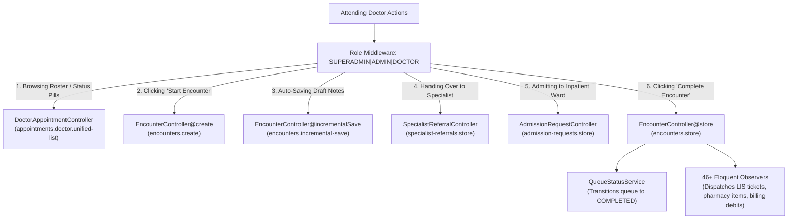
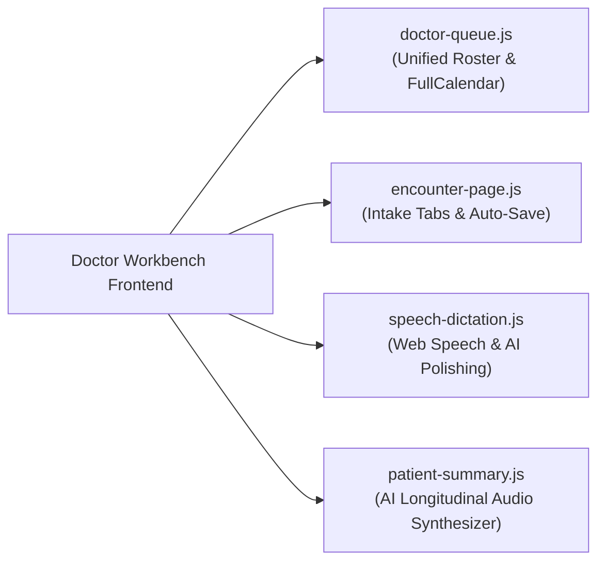

# Doctor Consultation Developer Architecture & Route Blueprint

<span class="badge-role">AUTHORITATIVE ROLE GUARD: SUPERADMIN | ADMIN | DOCTOR</span>

This developer reference focuses on **clinical execution and runtime usage**. It explains how the frontend and backend coordinate during a patient consultation, when each endpoint is called, how state transitions through the database, and how observers guarantee financial and medical ledger integrity.

---

## 1. Controller Architecture & Clinical Triggers

The Doctor Consultation Workbench splits clinical responsibilities across specialized controllers, each handling a distinct phase of the patient's visit:



### When & Why Each Controller is Used:
1. **`DoctorAppointmentController`**:
   - **Trigger**: Called whenever the doctor opens the queue page, clicks a status pill (`Waiting`, `Ready`, `In Consultation`), or switches to the calendar view.
   - **Clinical Execution**: Dynamically executes `HmoHelper::canDeliverService()` on every queued patient to determine whether to render a green **Start Encounter** button or a disabled **Blocked** button with the exact financial/insurance barrier.
2. **`EncounterController@create`**:
   - **Trigger**: Called when the doctor clicks **Start Encounter** on a patient card.
   - **Clinical Execution**: Queries the patient's triage vitals, historical allergies, active treatment plans, and previous visit timeline, binding them to the sticky consultation header.
3. **`EncounterController@incrementalSave`**:
   - **Trigger**: Called silently in the background every 15 seconds while the doctor is typing clinical notes or dictating history.
   - **Clinical Execution**: Updates draft notes and ICPC-2 complaints without altering queue states, ensuring zero data loss if network connection flickers.
4. **`EncounterController@store`**:
   - **Trigger**: Called when the doctor clicks **Complete Encounter** in the final review modal.
   - **Clinical Execution**: Runs an atomic database transaction that logs the ICD-10 diagnosis, signs the encounter record, stops the consultation stopwatch, marks the queue status as `COMPLETED`, routes prescriptions to pharmacy, dispatches lab requests to phlebotomy, and releases the patient.
5. **`SpecialistReferralController`**:
   - **Trigger**: Called when the doctor submits an internal clinic transfer or external hospital referral from the Referrals tab.
   - **Clinical Execution**: If marked `urgency: emergency`, broadcasts a high-priority alert to the reception dashboard.
6. **`AdmissionRequestController`**:
   - **Trigger**: Called when the doctor clicks **Admit** on the sticky header.
   - **Clinical Execution**: Places a temporary bed hold in the requested ward (e.g. Male Medical Ward, ICU) and alerts on-duty ward nurses.

---

## 2. Authoritative Route Map & Usage Lifecycle

All endpoints are registered in `routes/web.php` and `routes/appointments.php`, protected character-for-character by Spatie role middleware:

| Route URI | Method | Route Name | Clinical Trigger & Usage in Workflow |
|:---|:---|:---|:---|
| `/encounters` | `GET` | `encounters.index` | Doctor opens the outpatient consultation queue (`/encounters?status=waiting`). |
| `/appointments/doctor/unified-list` | `GET` | `appointments.doctor.unified-list` | DataTables AJAX call fetching real-time patient cards, active mini-timers, and HMO clearance badges. |
| `/appointments/doctor/unified-events` | `GET` | `appointments.doctor.unified-events` | FullCalendar v2 diff engine fetching scheduled specialist appointments. |
| `/appointments/{id}/checkin` | `POST` | `appointments.checkin` | Doctor clicks **Check-In** on a scheduled appointment card to move patient into the waiting room. |
| `/encounters/create` | `GET` | `encounters.create` | Doctor clicks **Start Encounter** or **Resume Encounter** to open the patient's chart. |
| `/encounters/incremental-save` | `POST` | `encounters.incremental-save` | Background auto-save debounced every 15 seconds while doctor types notes. |
| `/encounters` | `POST` | `encounters.store` | Doctor clicks **Complete Encounter** in `#concludeEncounterModal` to finalize care. |
| `/encounters/{encounter}/summary` | `GET` | `encounters.summary` | Fetches the 7 multi-category audit cards (Diagnosis, Labs, Imaging, Meds, Procedures, Referrals, Care Plan). |
| `/specialist-referrals` | `POST` | `specialist-referrals.store` | Doctor clicks **Submit Referral** on the referrals form. |
| `/admission-requests` | `POST` | `admission-requests.store` | Doctor clicks **Admit** on the sticky header to requisition a ward bed. |
| `/encounter-workbench` | `GET` | `encounter.workbench` | Clinical director or physician reviews historical consultation logbooks and financial ledger attribution. |

---

## 3. Frontend Architecture & Practical Execution

The Doctor Workbench relies on four standalone JavaScript modules strictly verified via `node --check`:



### A. `doctor-queue.js` (Roster & Timer Engine)
- **DataTables Card Rendering**: Injects HTML patient cards into `#unified-queue-table`. Validates HMO coverage and renders the appropriate primary button (`Start Encounter`, `Resume Encounter`, `Check-In`, or `Blocked`).
- **Live Consultation Timers**: Drives `.mini-timer` elements on active cards, tracking elapsed seconds and respecting paused intervals (`consultation_paused_seconds`).
- **Calendar Diff Refresh**: Employs MD5 event fingerprinting (`_docCalLastEvents`) to update changed appointments in FullCalendar without redrawing the DOM.

### B. `encounter-page.js` (Intake Orchestrator)
- **Tab Switching & Interception**: Governs `switch_tab(e, tabId)`. If uncommitted treatment plans exist, intercepts navigation via `#tpNoActivePlanPromptModal`.
- **Sticky Header State**: Manages `toggleSchDetails()`, toggling between the 250px expanded vitals box and the 45px compact ribbon, saving user preference in `localStorage`.
- **Auto-Save Engine**: Listens to input events on clinical notes, pushing changes to `POST /encounters/incremental-save` every 15 seconds.

### C. `speech-dictation.js` (Voice Dictation & NLP)
- **Web Speech API**: Uses browser-native speech recognition for real-time dictation.
- **AI Note Polishing**: Sends raw dictated strings to `/llm/polish-note`. If offline, falls back to the local Retext NLP engine (`formatMedicalStructure`), applying medical casing, dosage symbols, and SOAP structuring.

### D. `patient-summary.js` (Audio Synthesis)
- Analyzes longitudinal patient history (past diagnoses, surgeries, chronic medications).
- Synthesizes audio through `window.speechSynthesis` with speed rate controls (`0.8x`, `1.0x`, `1.2x`).

---

## 4. Memory Governance & Long-Shift Stability

In high-volume hospital clinics where physicians keep a browser tab open across 10+ hour shifts:
1. **Explicit Select2 Teardown**: Dynamic Select2 instances on diagnosis and drug search fields are explicitly destroyed via `$('select').select2('destroy')` before garbage collection.
2. **Event Detachment**: Event listeners on `#unified-queue-table` are decoupled during AJAX teardown to eliminate detached DOM memory leaks.
3. **Timer Cleanup**: Active `setInterval` handles driving consultation stopwatches are cleared via `clearInterval` whenever navigating away from the intake cockpit.

---

## 5. Automated Verification & Testing Commands

Verify all doctor features against the live test database:

```bash
# Verify Encounter creation and optimization workflows
vendor/bin/phpunit tests/Unit/Encounter/EncounterCreateOptimizationTest.php

# Run full feature tests for Doctor queues and consultations
vendor/bin/phpunit tests/Feature/Doctor/DoctorQueueTest.php

# Verify frontend scripts syntax
node --check public/js/doctor-queue.js
node --check public/js/encounter-page.js
node --check public/js/speech-dictation.js
node --check public/js/patient-summary.js
```

---

## Developer Subpages
- 👉 **[Encounter API & Save Contracts](/developer/workbenches/doctor/api-contracts)** — Paystack-style request/response payloads, practical triggers, and error cases.
- 👉 **[Database Models, Queues & Observers](/developer/workbenches/doctor/database-and-models)** — Schema definitions, `QueueStatus` state machines, and observer side effects.
