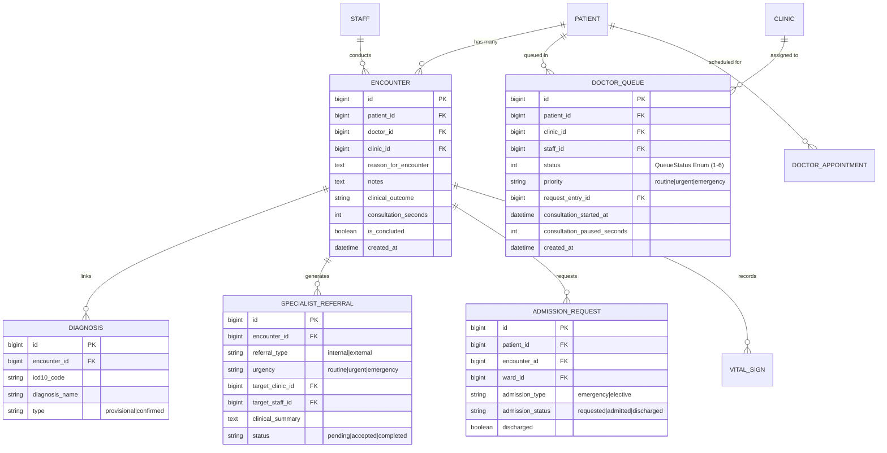
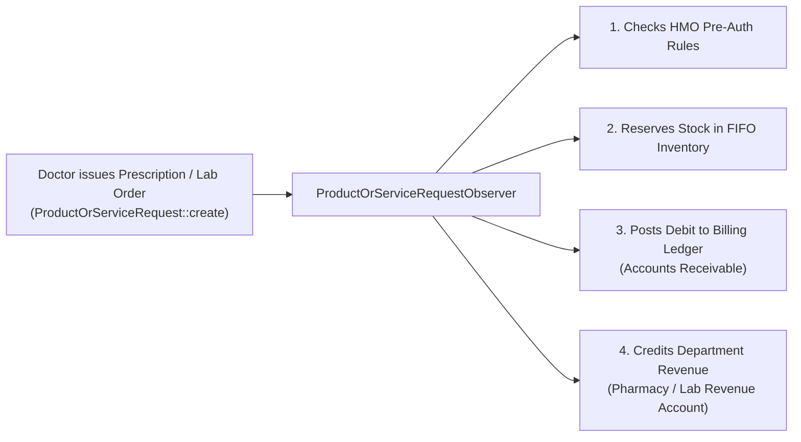

# Doctor Consultation Database Models, Queues & Observers

<span class="badge-role">AUTHORITATIVE ROLE GUARD: SUPERADMIN | ADMIN | DOCTOR</span>

This document details the relational database schema, Eloquent model structures, `QueueStatus` state machines, and observer double-entry invariants governing the Doctor Consultation domain.

---

## 1. Relational Entity Relationship Diagram



---

## 2. Core Eloquent Models & Schema Definitions

### A. `DoctorQueue` (`App\Models\DoctorQueue`)
The operational spine of the clinic waiting room. Synchronizes live patient volume across reception, nursing, and physician workbenches:
- **Table**: `doctor_queues`
- **Key Relationships**:
  - `belongsTo(Patient::class)`
  - `belongsTo(Clinic::class)`
  - `belongsTo(Staff::class, 'staff_id')`
  - `belongsTo(ProductOrServiceRequest::class, 'request_entry_id')`
- **Key Columns**:
  - `status`: Integer matching `App\Enums\QueueStatus`.
  - `priority`: `routine`, `urgent`, or `emergency`.
  - `consultation_started_at`: Timestamp when the clinician clicked "Start Encounter".
  - `consultation_paused_seconds`: Total seconds elapsed during consultation pauses.

### B. `QueueStatus` State Machine (`App\Enums\QueueStatus`)
```php
namespace App\Enums;

class QueueStatus
{
    const WAITING         = 1; // Checked in at reception, awaiting triage
    const VITALS_PENDING  = 2; // Being evaluated at nursing triage
    const READY           = 3; // Triage complete, waiting for doctor
    const IN_CONSULTATION = 4; // Active encounter open
    const COMPLETED       = 5; // Encounter finalized and discharged
    const SCHEDULED       = 6; // Pre-booked outpatient appointment
}
```

### C. `Encounter` (`App\Models\Encounter`)
Represents the legal and clinical record of a doctor-patient interaction:
- **Table**: `encounters`
- **Key Relationships**:
  - `hasMany(Diagnosis::class)`
  - `hasMany(SpecialistReferral::class)`
  - `hasOne(AdmissionRequest::class)`
  - `hasMany(VitalSign::class)`
- **Key Columns**:
  - `reason_for_encounter`: Presenting complaints or ICPC-2 primary classification.
  - `notes`: Full SOAP clinical note text (JSON or HTML).
  - `clinical_outcome`: Formal discharge/handover classification.
  - `consultation_seconds`: Total active clinical time logged.

### D. `SpecialistReferral` (`App\Models\SpecialistReferral`)
Coordinates internal clinic transfers and external facility paperwork:
- **Table**: `specialist_referrals`
- **Key Columns**:
  - `referral_type`: `internal` or `external`.
  - `urgency`: `routine`, `urgent`, or `emergency`.
  - `target_clinic_id`: Destination clinic ID.
  - `target_staff_id`: Specific consultant ID or null.
  - `provisional_diagnosis`: Clinical suspicion.
  - `reason`: Explicit referral inquiry.

---

## 3. Eloquent Observers & Double-Entry Invariants

CoreHealth v2 enforces strict ledger balance across 46+ Eloquent Observers. In the Doctor Consultation Workbench:



> [!CAUTION]
> **Observer Invariant Violation Warning**: NEVER execute raw database queries (`DB::table('encounters')->update(...)` or `DB::table('product_or_service_requests')->insert(...)`) for entities monitored by observers. Bypassing Eloquent models bypasses double-entry General Ledger balancing and FIFO inventory deductions.

### Key Active Observers in Doctor Workflows:
1. **`EncounterObserver`**:
   - Updates the patient's Clinical Story index upon saving.
   - Pushes clinical interaction telemetry to WeCare247 if the patient is enrolled in telemedicine sync.
2. **`DoctorQueueObserver`**:
   - Broadcasts queue state transitions over WebSockets to nursing and reception dashboards.
   - Clears cached KPI metric counts (`Waiting`, `Vitals`, `Ready`) upon status updates.
3. **`SpecialistReferralObserver`**:
   - Generates emergency alert notifications at reception when `urgency === 'emergency'`.
   - Injects the referral into the destination clinic's appointment queue.

---

## 4. Database Compatibility (MySQL 8.0 & MariaDB 10.5+)

All queries in the Doctor Workbench strictly comply with MySQL 8.0 and MariaDB 10.5+ multi-token matching:
- **No PostgreSQL Syntax**: No `ILIKE` operators; keyword searches employ standard `LIKE` or `App\Helpers\ClinicalSearchHelper`.
- **Date Functions**: Standardized to `NOW()`, `CURDATE()`, and `DATEDIFF()`.
- **JSON Compatibility**: MariaDB-compliant JSON extraction syntax (`JSON_UNQUOTE(JSON_EXTRACT(...))`).

---

## 5. Automated Verification & Testing Guidelines

When testing Doctor Consultation features:
- **Test Database Invariant**: Tests run strictly against `_corehealth_db_v2_test`. Never configure SQLite or in-memory databases.
- **Rollback Discipline**: Extend `Tests\TestCase` (which includes `DatabaseTransactions`). Every test executes inside a MySQL transaction and rolls back automatically.
- **NO `RefreshDatabase`**: NEVER use `RefreshDatabase` as it wipes pre-seeded clinical fixtures and schema migrations.

```bash
# Execute feature test suite for Doctor Workbench
vendor/bin/phpunit tests/Feature/Doctor/
```

