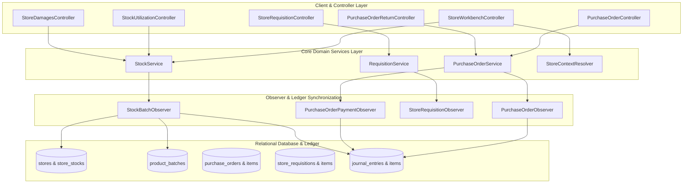

# Store, Inventory Governance & Materials Management Developer Reference

<span class="badge-role">AUTHORITATIVE ROLE GUARD: SUPERADMIN | ADMIN | super-admin | STORE | PHARMACY | ACCOUNTS</span>

The **Store & Inventory Management** subsystem coordinates multi-store supply chains across CoreHealth v2. It enforces multi-tier warehouse tenancy, automated purchase orders, Goods Receive Notes (GRNs), First-Expired-First-Out (FEFO) batch allocation, departmental stock utilization, and double-entry General Ledger balancing.

---

## 1. Architectural Overview & Service Layer

The inventory subsystem decouples controller endpoints, domain services, Eloquent observers, and context resolvers:



---

## 2. Double-Entry General Ledger Invariant

Whenever physical inventory is received, utilized, damaged, or returned, the system relies on Eloquent model observers to post balanced General Ledger journal entries:

```
1. GOODS RECEIPT (GRN Reception):
   DR 1210 Central Medical Store Inventory
   CR 2010 Accounts Payable (Vendor)

2. SUPPLIER AP PAYMENT:
   DR 2010 Accounts Payable (Vendor)
   CR 1020 Zenith Bank Operating Account

3. CLINICAL STOCK UTILIZATION / DISPENSING:
   DR 5010 Cost of Goods Sold - Pharmaceutical Drugs (or 5020 Consumables)
   CR 1210 Clinical / Pharmacy Store Inventory

4. COMPROMISED / DAMAGED STOCK WRITE-OFF:
   DR 5060 Stock Loss & Damage Expense (or 5065 Expiry Write-Off)
   CR 1210 Holding Store Inventory

5. PURCHASE ORDER RETURN (Supplier Credit Note):
   DR 2010 Accounts Payable (Vendor)
   CR 1210 Central Medical Store Inventory
```

> [!CAUTION]
> **Observer Invariant**: NEVER bypass Eloquent models with raw SQL insertions (`DB::table('store_stocks')->update(...)` or `DB::table('purchase_orders')->insert(...)`). Doing so bypasses `PurchaseOrderObserver` and `StockBatchObserver`, desynchronizing physical bin counts from General Ledger asset account `1210` and breaking the statutory Balance Sheet.

---

## 3. Core Controllers & Routes Namespace

The inventory routes are registered under `routes/inventory.php`:

| Module | Controller Class | Authoritative Route Prefix | Middleware Guard |
| :--- | :--- | :--- | :--- |
| **Store Workbench** | `StoreWorkbenchController` | `/inventory/store-workbench` | `auth` &bull; `role:SUPERADMIN\|ADMIN\|STORE` |
| **Purchase Orders** | `PurchaseOrderController` | `/inventory/purchase-orders` | `auth` &bull; `role:SUPERADMIN\|ADMIN\|STORE\|ACCOUNTS` |
| **Requisitions** | `StoreRequisitionController` | `/inventory/requisitions` | `auth` &bull; `role:SUPERADMIN\|ADMIN\|STORE\|PHARMACY` |
| **My Stock Utilization**| `StockUtilizationController` | `/inventory/requisitions/my-stock` | `auth` &bull; `role:SUPERADMIN\|ADMIN\|STORE\|NURSING` |
| **Store Damages** | `StoreDamagesController` | `/inventory/store-damages` | `auth` &bull; `role:SUPERADMIN\|ADMIN\|STORE` |
| **Requisition Returns** | `StoreRequisitionReturnController`| `/inventory/requisition-returns` | `auth` &bull; `role:SUPERADMIN\|ADMIN\|STORE` |
| **PO Returns** | `PurchaseOrderReturnController` | `/inventory/po-returns` | `auth` &bull; `role:SUPERADMIN\|ADMIN\|STORE\|ACCOUNTS` |
| **Store Governance** | `StoreGovernanceController` | `/inventory/config/store-governance` | `auth` &bull; `role:SUPERADMIN\|ADMIN\|STORE` |
| **Operating Expenses** | `ExpenseController` | `/inventory/expenses` | `auth` &bull; `role:SUPERADMIN\|ADMIN\|ACCOUNTS` |

---

## 4. Dedicated Developer Subpages

- 👉 **[Store API Contracts & Route Specifications](/developer/workbenches/inventory/api-contracts)**: Exhaustive JSON request payloads, query parameters, DataTables response formats, and status codes across all inventory endpoints.
- 👉 **[Store Database Schema, Models & Observers](/developer/workbenches/inventory/database-and-models)**: Entity-Relationship diagrams, database table structures, foreign key constraints, Eloquent models, and observer hooks.

---

## 5. Automated Testing Contracts

Execute test suites inside the sandboxed environment against the live test database `_corehealth_db_v2_test`:

```bash
# Run Full Inventory Feature Suite
vendor/bin/phpunit tests/Feature/Inventory/

# Run Purchase Order & AP Tests
vendor/bin/phpunit tests/Feature/Inventory/PurchaseOrderTest.php

# Run Store Requisitions & Lane Policy Tests
vendor/bin/phpunit tests/Feature/Inventory/StoreRequisitionTest.php

# Run Stock Utilization & Patient Billing Tests
vendor/bin/phpunit tests/Feature/Inventory/StockUtilizationTest.php
```

---

👉 **[Read Store User Guide](/user-guides/workbenches/inventory)**
