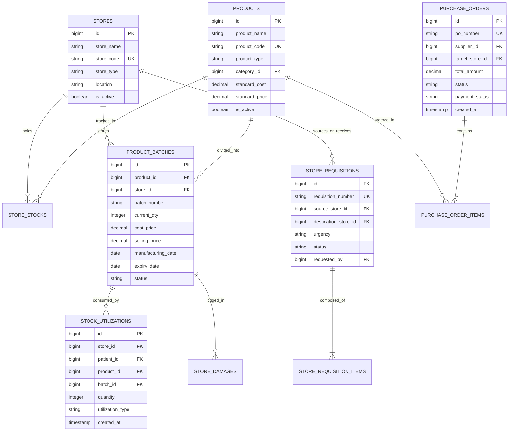

# Store Database Schema, Models & Observers

<span class="badge-role">AUTHORITATIVE ROLE GUARD: SUPERADMIN | ADMIN | super-admin | STORE | ACCOUNTS</span>

The Store and Inventory subsystem utilizes a normalized relational schema designed for multi-warehouse tenancy, high-throughput batch movements, FEFO fulfillment, and real-time General Ledger inventory synchronization.

---

## 1. Entity-Relationship Architecture



---

## 2. Core Relational Schemas

### `product_batches`
Maintains individual manufacturing lots with expiration tracking:
```sql
CREATE TABLE `product_batches` (
  `id` bigint unsigned NOT NULL AUTO_INCREMENT,
  `product_id` bigint unsigned NOT NULL,
  `store_id` bigint unsigned NOT NULL,
  `batch_number` varchar(100) NOT NULL,
  `initial_qty` int NOT NULL,
  `current_qty` int NOT NULL DEFAULT '0',
  `cost_price` decimal(12,2) NOT NULL DEFAULT '0.00',
  `selling_price` decimal(12,2) NOT NULL DEFAULT '0.00',
  `manufacturing_date` date DEFAULT NULL,
  `expiry_date` date NOT NULL,
  `status` enum('active','quarantined','expired','exhausted') NOT NULL DEFAULT 'active',
  `created_at` timestamp NULL DEFAULT NULL,
  `updated_at` timestamp NULL DEFAULT NULL,
  PRIMARY KEY (`id`),
  INDEX `batch_expiry_idx` (`expiry_date`),
  INDEX `batch_store_prod_idx` (`store_id`, `product_id`, `status`),
  FOREIGN KEY (`product_id`) REFERENCES `products` (`id`),
  FOREIGN KEY (`store_id`) REFERENCES `stores` (`id`)
) ENGINE=InnoDB DEFAULT CHARSET=utf8mb4 COLLATE=utf8mb4_unicode_ci;
```

---

### `purchase_orders` & `purchase_order_items`
Governs supplier procurement contracts:
```sql
CREATE TABLE `purchase_orders` (
  `id` bigint unsigned NOT NULL AUTO_INCREMENT,
  `po_number` varchar(50) NOT NULL UNIQUE,
  `supplier_id` bigint unsigned NOT NULL,
  `target_store_id` bigint unsigned NOT NULL,
  `total_amount` decimal(15,2) NOT NULL DEFAULT '0.00',
  `delivery_note_number` varchar(100) DEFAULT NULL,
  `expected_delivery_date` date DEFAULT NULL,
  `received_date` date DEFAULT NULL,
  `status` enum('draft','submitted','approved','partial','received','cancelled') NOT NULL DEFAULT 'draft',
  `payment_status` enum('unpaid','partial','paid') NOT NULL DEFAULT 'unpaid',
  `created_by` bigint unsigned NOT NULL,
  `created_at` timestamp NULL DEFAULT NULL,
  PRIMARY KEY (`id`)
) ENGINE=InnoDB DEFAULT CHARSET=utf8mb4 COLLATE=utf8mb4_unicode_ci;
```

---

## 3. Eloquent Observers & Ledger Hooks

### 1. `PurchaseOrderObserver` (`App\Observers\PurchaseOrderObserver`)
- **Trigger**: Fired on `PurchaseOrder::updated` when `status` transitions to `RECEIVED`.
- **Side Effect**:
  - Automatically verifies delivered batches.
  - Instantiates `AccountsPayable` liability record.
  - Posts General Ledger entry:
    - **`DR 1210 Central Store Inventory`**
    - **`CR 2010 Accounts Payable (Vendor)`**

### 2. `PurchaseOrderPaymentObserver`
- **Trigger**: Fired on `PurchaseOrderPayment::created`.
- **Side Effect**:
  - Updates PO `payment_status` (`PARTIAL` or `PAID`).
  - Posts General Ledger disbursement:
    - **`DR 2010 Accounts Payable`**
    - **`CR 1020 Zenith Bank Operating`**

### 3. `StockBatchAccountingObserver` (`App\Observers\Accounting\StockBatchAccountingObserver`)
- **Trigger**: Fired on `StockBatch::created` when `source = manual` or `opening_stock`.
- **Double-Entry Impact**:
  - **On Credit**: `DR 1310/1300 Inventory` / `CR 2100 Accounts Payable` (tagged to supplier sub-account).
  - **Cash/Till**: `DR 1310/1300 Inventory` / `CR 1030 Petty Cash / Till`.
  - **Opening Stock**: `DR 1310/1300 Inventory` / `CR 3100 Retained Earnings`.
  - **Donation**: Zero financial payable generated.

### 4. `StockBatchVoidObserver` (`App\Observers\Accounting\StockBatchVoidObserver`)
- **Trigger**: Fired on `StockBatch::updated` when `voided_at` is populated.
- **Side Effect**: Calls `AccountingService::reverseEntry` to cleanly reverse intake JE (`STATUS_REVERSED`) and zeroes lot stock.

### 5. `StockAdjustmentAccountingObserver` (`App\Observers\Accounting\StockAdjustmentAccountingObserver`)
- **Trigger**: Fired on `StockBatchTransaction::created` and `updated`.
- **Side Effect**:
  - Positive (+): `DR 1310 Inventory` / `CR 4230 Stock Variance Gain (Other Income)`.
  - Negative (-): `DR 5050 Inventory Shrinkage Loss` / `CR 1310 Inventory`.
  - Void Adjustment: Swaps debits and credits to cleanly reverse the variance JE.

### 6. `StockBatchReturnObserver` (`App\Observers\Accounting\StockBatchReturnObserver`)
- **Trigger**: Fired on `StockBatchReturn::created` and `updated` when `status = approved`.
- **Side Effect**: Deducts lot stock and creates balancing settlement entry (`DR 2100 AP Credit Note` or `DR 1010 Cash` / `CR 1310 Inventory`).

### 7. `StockUtilizationObserver` (`App\Observers\Accounting\StockUtilizationObserver`)
- **Trigger**: Fired on `StockUtilization::created` when `is_billed = false`.
- **Side Effect**: Posts `DR 5020 Cost of Medical Supplies Used (Department Expense)` / `CR 1310 Inventory`.

---

## Developer Reference
👉 **[Read Store User Guide](/user-guides/workbenches/inventory)**  
👉 **[Read Store API Contracts & Route Specifications](/developer/workbenches/inventory/api-contracts)**

