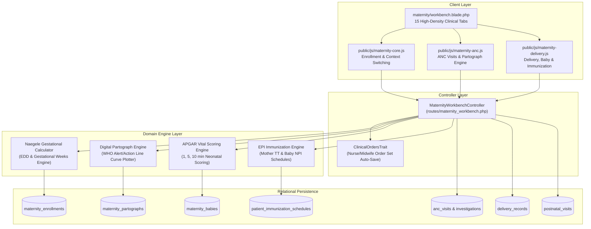
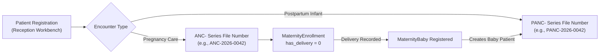

# Maternity, Obstetrics & Child Wellness Developer Architecture

AUTHORITATIVE ROLE GUARD: SUPERADMIN | ADMIN | super-admin | MATERNITY

The **Maternity, Obstetrics & Child Wellness Subsystem** manages the continuous journey of maternal, fetal, and neonatal healthcare. It governs antenatal care (ANC) booking, trimester monitoring, labor ward triage, the real-time **Digital Partograph** engine, delivery summaries, newborn biometrics and APGAR evaluations, postnatal recovery visits, and the National Programme on Immunization (EPI).

---

## 1. Architectural Overview & Component Structure

---

## 2. The Dual-Prefix Patient Isolation Architecture

To ensure strict longitudinal separation between pregnancy care and postpartum infant health, CoreHealth v2 implements a dual-prefix file numbering convention:

- **`ANC-` Prefix**: Assigned to expectant mothers upon ANC booking. Governs obstetric history, gestational weeks, trimester visits, laboratory screens, and intrapartum labor monitoring.
- **`PANC-` Prefix**: Assigned to the newborn upon registration in `#registerBabyModal`. Governs neonatal biometrics, APGAR scores, growth charts, and routine EPI immunization doses.
- **Bidirectional Context Switcher**: The client navigation bar (`#context-switch-container`) enables providers to switch between maternal records and infant charts with a single click without losing the active session state.

---

## 3. Real-Time Digital Partograph Engine

The digital partograph implements the World Health Organization (WHO) active phase labor monitoring standards:
- **Alert Line**: A straight line plotted from $4\text{ cm}$ of cervical dilation upwards at a constant rate of $1\text{ cm per hour}$ over 6 hours to full dilation ($10\text{ cm}$).
- **Action Line**: Parallel to the Alert Line and drawn $4\text{ hours}$ to the right.
- **Algorithmic Evaluation**: If the plotted dilation curve crosses to the right of the Alert Line, the system flags **Prolonged Active Phase**. If the curve crosses the Action Line, a high-priority banner recommends immediate obstetric review for operative delivery or labor augmentation.

---

## 4. Subsystem References

👉 **[Read Maternity API Contracts & JSON Schemas](/developer/workbenches/maternity/api-contracts)**  
👉 **[Read Maternity Database Schema & Models Reference](/developer/workbenches/maternity/database-and-models)**  
👉 **[Read Maternity User Story Guide](/user-guides/workbenches/maternity)**
