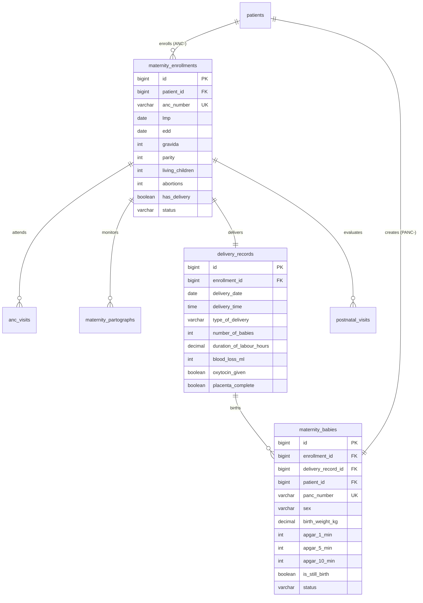

# Maternity Database Schema & Eloquent Models Reference

<span class="badge-role">AUTHORITATIVE ROLE GUARD: SUPERADMIN | ADMIN | super-admin | MATERNITY</span>

This reference details the relational schema, foreign key cascades, Eloquent model architectures, and database invariants governing the maternity module.

---

## 1. Entity-Relationship Overview



---

## 2. Table Specifications & Eloquent Models

### 1. `maternity_enrollments` (`App\Models\MaternityEnrollment`)
Governs the core obstetric admission, gestational age timeline, and file numbering.

| Column | Data Type | Nullable | Constraints & Description |
| :--- | :--- | :--- | :--- |
| `id` | `BIGINT UNSIGNED` | No | Primary Key. |
| `patient_id` | `BIGINT UNSIGNED` | No | References `patients.id`. Enrolled mother. |
| `anc_number` | `VARCHAR(50)` | No | Unique obstetric identifier (e.g. `ANC-2026-0042`). |
| `lmp` | `DATE` | No | Last Menstrual Period. |
| `edd` | `DATE` | No | Expected Date of Delivery (Naegele's rule). |
| `gravida` | `INT` | No | Total number of pregnancies. |
| `parity` | `INT` | No | Number of viable deliveries ($\ge 28$ weeks). |
| `living_children`| `INT` | No | Living offspring. |
| `abortions` | `INT` | No | Losses before 28 weeks. |
| `has_delivery` | `BOOLEAN` | No | Default `0`. Flips to `1` upon delivery save. |
| `status` | `VARCHAR(20)` | No | `active`, `delivered`, `discharged`. |

#### Eloquent Model Definition
```php
namespace App\Models;

use Illuminate\Database\Eloquent\Model;

class MaternityEnrollment extends Model
{
    protected $fillable = [
        'patient_id', 'anc_number', 'lmp', 'edd', 'gravida',
        'parity', 'living_children', 'abortions', 'has_delivery', 'status'
    ];

    public function patient() { return $this->belongsTo(Patient::class); }
    public function ancVisits() { return $this->hasMany(AncVisit::class, 'enrollment_id'); }
    public function partographEntries() { return $this->hasMany(MaternityPartograph::class, 'enrollment_id'); }
    public function deliveryRecord() { return $this->hasOne(DeliveryRecord::class, 'enrollment_id'); }
    public function babies() { return $this->hasMany(MaternityBaby::class, 'enrollment_id'); }
    public function postnatalVisits() { return $this->hasMany(PostnatalVisit::class, 'enrollment_id'); }
}
```

---

### 2. `delivery_records` (`App\Models\DeliveryRecord`)
Captures intrapartum outcomes, delivery mode, blood loss, and AMTSL execution.

| Column | Data Type | Nullable | Constraints & Description |
| :--- | :--- | :--- | :--- |
| `id` | `BIGINT UNSIGNED` | No | Primary Key. |
| `enrollment_id`| `BIGINT UNSIGNED` | No | Foreign key referencing `maternity_enrollments.id`. |
| `delivery_date`| `DATE` | No | Date of delivery. |
| `delivery_time`| `TIME` | Yes | Timestamp of expulsion. |
| `type_of_delivery` | `VARCHAR(30)` | No | `svd`, `assisted_vaginal`, `elective_cs`, `emergency_cs`, `vacuum`, `forceps`. |
| `number_of_babies` | `INT` | No | Number of fetuses delivered. |
| `blood_loss_ml`| `INT` | Yes | Estimated blood loss in milliliters. |
| `oxytocin_given`| `BOOLEAN` | No | Default `1` (Active Management of Third Stage). |
| `placenta_complete`| `BOOLEAN` | No | Default `1`. |
| `notes` | `LONGTEXT` | Yes | Permanent narrative synced to global timeline. |

---

### 3. `maternity_babies` (`App\Models\MaternityBaby`)
Links neonates to their maternal enrollment and assigns their distinct `PANC-` file series.

| Column | Data Type | Nullable | Constraints & Description |
| :--- | :--- | :--- | :--- |
| `id` | `BIGINT UNSIGNED` | No | Primary Key. |
| `enrollment_id`| `BIGINT UNSIGNED` | No | References `maternity_enrollments.id`. |
| `delivery_record_id` | `BIGINT UNSIGNED` | Yes | References `delivery_records.id`. |
| `patient_id` | `BIGINT UNSIGNED` | No | References `patients.id` (newborn demographic file). |
| `panc_number` | `VARCHAR(50)` | No | Child welfare series number (e.g. `PANC-2026-0042`). |
| `sex` | `VARCHAR(10)` | No | `male`, `female`, `ambiguous`. |
| `birth_weight_kg` | `DECIMAL(4,2)`| Yes | Birth weight in kilograms. |
| `apgar_1_min` | `INT` | Yes | APGAR score at 1 minute ($0–10$). |
| `apgar_5_min` | `INT` | Yes | APGAR score at 5 minutes ($0–10$). |
| `is_still_birth` | `BOOLEAN` | No | Default `0` (Live birth). |
| `status` | `VARCHAR(20)` | No | `alive`, `deceased`. |

---

## Developer Reference
👉 **[Read Maternity Developer Architecture](/developer/workbenches/maternity)**  
👉 **[Read Maternity API Contracts & JSON Schemas](/developer/workbenches/maternity/api-contracts)**

