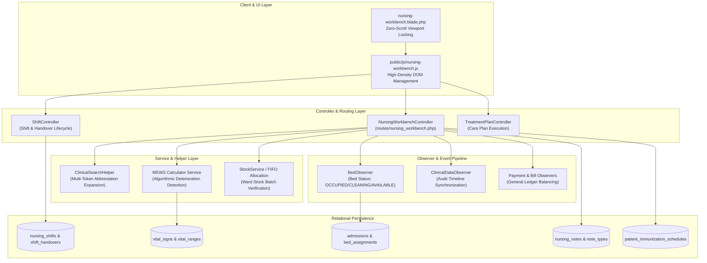
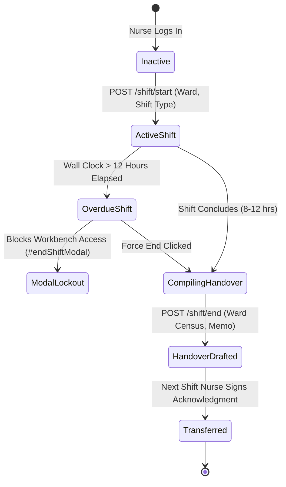

# Nursing & Inpatient MAR Developer Architecture

AUTHORITATIVE ROLE GUARD: SUPERADMIN | ADMIN | super-admin | NURSE

The **Nursing & Inpatient Care Subsystem** orchestrates 24-hour bedside care delivery across general wards, surgical suites, and intensive care units. It integrates shift lifecycle controls, real-time vital sign tracking with automated Modified Early Warning Score (MEWS) telemetry, electronic Medication Administration Records (eMAR), Intake & Output fluid balance accounting, and nurse-initiated clinical service requests.

---

## 1. Architectural Overview & Component Structure

The nursing engine is built on a high-throughput, modular architecture decoupling the bedside view layer from shift tracking, clinical ordering, and stock ledger synchronization:

---

## 2. Shift Roster & Handover State Machine

To prevent medication administration gaps and ensure clinical continuity, CoreHealth v2 locks the nursing workbench until an active shift is started:

- **Overdue Shift Lockout**: Handled client-side and server-side. If a shift exceeds 12 hours, `ShiftController::checkActiveShift()` returns `{ has_overdue_shift: true }`, triggering `#endShiftModal`. The user must review summary statistics, enter an optional handover memo, and click `#confirm-end-shift-btn` before new clinical entries can be posted.
- **Handover Memos**: Stored in `shift_handovers`. Multiple oncoming nurses can acknowledge via `POST /nursing-workbench/handovers/acknowledge-multiple`.

---

## 3. Multi-Token Consumable & Service Search Engine

Nursing procedural billing utilizes `App\Helpers\ClinicalSearchHelper`:
- **Abbreviation Auto-Expansion**: Maps clinical shortcuts to canonical database tokens:
  - `inj` $\rightarrow$ `injection`
  - `canula` $\rightarrow$ `cannula`
  - `wond` $\rightarrow$ `wound`
  - `drg` $\rightarrow$ `dressing`
- **Multi-Token Filtering**: Queries across both `products` (ward consumables, batch items) and `services` (nursing fees, procedure categories 4, 8, and 5) using MariaDB/MySQL compatible `LIKE` clauses without relying on PostgreSQL-specific syntax.

---

## 4. Subsystem References

👉 **[Read Nursing API Contracts & JSON Schemas](/developer/workbenches/nursing/api-contracts)**  
👉 **[Read Nursing Database Schema & Models Reference](/developer/workbenches/nursing/database-and-models)**  
👉 **[Read Nursing User Story Guide](/user-guides/workbenches/nursing)**
