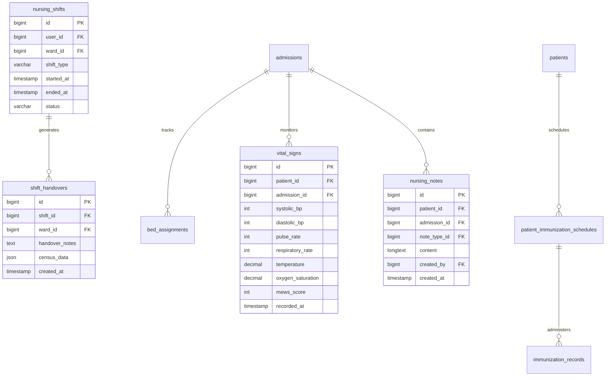

# Nursing Database Schema & Eloquent Models Reference

<span class="badge-role">AUTHORITATIVE ROLE GUARD: SUPERADMIN | ADMIN | super-admin | NURSE</span>

This reference details the relational schema, column definitions, Eloquent relationships, and observers governing the nursing data layer.

---

## 1. Entity-Relationship Overview



---

## 2. Table Specifications & Eloquent Models

### 1. `nursing_shifts` (`App\Models\NursingShift`)
Tracks staff shift coverage and enforces the 12-hour maximum active duration.

| Column | Data Type | Nullable | Constraints & Description |
| :--- | :--- | :--- | :--- |
| `id` | `BIGINT UNSIGNED` | No | Primary Key (Auto-Increment). |
| `user_id` | `BIGINT UNSIGNED` | No | Foreign key referencing `users.id`. Nurse on duty. |
| `ward_id` | `BIGINT UNSIGNED` | No | Foreign key referencing `wards.id`. Assigned unit. |
| `shift_type` | `VARCHAR(30)` | No | `morning` ($07:00–15:00$), `afternoon` ($14:00–21:00$), `night` ($20:00–08:00$). |
| `started_at` | `TIMESTAMP` | No | Clock-in timestamp. |
| `ended_at` | `TIMESTAMP` | Yes | Clock-out timestamp. |
| `status` | `VARCHAR(20)` | No | `active`, `ended`, `overdue`. |
| `notes` | `TEXT` | Yes | Handover narrative or operational notes. |

#### Eloquent Model Definition
```php
namespace App\Models;

use Illuminate\Database\Eloquent\Model;

class NursingShift extends Model
{
    protected $fillable = [
        'user_id', 'ward_id', 'shift_type', 'started_at', 'ended_at', 'status', 'notes'
    ];

    public function user() { return $this->belongsTo(User::class); }
    public function ward() { return $this->belongsTo(Ward::class); }
    public function handovers() { return $this->hasMany(ShiftHandover::class, 'shift_id'); }
}
```

---

### 2. `vital_signs` (`App\Models\VitalSign`)
Stores raw physiological metrics and derived early warning scores.

| Column | Data Type | Nullable | Constraints & Description |
| :--- | :--- | :--- | :--- |
| `id` | `BIGINT UNSIGNED` | No | Primary Key. |
| `patient_id` | `BIGINT UNSIGNED` | No | References `patients.id`. |
| `admission_id` | `BIGINT UNSIGNED` | Yes | References `admissions.id` (null for outpatients). |
| `systolic_bp` | `INT` | Yes | Systolic arterial pressure ($mmHg$). |
| `diastolic_bp` | `INT` | Yes | Diastolic arterial pressure ($mmHg$). |
| `pulse_rate` | `INT` | Yes | Heart rate in beats per minute ($bpm$). |
| `respiratory_rate` | `INT` | Yes | Breaths per minute. |
| `temperature` | `DECIMAL(4,2)` | Yes | Body temperature in degrees Celsius ($°C$). |
| `oxygen_saturation`| `DECIMAL(5,2)` | Yes | Peripheral capillary oxygen saturation ($SpO_2\%$). |
| `mews_score` | `INT` | Yes | Derived Modified Early Warning Score ($0–14$). |
| `recorded_by` | `BIGINT UNSIGNED` | No | References `users.id`. |

---

### 3. `shift_handovers` (`App\Models\ShiftHandover`)
Records formal ward census, patient status tallies, and outgoing nurse memos.

| Column | Data Type | Nullable | Constraints & Description |
| :--- | :--- | :--- | :--- |
| `id` | `BIGINT UNSIGNED` | No | Primary Key. |
| `shift_id` | `BIGINT UNSIGNED` | No | Foreign key referencing `nursing_shifts.id`. |
| `ward_id` | `BIGINT UNSIGNED` | No | Foreign key referencing `wards.id`. |
| `handover_notes` | `LONGTEXT` | Yes | SBAR clinical handover narrative. |
| `census_data` | `JSON` | Yes | Ward census statistics (admitted, transfers, discharges). |
| `acknowledged_by`| `BIGINT UNSIGNED` | Yes | References `users.id` of oncoming charge nurse. |

---

## 3. Observer Hooks & Ledger Invariants

- **`App\Observers\BedObserver`**:
  - Automatically transitions `beds.status` when `bed_assignments` records are created or updated (`available` $\leftrightarrow$ `occupied` $\leftrightarrow$ `cleaning`).
  - Triggers ward dashboard count refreshes via Redis broadcasting.
- **Double-Entry General Ledger Guarantee**:
  - All consumable items billed via nursing clinical requests execute through `App\Models\BillItem` and `App\Models\Payment` Eloquent models.
  - Raw `DB::table(...)` inserts are strictly banned, ensuring that General Ledger journal entries are balanced automatically by observers.

---

## Developer Reference
👉 **[Read Nursing Developer Architecture](/developer/workbenches/nursing)**  
👉 **[Read Nursing API Contracts & JSON Schemas](/developer/workbenches/nursing/api-contracts)**

