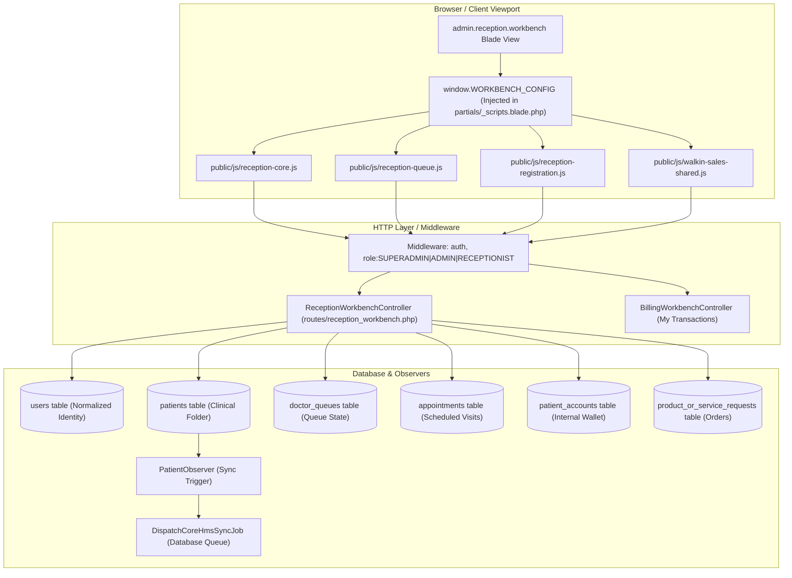

# Reception Workbench Developer API & Architecture Reference

<span class="badge-role">AUTHORITATIVE ROLE GUARD: SUPERADMIN | ADMIN | RECEPTIONIST</span>

This technical reference documents the backend controller actions, verified route definitions, database tables, observer side-effects, and standalone JavaScript modules powering the Reception & Health Records Workbench.

---

## 1. Architectural Component Map



---

## 2. Complete Verified Route Contracts (`routes/reception_workbench.php`)

All reception routes reside under the `reception/` URI prefix with middleware `['auth']` and name prefix `reception.`:

| HTTP Method | Route Name | URI | Controller Action | Purpose |
|---|---|---|---|---|
| `GET` | `reception.workbench` | `/reception/workbench` | `ReceptionWorkbenchController@index` | Main workbench cockpit view |
| `GET` | `reception.search-patients` | `/reception/search-patients` | `ReceptionWorkbenchController@searchPatients` | Asynchronous debounced patient search |
| `POST` | `reception.patient.quick-register` | `/reception/patient/quick-register` | `ReceptionWorkbenchController@quickRegister` | Rapid modal patient registration |
| `GET` | `reception.patient.next-file-number` | `/reception/patient/next-file-number` | `ReceptionWorkbenchController@getNextFileNumber` | Sequential file number generator |
| `POST` | `reception.patient.check-file-number` | `/reception/patient/check-file-number` | `ReceptionWorkbenchController@checkFileNumberExists` | Validates manual file number uniqueness |
| `POST` | `reception.patient.check-duplicate` | `/reception/patient/check-duplicate` | `ReceptionWorkbenchController@checkDuplicatePatient` | Phone and name duplicate prevention |
| `GET` | `reception.patient` | `/reception/patient/{id}` | `ReceptionWorkbenchController@getPatient` | Full patient demographic record |
| `GET` | `reception.patient.visits` | `/reception/patient/{id}/visits` | `ReceptionWorkbenchController@getVisitHistory` | Longitudinal visit history |
| `GET` | `reception.patient.queue` | `/reception/patient/{id}/queue` | `ReceptionWorkbenchController@getPatientQueueEntries` | Active queue entries for patient |
| `GET` | `reception.queue.routing-slip` | `/reception/queue/{id}/routing-slip` | `ReceptionWorkbenchController@getRoutingSlip` | Thermal patient routing slip |
| `PUT` | `reception.patient.update` | `/reception/patient/{id}/update` | `ReceptionWorkbenchController@updatePatient` | Updates patient biodata & HMO |
| `GET` | `reception.queue-counts` | `/reception/queue-counts` | `ReceptionWorkbenchController@getQueueCounts` | Real-time queue badge counters |
| `GET` | `reception.queue-list` | `/reception/queue-list` | `ReceptionWorkbenchController@getQueueList` | DataTable provider for doctor queue |
| `GET` | `reception.clinics` | `/reception/clinics` | `ReceptionWorkbenchController@getClinics` | List active specialty clinics |
| `GET` | `reception.clinic.doctors` | `/reception/clinics/{id}/doctors` | `ReceptionWorkbenchController@getDoctorsByClinic` | Active physicians for clinic |
| `GET` | `reception.services.consultation` | `/reception/services/consultation` | `ReceptionWorkbenchController@getConsultationServices` | Active consultation tariffs |
| `GET` | `reception.services.lab` | `/reception/services/lab` | `ReceptionWorkbenchController@getLabServices` | Laboratory investigation catalog |
| `GET` | `reception.services.imaging` | `/reception/services/imaging` | `ReceptionWorkbenchController@getImagingServices` | Radiology procedure catalog |
| `GET` | `reception.services.procedure` | `/reception/services/procedure` | `ReceptionWorkbenchController@getProcedureServices` | Minor procedure catalog |
| `GET` | `reception.products` | `/reception/products` | `ReceptionWorkbenchController@getProducts` | Pharmacy items for walk-in sales |
| `GET` | `reception.hmos` | `/reception/hmos` | `ReceptionWorkbenchController@getHmos` | List active HMO insurance providers |
| `POST` | `reception.tariff-preview` | `/reception/tariff-preview` | `ReceptionWorkbenchController@getTariffPreview` | Real-time HMO vs Private tariff check |
| `POST` | `reception.book-consultation` | `/reception/book-consultation` | `ReceptionWorkbenchController@bookConsultation` | Outpatient queue dispatching |
| `POST` | `reception.book-walkin` | `/reception/book-walkin` | `ReceptionWorkbenchController@bookWalkinServices` | Multi-department walk-in checkout |
| `GET` | `reception.today-stats` | `/reception/today-stats` | `ReceptionWorkbenchController@getTodayStats` | Daily front-desk intake metrics |
| `GET` | `reception.my-transactions` | `/reception/my-transactions` | `BillingWorkbenchController@getMyTransactions` | Cashier shift collections log |
| `GET` | `reception.patient.service-requests` | `/reception/patient/{id}/service-requests` | `ReceptionWorkbenchController@getServiceRequests` | Service requests DataTable |
| `DELETE` | `reception.request.discard` | `/reception/request/{type}/{id}/discard` | `ReceptionWorkbenchController@discardServiceRequest` | Cancels unfulfilled service request |
| `GET` | `reception.hmo-pending-validation` | `/reception/hmo-pending-validation` | `ReceptionWorkbenchController@getHmoPendingValidation` | HMO secondary authorization list |
| `POST` | `reception.hmo-validate` | `/reception/hmo-validate/{id}` | `ReceptionWorkbenchController@validateHmoRequest` | Single HMO request approval |
| `POST` | `reception.hmo-batch-validate` | `/reception/hmo-batch-validate` | `ReceptionWorkbenchController@batchValidateHmo` | Batch HMO request approval |

---

## 3. Dedicated API & Database Sub-Guides

For detailed Paystack-style endpoint specs and relational database schemas:

- 👉 **[Read Paystack-Style API Contracts & Endpoint Specs](/developer/workbenches/reception/api-contracts)**: Request payloads, response JSON schemas, validation rules, and error response codes.
- 👉 **[Read Database Schemas & Observer Architecture](/developer/workbenches/reception/database-and-models)**: Normalization across `users` and `patients`, observer pipelines, and ledger integrity.

---

## 4. Frontend Configuration Contract (`window.WORKBENCH_CONFIG`)

Injected by `resources/views/admin/reception/partials/_scripts.blade.php`:

::: v-pre
```html
<script>
window.WORKBENCH_CONFIG = {
    csrf: '{{ csrf_token() }}',
    baseUrl: '{{ url("/") }}',
    hospitalColor: '{{ appsettings('hos_color') ?? '#0066cc' }}',
    canBill: {{ $canBillUser ? 'true' : 'false' }},
    hmos: @json(\App\Models\Hmo::with('scheme')->orderBy('name')->get()->map(fn($h) => [
        'id' => $h->id,
        'name' => $h->name,
        'scheme_name' => $h->scheme->name ?? 'Other'
    ])),
    routes: {
        'reception.patient.quick-register': '{{ route("reception.patient.quick-register") }}',
        'reception.clinics': '{{ route("reception.clinics") }}',
        'reception.hmos': '{{ route("reception.hmos") }}',
        'reception.services.consultation': '{{ route("reception.services.consultation") }}',
        'reception.services.lab': '{{ route("reception.services.lab") }}',
        'reception.services.imaging': '{{ route("reception.services.imaging") }}',
        'reception.products': '{{ route("reception.products") }}',
        'reception.tariff-preview': '{{ route("reception.tariff-preview") }}',
        'reception.book-consultation': '{{ route("reception.book-consultation") }}',
        'reception.book-walkin': '{{ route("reception.book-walkin") }}',
        'reception.queue-counts': '{{ route("reception.queue-counts") }}'
    }
};
</script>
```
:::

### Standalone JavaScript Modules (Verified via `node --check`):
- `public/js/reception-core.js` — Coordinates patient selection, header profile binding, and tab state transitions.
- `public/js/reception-queue.js` — Handles live queue polling, DataTable initialization, and clinic filtering.
- `public/js/reception-registration.js` — Governs multi-step modal registration, DOB/age calculations, and `ANC-`/`PANC-` prefix resolution.
- `public/js/walkin-sales-shared.js` — Manages direct outpatient sales checkout.
- `public/js/billing-my-transactions.js` — Cashier transaction logs and thermal receipt reprints.
- `public/js/workbench-helper.js` — Shared AJAX URL resolution and session helpers.

---

## 5. Automated PHPUnit Testing Suite

Tests execute inside MySQL database transactions (`DatabaseTransactions`), targeting the live MySQL test schema `_corehealth_db_v2_test`:

```bash
# Run Reception test suite
vendor/bin/phpunit tests/Feature/Reception/ReceptionQueueTest.php
vendor/bin/phpunit tests/Feature/Reception/ConsultationBookingCycleTest.php
vendor/bin/phpunit tests/Feature/Reception/ReceptionWalkinBillingTest.php
```

---

## 6. Submodule Developer Documentation

| Technical Document | Scope & Specification |
|---|---|
| **[Paystack-Style API Contracts](/developer/workbenches/reception/api-contracts)** | Formal endpoint definitions with HTTP badges, headers, JSON request/response bodies, validation rules, and status codes. |
| **[Database Schemas & Observer Models](/developer/workbenches/reception/database-and-models)** | Relational table schemas, foreign key diagrams, `PatientObserver` / `PaymentObserver` triggers, and General Ledger balancing invariants. |

---

👉 **[Read User Guide for Reception Workbench](/user-guides/workbenches/reception)**
