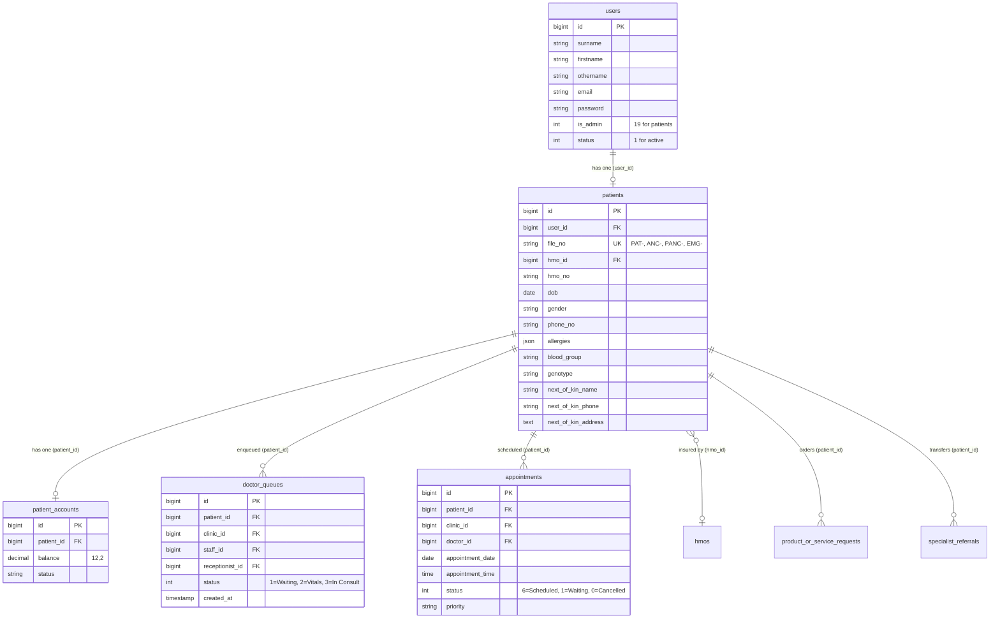

# Reception Database Schemas & Data Model Architecture

<span class="badge-role">AUTHORITATIVE ROLE GUARD: SUPERADMIN | ADMIN | RECEPTIONIST</span>

This technical reference documents the database schemas, Eloquent relationships, observer side-effects, and General Ledger integration invariants powering the Reception Workbench.

---

## 1. Normalized Identity Architecture

CoreHealth v2 strictly decouples clinical folder data from user authentication and personnel records:



---

## 2. Primary Eloquent Models

### `App\Models\Patient`
- **Relationships**:
  - `user()`: `belongsTo(User::class, 'user_id')`
  - `account()`: `hasOne(PatientAccount::class, 'patient_id')`
  - `hmo()`: `belongsTo(Hmo::class, 'hmo_id')`
  - `doctorQueues()`: `hasMany(DoctorQueue::class, 'patient_id')`
  - `appointments()`: `hasMany(Appointment::class, 'patient_id')`
- **Prefix Resolution Helper**:
  ```php
  // Defined in App\Models\Patient:
  public const WORKBENCH_PREFIX_OPTIONS = [
      'maternity' => ['ANC-', 'PANC-'],
  ];

  public static function getPrefixOptionsForWorkbench(?string $workbench): array;
  public static function resolveWorkbenchFromFileNo(?string $fileNo): ?string;
  ```

### `App\Models\DoctorQueue`
- **Relationships**:
  - `patient()`: `belongsTo(Patient::class, 'patient_id')`
  - `clinic()`: `belongsTo(Clinic::class, 'clinic_id')`
  - `staff()`: `belongsTo(Staff::class, 'staff_id')`
  - `receptionist()`: `belongsTo(User::class, 'receptionist_id')`
- **Status Codes**:
  - `1`: Waiting for clinician review.
  - `2`: Vitals pending (queued for nursing triage).
  - `3`: Ready for consultation.
  - `4`: Currently active in consultation room.
  - `5`: Consultation completed.
  - `0`: Inactive or cancelled entry.

---

## 3. Observer Side-Effects & Double-Entry Invariant

CoreHealth v2 relies on 46+ Eloquent observers for ledger balancing, audit tracking, and cloud synchronization:

### 1. `PatientObserver`
- **`created` Event**:
  1. Verifies that an internal wallet record (`patient_accounts`) is initialized.
  2. Creates immutable record in `activity_log`.
  3. Dispatches `DispatchCoreHmsSyncJob::dispatch($patient, 'PATIENT_REGISTERED')` for central multi-facility cloud replication.

### 2. Double-Entry General Ledger Invariant (`PaymentObserver`)
When direct walk-in services are settled at the front desk:
- **Rule**: **NEVER bypass Eloquent models with raw DB queries** (`DB::table('payments')->insert(...)`).
- Always use `Payment::create(...)`.
- `PaymentObserver` automatically generates double-entry records in `gl_transactions`:
  - **Debit**: Current Asset (Cash in Till `1010` or Bank POS `1020`).
  - **Credit**: Department Revenue Account (Laboratory `4010`, Pharmacy `4020`, or Radiology `4030`).
  - Strict balance: $\sum \text{Debits} = \sum \text{Credits}$.

---

## 4. Testing Invariants & MySQL Transaction Isolation

- **Main MySQL Test Database**: Tests must execute against `_corehealth_db_v2_test`. Never configure SQLite or in-memory databases (they fail on MySQL JSON functions and full-text indexes).
- **Transaction Rollbacks**: Every test class must extend `Tests\TestCase` (which leverages the `DatabaseTransactions` trait). Every test executes inside a MySQL transaction and automatically rolls back changes upon completion.
- **Strictly Prohibited**: **NEVER add the `RefreshDatabase` trait.** It would drop pre-seeded hospital tariffs, chart of accounts, and clinic configurations.

---

👉 **[Return to Reception Developer Reference](/developer/workbenches/reception)** | **[View API Contracts](/developer/workbenches/reception/api-contracts)**

