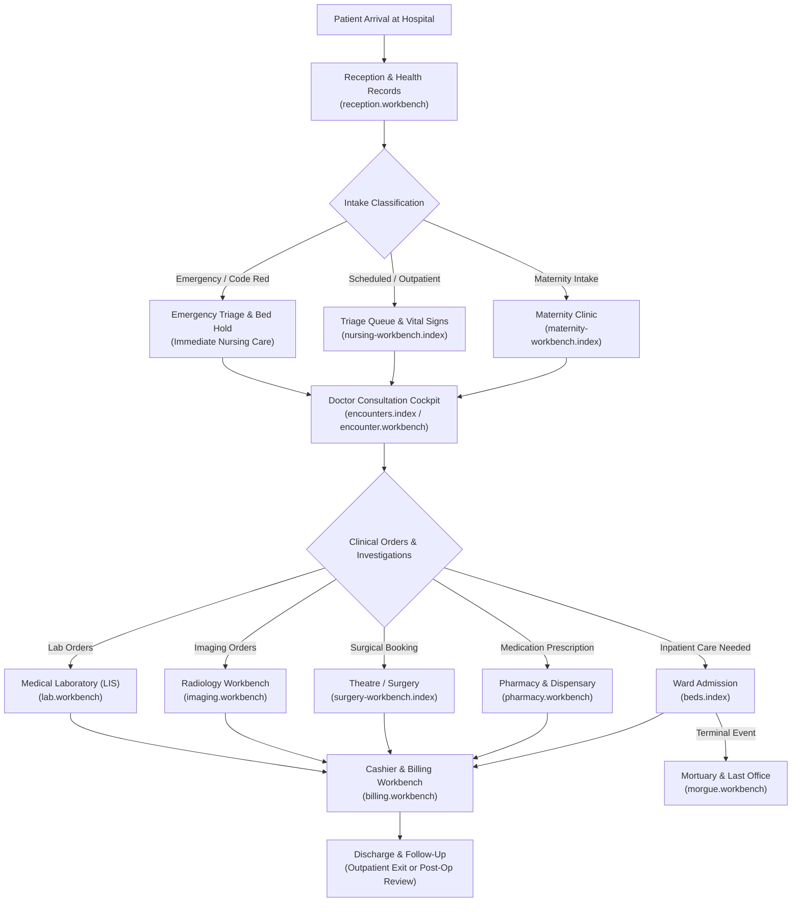
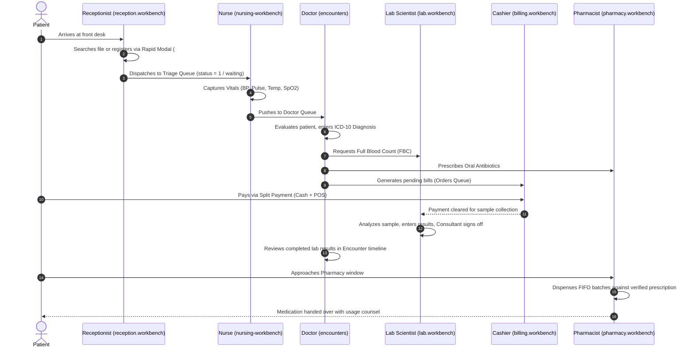

# The Longitudinal Patient Clinical Pathway

In CoreHealth v2, clinical care is designed as a continuous, unified patient narrative rather than disconnected departmental silos. Every interaction—from outpatient registration at Reception to pharmacy dispensing or ward admission—shares a single longitudinal Electronic Health Record (EHR).

---

## 1. Visual Overview: Longitudinal Care Flow

---

## 2. The Hospital Patient Journey Flowchart

---

## 3. Departmental Handoff Sequences

The clinical lifecycle enforces strict cross-module data integrity:

---

## 4. Departmental Navigation Matrix (Fact-Checked)

| Workbench | Real Route Name & URI | Authoritative Role Guard (`sidebar.blade.php`) | Core Purpose | Direct Story Link |
|---|---|---|---|---|
| **Reception & Records** | `reception.workbench` (`/reception/workbench`) | `@hasanyrole('SUPERADMIN\|ADMIN\|RECEPTIONIST')` | Patient file management, triage queue dispatch, rapid registration | [Read Story &rarr;](/user-guides/workbenches/reception) |
| **Doctor Consultation** | `encounters.index` (`/encounters?status=waiting`) | `@hasanyrole('SUPERADMIN\|ADMIN\|DOCTOR')` | Encounter management, ICD-10 diagnosis, clinical order sets | [Read Story &rarr;](/user-guides/workbenches/doctor) |
| **Nursing & MAR** | `nursing-workbench.index` (`/nursing-workbench`) | `@hasanyrole('SUPERADMIN\|ADMIN\|NURSE')` | Vitals triage, medication administration (MAR), fluid balance, consumables | [Read Story &rarr;](/user-guides/workbenches/nursing) |
| **Pharmacy & Dispensary** | `pharmacy.workbench` (`/pharmacy-workbench`) | `@hasanyrole('SUPERADMIN\|ADMIN\|PHARMACIST')` | Prescription fulfillment, FIFO batch tracking, returns & damages | [Read Story &rarr;](/user-guides/workbenches/pharmacy) |
| **Medical Laboratory (LIS)**| `lab.workbench` (`/lab-workbench`) | `@hasanyrole('SUPERADMIN\|ADMIN\|LAB SCIENTIST')` | Specimen accessioning, result entry, dual supervisor approval | [Read Story &rarr;](/user-guides/workbenches/laboratory) |
| **Imaging / Radiology** | `imaging.workbench` (`/imaging-workbench`) | `@hasanyrole('SUPERADMIN\|ADMIN\|RADIOLOGIST')` | Modality worklists, report authoring, DICOM attachments | [Read Story &rarr;](/user-guides/workbenches/imaging) |
| **Theatre & Surgery** | `surgery-workbench.index` (`/surgery-workbench`) | `@hasanyrole('SUPERADMIN\|ADMIN\|SURGERY\|DOCTOR\|NURSE')` | Surgical schedules, WHO checklist, intra-operative team logs | [Read Story &rarr;](/user-guides/workbenches/theatre) |
| **Maternity (ANC/PANC)** | `maternity-workbench.index` (`/maternity-workbench`) | `@hasanyrole('SUPERADMIN\|ADMIN\|MATERNITY')` | Antenatal visits, partographs, delivery records, child wellness | [Read Story &rarr;](/user-guides/workbenches/maternity) |
| **Ward Admissions / Beds** | `beds.index` (`/beds`) | `@hasanyrole('SUPERADMIN\|ADMIN\|NURSE')` | Ward occupancy, bed allocation, nursing rounds, transfer logs | [Read Story &rarr;](/user-guides/workbenches/inpatient) |
| **Billing & Cashier** | `billing.workbench` (`/billing-workbench`) | `@hasanyrole('SUPERADMIN\|ADMIN\|ACCOUNTS\|BILLER')` | Multi-tender checkout, split payments, patient deposits | [Read Story &rarr;](/user-guides/workbenches/billing) |
| **HMO & Insurance** | `hmo.workbench` (`/hmo/workbench`) | `@hasanyrole('SUPERADMIN\|ADMIN\|HMO Executive')` | Tariff management, secondary pre-auth, remittance reconciliation | [Read Story &rarr;](/user-guides/workbenches/hmo) |
| **Store & Inventory** | `inventory.store-workbench.index` (`/inventory/store-workbench`) | `@hasanyrole('SUPERADMIN\|ADMIN\|STORE')` | Multi-store transfers, lane policy approvals, purchase orders | [Read Story &rarr;](/user-guides/workbenches/inventory) |
| **Internal Audit & Ops** | `audit.workbench` (`/audit-workbench`) | `hasAnyRole(['SUPERADMIN', 'ADMIN', 'AUDITOR', 'AUDIT'])` | Duty shift certificates, cashier till balancing, page stamping | [Read Story &rarr;](/user-guides/workbenches/ops-audit) |
| **Mortuary & Last Office**| `morgue.workbench` (`/morgue-workbench`) | `@hasanyrole('SUPERADMIN\|ADMIN\|MORGUE')` | Deceased intake, embalming records, vault storage, release logs | [Read Story &rarr;](/user-guides/workbenches/mortuary) |
| **Human Resources & ESS** | `hr.workbench.index` (`/hr/workbench`) | `@hasanyrole('SUPERADMIN\|ADMIN\|HR MANAGER')` (`@can('hr-workbench.access')`) | Staff records, duty rosters, locum pass issuing, status governance | [Read Story &rarr;](/user-guides/workbenches/hr) |
| **Operational Cockpit** | `home` (`/home`) | Authenticated Staff (Perspective Switcher) | Zero-scroll triage, real-time KPI matrix, role launchpad dock | [Read Story &rarr;](/user-guides/workbenches/cockpit) |
