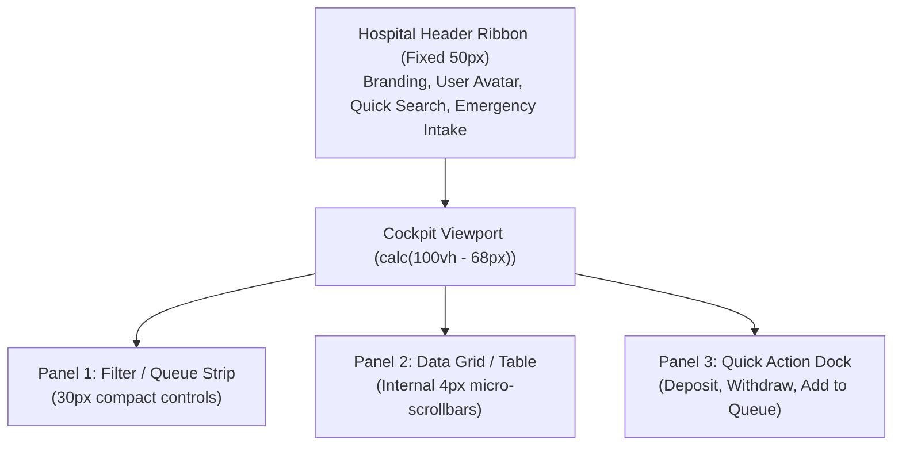

# Zero-Scroll Cockpit Standards & User Experience

CoreHealth v2 departs from traditional, vertically scrolling administrative web pages in favor of an **Operational Cockpit Architecture**. When staff work in acute hospital environments, every second spent scrolling past promotional footers or chasing expanding tables represents lost clinical velocity.

---

## 1. Zero-Scroll Viewport Principles

All major workbenches lock the browser viewport to exactly `100vh`:

### Key UI Invariants
1. **Suppression of App Chrome**: Outer window scrollbars are strictly eliminated on desktop (`overflow: hidden; height: 100vh;`).
2. **Compact Control Heights**: Form inputs, select dropdowns, and search controls are locked to high-density `30px` heights with `0.8125rem` typography.
3. **Micro-Scrollbars**: Internal data grids handle large datasets with custom `4px` non-intrusive scrollbars (`-webkit-scrollbar`).
4. **Baseline Resolution Support**: 100% of triage filters, queues, and action buttons fit comfortably on standard **1366×768** hospital laptop monitors without clipping.

---

## 2. Keyboard Accelerators & Rapid Intake

| Shortcut / Trigger | Action | Context |
|---|---|---|
| `Ctrl + K` / `Cmd + K` | Universal Patient Search | Header Ribbon & Workbenches |
| `Alt + N` | Rapid New Patient Registration Modal | Reception, Billing, Doctor |
| `Alt + W` | Register Outpatient Walk-In | Reception & Billing |
| `Alt + E` | Emergency Code Red Intake | Global Emergency Header |
| `Enter` (in Search) | Auto-select first matching patient file | Search input |
| `Esc` | Close active modal without page refresh | Any active dialog |

---

## 3. Visual Tour: Cockpit Layout Example

Below is the Billing Workbench operating in cockpit mode, showcasing compact action buttons, KPI telemetry, and non-overlapping account panels:

> [!TIP]
> Notice how the Current Balance card, deposit action buttons, and transaction filters are stacked cleanly above the telemetry grid without obscuring transaction records.

