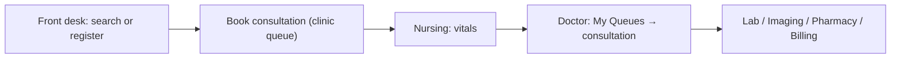

# CoreHealth Staff App

ALL STAFF — you see the same workspaces as on the web

The **CoreHealth Staff App** is one app for every staff member, on a phone, tablet or computer. It shows the same workspaces as the web sidebar, in the same order, and only the ones your roles allow. Some workspaces already have native screens; every other link opens its web page from the app, so nothing is out of reach.

> **Persona:** Mrs. Ada Obi runs the front desk. On her tablet she searches a returning patient, books a consultation into the Medicine clinic, and registers two new patients, all without opening the web workbench. Dr. Bala sees the same patients appear in **My Queues** on his phone.

---

## 1. Sign in and find your workspaces

**Where:** open the app → enter the hospital server address (first time only) → sign in with your staff email and password.

- Patient accounts and deactivated staff cannot sign in to this app.
- **Phone:** the current workspace name is at the top; tap it to switch workspace. The bottom bar shows its main screens; **More** lists the rest.
- **Tablet:** the same, with a navigation rail on the left.
- **Computer:** a full sidebar, exactly like the web, with every workspace and item.

Items marked **Web** aren't native yet: they open the same page on the web (you may need to sign in there too).

---

## 2. Front desk (Health Records)

**Where:** workspace **Health Records** → **Front Desk**.

- **Search patients** by name, file number or phone, then tap a patient to open their record.
- **Today:** new registrations, patients queued, consultations done, pending services.
- **Queue now:** waiting, vitals pending, in consultation, emergency, admitted, and HMO requests waiting for validation.
- **Patient record:** details and HMO, today's queue entries, upcoming appointments and recent visits. **Book consultation** sends the patient to a clinic queue: choose the clinic, optionally a doctor, and the consultation service (the price shown comes from the hospital tariff).

---

## 3. Register a new patient

**Where:** **Health Records** → **New Patient**.

| Field | Required | Notes |
|---|---|---|
| Surname, First name | Yes | At least 2 letters each |
| Gender | Yes | Male, Female or Others |
| Date of birth | Yes | Pick from the calendar |
| File number | No | The next number is filled in; change it only if needed |
| Phone, email, address, other name | No | |
| HMO / scheme and HMO number | No | Leave empty for private (cash) patients |
| Next of kin and phone | No | |

Before saving, the app checks for **possible existing patients** with the same name, phone or date of birth. Open one of them instead of creating a duplicate folder, or choose **Register anyway**. After saving, the new record opens so you can book a consultation straight away.

---

## 4. Intake queue

**Where:** **Health Records** → **Queue**. Filter by **Waiting, Vitals, In consultation, Completed, Emergency** or **Admitted** (each shows its count). Tap a patient to open their record. Pull down to refresh.

---

## 5. Doctors

**Where:** workspace **Doctors**.

- **Dashboard:** today's queue numbers and your recent lab and imaging orders.
- **My Queues:** your patient queue. Open a patient to start or continue the consultation: notes and diagnosis, labs, imaging, prescriptions, procedures, referrals, admission and conclude.
- **Investigations:** all your lab and imaging orders.

---

## 6. Hand-over

Everything the app saves goes through the same hospital system as the web, so billing, queues and records update for every department immediately.

---

## 7. Patients use the patient app

Patients don't sign in to the staff app. They use the **CoreHealth Patient App**: they sign in with their **file number and phone number** and see their own visits, vitals, results, prescriptions, procedures, admissions, referrals and appointments, and can message their own doctors. Nothing they see can belong to another patient.

---

## Developer Reference
👉 **[Native Staff Client developer reference](/developer/native-client)**
