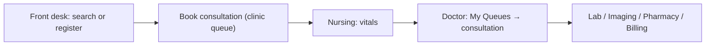

# CoreHealth Staff App

ALL STAFF — you see the same workspaces as on the web

The **CoreHealth Staff App** is one app for every staff member, on a phone, tablet or computer. It shows the same workspaces as the web sidebar, in the same order, and only the ones your roles allow. Some workspaces already have native screens; every other link opens its web page from the app, so nothing is out of reach.

> **Persona:** Mrs. Ada Obi runs the front desk. On her tablet she searches a returning patient, books a consultation into the Medicine clinic, and registers two new patients, all without opening the web workbench. Dr. Bala sees the same patients appear in **My Queues** on his phone.

---

## 1. Sign in and find your workspaces

**Where:** open the app → enter the hospital server address (first time only) → sign in with your staff email and password.

- Patient accounts and deactivated staff cannot sign in to this app.
- **Computer:** a sidebar on the left lists every workspace and item in the web's order. **Collapse** at the bottom shrinks it to icons. The bar along the top shows where you are (*Workspace › Screen*), **Search patients**, **Messenger** and your account.
- **Tablet:** the sidebar shows as icons only; hover or long-press an icon to see its name.
- **Phone:** the current screen and workspace are at the top; tap them to switch workspace. The bottom bar shows the workspace's main screens and **More** lists the rest. The magnifier opens patient search.
- On a computer or tablet, records open **beside the sidebar**, so you never lose your place. Use the back arrow on the record, or tap the sidebar item again to go back to the list.

### Search and the menu filter
The search box in the top bar (**Ctrl K**, **⌘K** on a Mac) is the same search as the web's top bar. It finds pages, features and modules you may use, and marks those already in your menu with **In menu**. Press **Enter** to open a result; **Alt+Enter** (or the target button) shows where it sits in the menu. **Menu (/)** filters the sidebar with what you typed instead.

The **Filter menu** box at the top of the sidebar (press **/**) narrows the menu as you type: type a workspace name to see all of its pages, or part of a page name. **Enter** opens the only match, or searches everywhere when there are several. To find a **patient**, use the search box on the workbench itself (Health Records, Nursing, Billing, Maternity), as on the web.

### Pages that are not in the app yet
Items marked **Web** open their web page. Tap **Open on web**: the page opens in your browser **already signed in** as you, using a one-time link that works once, for one minute, on your device only.

### Clinical Context
On a Nursing or Maternity patient, **Clinical Context** opens the same summary as the web: Encounter Notes, Labs, Imaging, Vitals, Medications, Allergies, Inj/Imm History and Procedures. New lab and imaging results show a red count; opening one marks it as seen.

### Light or dark
Open your account (your initials, top right) → **Appearance** → **System**, **Light** or **Dark**. *System* follows your device. The hospital's colour is kept in both modes.

Items marked **Web** aren't native yet: they open the same page on the web, already signed in (see *Pages that are not in the app yet*).

---

## 2. Front desk (Health Records)

**Where:** workspace **Health Records** → **Front Desk**.

- **Search patients** by name, file number or phone, then tap a patient to open their record.
- **Shortcuts:** **New patient**, **Register walk-in** (`EX-` file numbers), **Emergency intake** (shown only when Hospital Config allows it at reception), **Open queue**, **Today's appointments**, **Referrals**, **HMO validation**, **My transactions**, **Contacts** and **Price list**.
- **Today** and **Queue now** show the same numbers as the web workbench.

### Patient record

Tap a patient to open their record. Every patient record in the app has the same layout:
- **Banner** (top): the patient's name, file number, age and gender, plus badges for HMO, account balance and allergies. The record's main actions sit on the right; **⋮** holds the rest.
- **Clinical alerts strip** under the banner: tap it to add, edit or remove an alert and choose who sees it.
- **Sections:** on a computer they are listed on the left, grouped (e.g. *Activity*); on a phone they are a row of pills under the banner.

The sections match the web workbench:

| Tab | What you can do |
|---|---|
| **Profile** | Demographics, next of kin, medical details, insurance, family members, registration details and old records. **Edit** (pencil) opens the full patient form. |
| **Visits** | Every previous visit with doctor and service. |
| **Service requests** | All lab, imaging, pharmacy, procedure and custom requests with date, type, billing, delivery and department filters, totals (HMO covers / patient pays), details, and **Discard** with a reason. |
| **Appointments** | Appointments with **Check in, Reschedule, Change doctor, Cancel, No-show** and **History** (only the actions the hospital allows for that appointment), plus **New appointment** with clinic time slots. |
| **Admissions** | Admissions with ward, bed, length of stay and the admission bill. |

### Book a service

**Book service** (button on the record): choose **Walk-in (now)** or **Schedule future** (date, time slot or custom time, priority, notes). Each family member can be ticked and booked at the same time with their own service, clinic and doctor. The price the patient pays (and what the HMO covers) appears as soon as a service is chosen. **Force re-bill** charges again inside the free follow-up window. Staff who can take payments go straight to **checkout** for new bills.

### Walk-in sales and checkout

**Walk-in sale** (button on the record): search **Laboratory, Imaging, Pharmacy** (out-of-stock items can't be added) or **Procedures**, or add a **Custom item** (description, price, quantity, department, billable or not). The cart shows what the patient pays after HMO cover. **Checkout & pay** creates the requests and opens checkout; **Recent** lists today's requests to pay or discard.

**Checkout** takes **Cash, POS, Transfer, Mobile money, Split payment** (several methods adding up to the total), **Bill to staff, Bill to organization** or **Account balance** (warns when the balance would go into debit). Quantity and discount can be adjusted per item. The receipt appears after payment.

### Desk panels

- **HMO validation:** pending HMO items; validate one or tick several and validate together, with notes.
- **Referrals:** pending (and booked, referred-out, declined, cancelled, completed) referrals; **View**, **Book into clinic**, **Refer out**, **Decline** (reason required) or **Cancel**.
- **Today's appointments:** all appointments for a day with the same actions as the Appointments tab.
- **My transactions:** your collections for a date range, totals by payment method, and each payment's items.
- **Emergency intake:** existing, new or unidentified patient, arrival, ESI triage level, vitals, Glasgow Coma Scale, pain score, allergies, then **queue for consultation, admit to emergency, direct lab/imaging service** or **morgue (brought in dead)**.

---

## 3. Register a new patient

**Where:** **Health Records** → **New Patient** (or **New patient** / **Register walk-in** on the doctor queue).

| Field | Required | Notes |
|---|---|---|
| Surname, First name | Yes | At least 2 letters each |
| Gender | Yes | Male, Female or Others |
| Date of birth, age or age group | Yes | Enter the date, an age in years/months/days, or an age group |
| File number | No | The next number is filled in; tap refresh for the latest |
| Phone, email, address, referred from | No | Quick chips: Self, Family/Friend, Doctor, Hospital/Clinic, Outreach, Corporate |
| Photo and old records | No | Take or upload a photo (2 MB); attach old records (PDF, Word or image, 5 MB) |
| Blood group, genotype, disability, nationality, ethnicity, allergies, history, notes | No | Allergies become red alerts everywhere |
| Next of kin name, phone, address | No | |
| Coverage and HMO number | No | Private or an HMO |
| Family principal / link to principal | No | Links the household |
| Registration fee | No | Bills the chosen registration service |

The app checks for **possible existing patients** first, then shows a **summary** to confirm before saving.

---

## 4. Intake queue

**Where:** **Health Records** → **Queue**. Filter by **Waiting, Vitals, Ready, In consultation, Completed, Emergency** or **Admitted**, or open **Today's appointments, Pending referrals** and **HMO validation**. Tap a patient to open their record. Pull down to refresh.

---

## 5. Doctors

**Where:** workspace **Doctors** → **My Queues**.

- **Ribbon:** New patient, Register walk-in (`DOC-` numbers), Emergency intake (when enabled for doctors), Contacts, Price list.
- **Today's Queue:** counts, date range and status filters; **Check in, Reschedule, Reassign, No-show, Cancel**; start or resume the consultation.
- **Calendar:** your week of appointments and queue entries.
- **History:** previous encounters (tap one to open it), my/other admissions, my and all referrals.

### The consultation

The header shows the patient, clinic and admission status, the **consultation timer** (tap to pause or resume; it is kept on the server like the web), **Admit** or **Discharge**, and the **⋮ menu**: Edit patient, Clinical alerts, Refer, **Order sets & bundles**, **AI Scribe Studio**, **Medical report**, Patient profiles.

Tabs follow the web: **Treatment Plans** (when switched on in Hospital Config), **Clinical Story**, Vitals (with trend chart), Nurse Charts (fluid and solid intake/output: start, record, end), Inj/Imm, **Notes** (diagnoses with status and course, **favourites**, templates, dictation, **AI polish**; autosaves every 10 seconds), Labs and Imaging (**Perform / Enter / Edit result** when the hospital allows; unviewed results counted on the tab), Meds (**Simple** or **Structured** dosing, starting with the hospital's default), **Care Plan**, Procedures, Admissions, Referrals, Med Chart (tap a drug to schedule, give, edit, discontinue or resume), History and Summary.

- **Order sets & bundles:** apply a treatment-plan template (pick its items), a service bundle, or re-order items from a past encounter; save this encounter's orders as a template.
- **AI Scribe Studio:** read the AI patient briefing, dictate or type the consultation, **Structure note** in Clerking, SOAP or POMR, review the catalog-matched orders, then **Sign & commit**. The note is saved to the encounter and the ticked orders are sent.

- **Medical report:** sections like the web report, one-tap patient data, save as draft or **Finalize**. Print from the web.

- **Conclude:** review the seven summary cards, choose the **outcome** (death outcomes ask for date, time and cause), optionally schedule a **follow-up** (date, slot, priority, notes, pre-paid), then **Complete encounter**.

---

## 6. Hand-over

## Billing desk
Open **Billing → Billing Desk** (*Payments*). Start your shift from the top right; the shift badge shows what you have collected. Tap a tile to list a payment queue (Emergency, All unpaid, HMO items, Credit accounts), or use **Search patients** (Ctrl K). A patient's bill has sections: **Billing** (select items, adjust quantity and discount, **Pay** by cash, POS, transfer, mobile, split, account balance, staff or organisation, or print an **Invoice**), **Walk-in**, **Receipts**, **Admissions** (bill by category) and **Account** (deposit, withdraw, adjust, statement). Receipts show as readable text; printing stays on the web.

## Nursing desk
Open **Nursing → Nursing Desk** (*Ward care*). Your shift status is at the top right: **Start shift** (choose the ward and acknowledge waiting handovers) or **End shift**. The tiles show each queue's count; tap one to list it: **Admitted**, **Vitals due**, **Medication due**, **Bed requests**, **Discharge** or **Deceased**. Use **Search patients** (Ctrl K) to find anyone else. **Ward dashboard** is the main action; **Handovers**, **Emergency intake** and **Register walk-in** are beside it, and **More** has New patient, Reports, Outreach tallies and Contacts. The **Ward dashboard** shows beds by ward, who is waiting for a bed (assign one) and bed maintenance.

A patient record has sections grouped as *Clinical*, *Care*, *Orders & billing* and *Admission*:

 **Vitals** (record and edit your own within the edit window), **Medications** (tap a drug to chart doses), **Charts** (notes and intake/output), **Injections** (from ward stock, a dispensed prescription or the patient's own drug), **Immunizations** (generate the schedule, give or skip each dose), **Requests** (labs, imaging, procedures, prescriptions, service and consumable bills) and, for admitted patients, **Admission** (bed, checklists, discharge). On a patient, **Clinical story** shows the same timeline the doctor sees, and the sparkle button opens the **AI Scribe Studio**: dictate, pick Focus DAR, SBAR or SOAPIE, review the note and the orders it found (check each drug and test is the right one, use *Match catalog* if not), then **Sign & commit**. The note is filed under the note type shown (default *Others*). On **Medications**, **Add drug** charts a ward-stock or patient's-own drug that has no prescription: set a schedule or give a dose now; ward stock is taken from the chosen store and billed unless you switch billing off. **Requests** has the order sets (re-order from an earlier encounter, shared treatment plan templates, bundles). Picking a bundle shows its price and every item before you apply it; the **Bundles** list then lets you remove a single item (with a reason) or the whole bundle. **Billing** raises service, lab, imaging and consumable bills and shows the billing history. **Surgery Workbench** and **Manage Beds** are in the Nursing menu, and **Reports** is on the desk. End your shift to create the handover for the next nurse. Surgery and bed setup open on the web.

## Maternity desk
Open **Maternity → Maternity Desk**. Search for a mother (patients who are not enrolled show **Enrol**), or choose from the queues: **Active ANC**, **Due visits**, **High risk**, **Upcoming EDD**, **Postnatal**, **Overdue immunization**, **Admitted**, **Bed requests** and **Discharge**.

An enrolment opens with the **Overview**: gestation today, days to EDD, ANC visits and risk at a glance, then the booking details and the timeline. **Edit enrolment**, the **ANC card**, the **Road-to-health card** and **Discharge from care** are under **⋮** in the banner. The sections are grouped as *Pregnancy*, *Birth*, *Care*, *Orders & billing* and *Records*:

Sections: **Overview**, **ANC** (visits), **History** (medical history and previous pregnancies), **Orders** (labs, imaging, procedures, prescriptions), **Delivery**, **Partograph**, **Babies** (tap a baby for details, growth and immunization), **Postnatal**, **Immunization** (the mother's schedule), **Vitals**, **Notes** and **Audit**. **Billing**, **Investigations**, the order sets and bundles work as in Nursing. **Clinical story** and the **AI Scribe Studio** (Antenatal, Labour & delivery, Postnatal, Neonatal) are on the enrolment too. The **ANC card** and **Road-to-health card** open in the app as text (printing the layout stays on the web); **Outreach** and **Reports** are on the desk.

Everything the app saves goes through the same hospital system as the web, so billing, queues and records update for every department immediately.

---

## 7. Patients use the patient app

Patients don't sign in to the staff app. They use the **CoreHealth Patient App**: they sign in with their **file number and phone number** and see their own visits, vitals, results, prescriptions, procedures, admissions, referrals and appointments, and can message their own doctors. Nothing they see can belong to another patient.

---

## Developer Reference
👉 **[Native Staff Client developer reference](/developer/native-client)**
