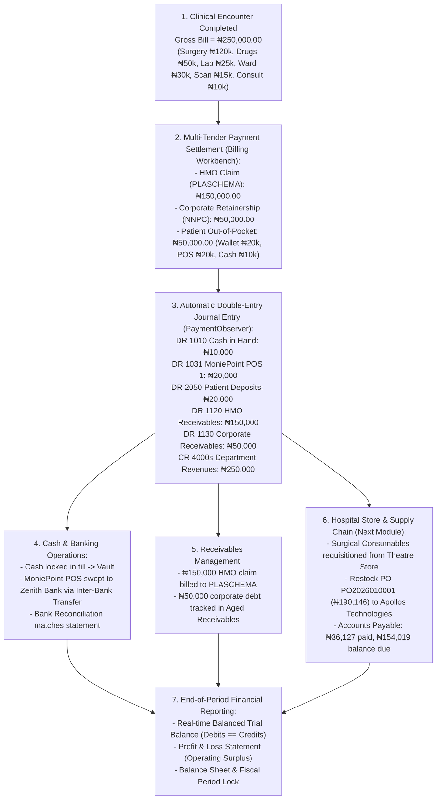

# Financial Accounting, General Ledger & Fund Governance

ROLE GUARD: SUPERADMIN | ADMIN | super-admin | ACCOUNTS

The **Accounting Workbench** is the financial command center of CoreHealth v2. It enforces strict double-entry bookkeeping, maintains real-time general ledger balancing, automates revenue attribution from clinical workbenches, governs supplier disbursements, tracks aged receivables, and produces statutory financial statements (IFRS / SAS).

---

## 1. Visual Tour: Financial Control Center

> [!NOTE]
> The **Accounting Dashboard** provides instant visibility over the active fiscal period (*November 2026*), frequently used quick actions (New Journal Entry, Trial Balance, P&L, Balance Sheet), core navigation cards, and live operational stats (Total Entries, Monthly Revenue, Monthly Expenses).

---

## 2. "Follow the Money": The Canonical Hospital Financial Story

To understand how money moves across CoreHealth v2, follow the concrete journey of patient **Oladipo Amina (File No: `14-32-97`)**, admitted for an Elective Laparoscopic Appendectomy with a total gross bill of **₦250,000.00**:

---

## 3. Comprehensive Accounting Subpages

Every single accounting module listed on the Accounting Dashboard is exhaustively documented in the dedicated subpages below:

### 1. Chart of Accounts & General Ledger
👉 **[Read Guide: Chart of Accounts & GL](/user-guides/workbenches/accounting/chart-of-accounts-and-gl)**
- **5-Class Account Hierarchy**: Assets (1000s), Liabilities (2000s), Equity (3000s), Revenue (4000s), Expenses (5000s).
- **Double-Entry Journal Entries**: Automated clinical transaction logs and compound manual journal entry creation.
- **Fiscal Periods & Locking**: Monthly period closure, preventing backdated tampering, and annual retained earnings rollover.
- **Opening Balances**: Baseline balance sheet migration and historical trial balance setup.

### 2. Banking, Cashbook & Reconciliations
👉 **[Read Guide: Banking & Cashbook](/user-guides/workbenches/accounting/banking-and-cashbook)**
- **Bank Registry & Cashbook**: Managing operational bank accounts, merchant POS clearing accounts, and vault registers.
- **Inter-Account Transfers**: Sweeping POS collections to operating treasury accounts with two-step clearance.
- **Bank Reconciliation Engine**: Statement upload, automated matching algorithm, unpresented cheques, and bank charge adjustments.
- **Petty Cash Imprest**: Custodian floats, disbursement voucher workflows, receipt attachments, and replenishment JEs.

### 3. Receivables, Payables, Store POs & Expenses
👉 **[Read Guide: Payables, Expenses & Receivables](/user-guides/workbenches/accounting/payables-expenses-and-deposits)**
- **Aged Receivables & Debtors**: 30/60/90-day aging buckets, patient overdraft recovery, HMO claim batches, and staff medical payroll deductions.
- **Purchase Orders (POs) & Store Scaffolding**: Connecting directly to the Store Workbench! PO workflows (Create &rarr; Approve &rarr; Goods Receive Note GRN &rarr; Stock Sync).
- **Accounts Payable (AP)**: Vendor invoice processing, supplier payments (e.g. *Apollos Technologies*), and payment vouchers.
- **Hospital Expenses**: Operational vouchers for generator diesel, oxygen refilling, and hospital maintenance.
- **Patient Deposits & Credit Notes**: Managing hospital customer prepayment liabilities and issuing approved clinical refunds.

### 4. Assets, Liabilities, Leases, Cost Centers & Budgets
👉 **[Read Guide: Assets, Liabilities & Budgets](/user-guides/workbenches/accounting/assets-liabilities-and-budgets)**
- **Fixed Asset Register**: Capitalizing medical equipment (e.g. *Laparoscopic Surgical Tower*).
- **Automated Depreciation Engine**: Monthly straight-line depreciation runs and accumulated depreciation JEs.
- **Liabilities & IFRS 16 Leases**: Amortizing bank loans and calculating Right-of-Use (ROU) asset lease schedules.
- **Departmental Cost Centers**: Revenue and expense attribution across General Outpatient, Surgery, Laboratory, and Pharmacy.
- **CAPEX Projects**: Tracking Work-In-Progress (WIP) hospital infrastructure expansion before asset capitalization.
- **Budgets & Variance Analysis**: Setting departmental targets and flagging negative expenditure variances.
- **Cash Flow Forecast**: 30-day liquidity projections modeling patient inflows, HMO collections, and supplier obligations.

### 5. Financial Reports, Statements & Audit
👉 **[Read Guide: Financial Reports & Audit](/user-guides/workbenches/accounting/financial-reports-and-audit)**
- **Core Financial Statements**: Trial Balance, Profit & Loss (Income Statement), Balance Sheet, and Cash Flow Statement.
- **Audit Trails & Ledgers**: Chronological General Ledger transaction drilldown, account activity history, and auditor verification stamps.
- **Financial KPIs**: Monitoring current ratios, operating margins, and Days Sales Outstanding (DSO).

---

## 4. Upstream Store & Hospital Procurement Connection

The Accounting Workbench connects directly to the **Store & Inventory Workbench** (our next comprehensive module):
- Most hospital expenses do not originate in the finance office; they begin in the Store when consumables (gauze, gloves, sutures, IV lines) and pharmaceutical drugs are requisitioned by clinical units.
- Store managers initiate **Purchase Orders (POs)** to suppliers. When goods are delivered, the Store issues a **Goods Receive Note (GRN)** which automatically generates an **Accounts Payable Voucher** in Accounting.
- This automated bridge guarantees that inventory asset values on the Balance Sheet match physical store stock at all times.

---

## Developer Reference
👉 **[Read Accounting Architecture & API Contracts](/developer/workbenches/accounting/api-contracts)**  
👉 **[Read Accounting Database Schema & Observers Reference](/developer/workbenches/accounting/database-and-models)**
