# Fixed Assets, IFRS 16 Leases, Cost Centers, CAPEX & Budgets

ROLE GUARD: SUPERADMIN | ADMIN | super-admin | ACCOUNTS | AUDIT

The **Capital Governance & Planning** subsystem manages hospital property, medical plant and equipment, automated IFRS-compliant depreciation schedules, IFRS 16 lease liability amortization, departmental cost centers, capital expenditure (CAPEX) infrastructure projects, annual departmental operating budgets, and 30-day cash flow liquidity forecasts.

---

## 1. Visual Tour: Capital Equipment & Assets

> [!NOTE]
> The **Fixed Assets Register** catalogs high-value hospital equipment (Laparoscopic Surgical Towers, MRI Scanners, Ultrasound Machines, ICU Ventilators) with asset tags, serial numbers, acquisition dates, purchase costs, and real-time net book values (NBV).

---

## 2. Stepped Capital & Budgetary Flow

```mermaid
flowchart TD
    subgraph Fixed Assets & Depreciation
        A["1. Capital Equipment Acquired:<br/>Laparoscopic Surgical Tower<br/>Cost = ₦12,000,000.00 (5-Yr Useful Life)"] --> B["Asset Registered & Tagged (AST-2026-0089)"]
        B --> C["2. Monthly Depreciation Run:<br/>Engine calculates straight-line ₦200,000/month<br/>DR 5050 Depreciation Expense, CR 1590 Accumulated Depreciation"]
    end

    subgraph Cost Center Margins
        D["Oladipo Amina Appendectomy Surgery"] --> E["3. Departmental Cost Center (General Surgery):<br/>Revenue: ₦120,000.00<br/>Direct Consumables: ₦45,000.00 (Trocar, Sutures, Gas)<br/>Gross Margin: ₦75,000.00 (62.5% contribution)"]
    end

    subgraph Infrastructure Projects & Leases
        F["Hospital Expansion Plan"] --> G["4. CAPEX Project: ICU Wing WIP (₦45M Budget)"]
        G --> H["Milestones verified & capitalized into Fixed Asset Register"]
        I["Dialysis Center Building Lease"] --> J["5. IFRS 16 Lease Schedule:<br/>ROU Asset & Lease Liability Amortization"]
    end

    subgraph Budgetary Governance & Liquidity
        K["6. Annual Operating Budget:<br/>Surgical Dept: ₦15M Budget vs Actuals"] --> L["Variance Analysis Alert"]
        M["7. 30-Day Cash Flow Forecast:<br/>Projects ₦154k AP due vs HMO receivables"]
    end
```

---

## 3. Fixed Asset Register & Automated Depreciation Engine

Hospitals depend on complex biomedical technology whose capital costs must be accurately amortized over their clinical lifespan:

### 1. Clinical & Operational Objective
Maintain an audit-proof register of all biomedical and facility assets, track physical locations, and automate monthly straight-line depreciation postings to the General Ledger without manual journal calculation.

### 2. Exact UI Location / Where to Click
- Navigate to **Accounting** &rarr; **Fixed Assets** (`/accounting/fixed-assets`).
- To register a new medical machine, click **`+ New Asset`** (`#btn-create-asset` or `/accounting/fixed-assets/create`).

### 3. Registering the Laparoscopic Surgical Tower
- **Asset Name (*Required)**: `Karl Storz HD Laparoscopic Surgical Tower`.
- **Asset Code / Tag (*Required)**: `AST-2026-SURG-0089`.
- **Category (*Required)**: Select `Medical & Surgical Equipment (1520)`.
- **Department / Location (*Required)**: `Main Operating Theatre - Suite 1`.
- **Acquisition Date (*Required)**: `01 Jan 2026`.
- **Purchase Cost (*Required)**: `₦12,000,000.00`.
- **Salvage / Residual Value (*Optional)**: `₦0.00`.
- **Useful Life (Months) (*Required)**: `60` (5 Years).
- **Depreciation Method (*Required)**: `Straight Line`.

### 4. Running the Automated Depreciation Engine
1. At the end of every calendar month, click **`Run Monthly Depreciation`** (`#btn-run-depreciation`).
2. The engine evaluates all active fixed assets:
   $$\text{Monthly Depreciation} = \frac{\text{Purchase Cost} - \text{Salvage Value}}{\text{Useful Life in Months}} = \frac{₦12,000,000 - ₦0}{60} = \mathbf{₦200,000.00 / \text{month}}$$
3. It automatically posts a compound General Ledger entry:
   - **`DR 5050 Medical Equipment Depreciation Expense`**: `₦200,000.00`
   - **`CR 1590 Accumulated Depreciation - Medical Equipment`**: `₦200,000.00`
4. The Net Book Value (NBV) on the asset detail card automatically decrements to `₦11,800,000.00`.

---

## 4. IFRS 16 Leases & Long-Term Liabilities

Under **IFRS 16**, operating leases (such as leased hospital annex buildings or vendor reagent-placement analyzers) cannot remain off-balance sheet:

### 1. Clinical & Operational Objective
Capitalize long-term clinical property and high-value analyzer leases as **Right-of-Use (ROU) Assets** with corresponding **Lease Liabilities**, computing interest expense and principal reductions automatically.

### 2. Exact UI Location / Where to Click
- Navigate to **Accounting** &rarr; **Leases (IFRS 16)** (`/accounting/leases`).
- To create a lease agreement, click **`+ New Lease`** (`/accounting/leases/create`).

### 3. Dialysis Wing Building Lease Parameters
- **Lease Title (*Required)**: `Dialysis Wing Facility Lease - 3-Year Tenancy`.
- **Lessor (*Required)**: `Prime Properties Investment Ltd`.
- **Commencement Date (*Required)**: `01 Jan 2026` (Duration: 36 Months).
- **Monthly Lease Payment (*Required)**: `₦500,000.00`.
- **Discount Rate (Incremental Borrowing Rate) (*Required)**: `12.0% per annum`.
- **Initial ROU Asset & Liability**: Engine calculates present value ($PV$) of future cash flows: **`₦15,432,600.00`**.
- **Downstream Journal Generation**:
  - Initial Capitalization: `DR 1580 Right-of-Use Asset (₦15.43M)`, `CR 2520 Lease Liability (₦15.43M)`.
  - Monthly Settlement: When ₦500,000 is paid via Zenith Bank, the engine splits the payment: `DR 2520 Lease Liability (Principal reduction ₦345,674)`, `DR 5070 Lease Finance Interest (₦154,326)`, `CR 1020 Zenith Bank (₦500,000)`.

---

## 5. Departmental Cost Centers & Profitability Margins

### "Follow the Money": General Surgery Margin on Oladipo Amina's Procedure
To understand departmental profitability, hospital operations are divided into distinct Cost Centers:

### 1. Clinical & Operational Objective
Attribute revenues and direct consumable costs to specific clinical delivery units, calculating gross contribution margins and distributing shared hospital overheads (electricity, administration).

### 2. Exact UI Location / Where to Click
- Navigate to **Accounting** &rarr; **Cost Centers** (`/accounting/cost-centers`).
- Click on **`General Surgery & Operating Theatre`** (`/accounting/cost-centers/3`).

### 3. Financial Margin Breakdown
When *Oladipo Amina's* appendectomy was concluded:
- **Revenue Earned**:
  - Surgery & Theatre Fee: `₦120,000.00`
- **Direct Costs Incurred (from Store Workbench GRN)**:
  - Laparoscopic Trocar (10mm): `₦8,500.00`
  - Vicryl Sutures (2 boxes): `₦8,400.00`
  - Surgical Gowns & Gloves: `₦6,321.90`
  - Anaesthesia Gases (Petty Cash voucher): `₦12,500.00`
  - Recovery Medication: `₦9,278.10`
  - **Total Direct Consumable Cost**: **`₦45,000.00`**
- **Contribution Margin Calculation**:
  $$\text{Gross Contribution} = ₦120,000.00 - ₦45,000.00 = \mathbf{₦75,000.00 \quad (62.5\% \text{ Gross Margin})}$$
- **Overhead Allocation**: At month-end, the Cost Center controller runs **`Run Overhead Allocation`** (`/allocations/run`) to apportion shared hospital power (₦60,060 diesel expense) based on floor square meters.

---

## 6. CAPEX Projects & Infrastructure WIP

When the hospital undertakes multi-stage capital construction (e.g. building a New Intensive Care Unit Wing):

### 1. Clinical & Operational Objective
Aggregate contractor invoices, architectural fees, and building materials into a **Capital Work-In-Progress (CWIP)** account (`1595`) without prematurely expensing them, until final commissioning when the completed building is capitalized into the Fixed Asset Register.

### 2. Exact UI Location / Where to Click
- Navigate to **Accounting** &rarr; **CAPEX** (`/accounting/capex`).
- Click **`+ New CAPEX Project`** (`#btn-create-capex` or `/accounting/capex/create`).

### 3. Step-by-Step CAPEX Lifecycle
1. **Project Initiation**:
   - Project Name: `Phase 2 New ICU Wing & High-Dependency Unit`.
   - Approved Budget: `₦45,000,000.00`.
   - Status: `APPROVED & IN PROGRESS`.
2. **Recording Milestone Expenses**:
   - When contractor submits Milestone 2 invoice (₦12,500,000 for electrical and HVAC medical gas piping):
   - Click **`Record Project Expense`** (`/accounting/capex/{id}/expense`).
   - The engine posts:
     - **`DR 1595 Capital Work-In-Progress (CWIP)`**: `₦12,500,000.00`
     - **`CR 2010 Accounts Payable (Contractor)`**: `₦12,500,000.00`
3. **Commissioning & Capitalization**:
   - When construction finishes, the Chief Engineer signs off the handover certificate.
   - Click **`Complete & Capitalize Asset`** (`/accounting/capex/{id}/complete`).
   - The engine automatically transfers the cumulative ₦45M CWIP balance into **`1510 - Hospital Buildings & Infrastructure`** and sets up its 25-year depreciation schedule.

---

## 7. Budgets & Variance Analysis

### 1. Clinical & Operational Objective
Establish annual spending ceilings for clinical departments, track actual general ledger expenditures against monthly allocations, and flag negative variances before budget exhaustion.

### 2. Exact UI Location / Where to Click
- Navigate to **Accounting** &rarr; **Budgets** (`/accounting/budgets`).
- Select the active annual budget: **Fiscal Year 2026 Master Operating Budget**.

### 3. Departmental Budget Governance
- **Surgical Department Annual Allocation**: `₦15,000,000.00` (Monthly Quota: `₦1,250,000.00`).
- **Actual Monthly Spend**: `₦845,000.00` (Consumables, sutures, petty cash oxygen).
- **Variance Analysis**:
  $$\text{Variance} = \text{Budget} - \text{Actual} = ₦1,250,000.00 - ₦845,000.00 = +\mathbf{₦405,000.00 \text{ (Favorable Variance)}}$$
- **Variance Report**: Navigate to `/accounting/budgets/variance-report` to export departmental variance statements for the Hospital Board of Governors.

---

## 8. 30-Day Cash Flow Forecast

### 1. Clinical & Operational Objective
Model anticipated hospital cash inflows and contractual outflows over a 30-day forward horizon, detecting prospective liquidity deficits before obligations fall due.

### 2. Exact UI Location / Where to Click
- Navigate to **Accounting** &rarr; **Cash Flow Forecast** (`/accounting/cash-flow-forecast`).
- Click **`Generate Forecast Model`** (`/accounting/cash-flow-forecast/create`).

### 3. Forecasting Logic & "Follow the Money" Integration
The forecasting engine dynamically synthesizes data across workbenches:
1. **Expected Operating Inflows**:
   - Patient Cash & POS daily projections: `+₦3,500,000.00`.
   - Matured HMO Claim Collections (including PLASCHEMA ₦150k claim): `+₦4,200,000.00`.
   - Corporate Retainership settlements (NNPC ₦50k): `+₦1,800,000.00`.
2. **Committed Operating Outflows**:
   - Accounts Payable due dates (including *Apollos Technologies* ₦154,019.00 balance): `-₦2,650,000.00`.
   - Monthly Staff Payroll (due 25th of month): `-₦4,800,000.00`.
   - Dialysis Lease installment: `-₦500,000.00`.
   - Generator Diesel bulk replenishment: `-₦250,000.00`.
3. **Liquidity Net Projection**:
   - The forecast graph reveals positive liquidity with closing cash reserves projected above `₦3,800,000.00`, ensuring the hospital meets all payroll and vendor obligations smoothly.

---

## Downstream Financial Impact
- **Asset Integrity**: Real-time fixed asset tracking prevents ghost assets and ensures hospital balance sheets reflect true depreciated values.
- **Cost Discipline**: Cost center gross margins show clinical directors which surgical procedures generate surplus versus those running at a loss.
- **Solvency Assurance**: The 30-day cash forecast guarantees that procurement orders on the Store Workbench are only approved when future liquidity permits.

---

## Developer Reference
👉 **[Read Accounting Architecture & API Contracts](/developer/workbenches/accounting/api-contracts)**  
👉 **[Read Accounting Database Schema & Observers Reference](/developer/workbenches/accounting/database-and-models)**

