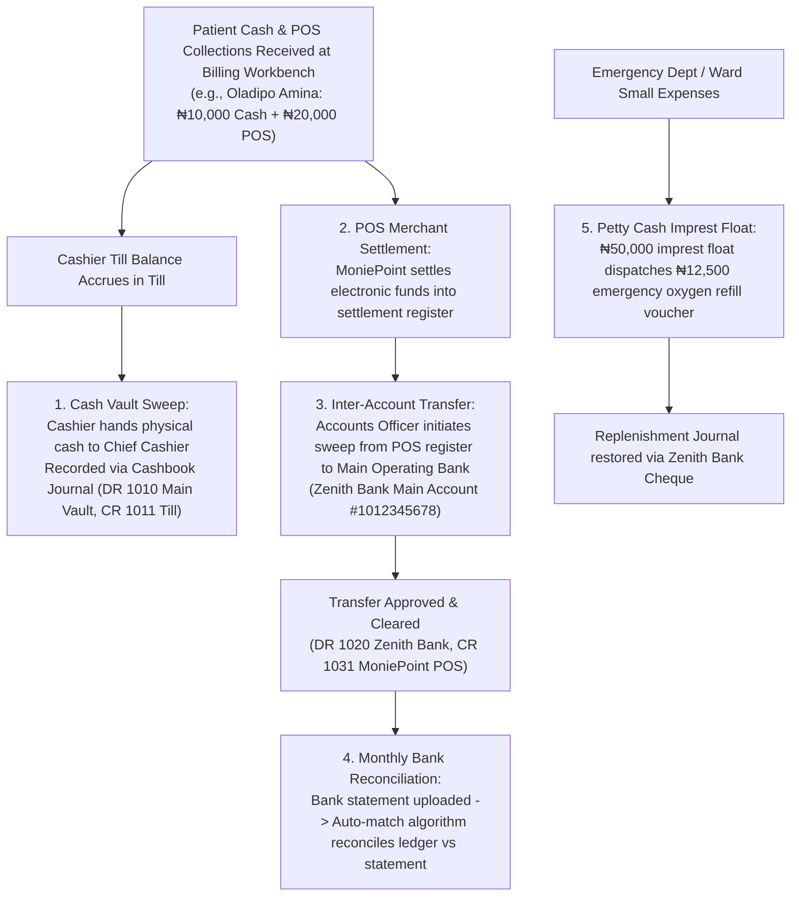

# Banking, Cashbook, Sweeps & Petty Cash Imprest

ROLE GUARD: SUPERADMIN | ADMIN | super-admin | ACCOUNTS | AUDIT

The **Banking & Cash Management** subsystem governs hospital liquidity across physical currency vaults, electronic POS merchant settling terminals, commercial bank operating accounts, inter-account transfers, automated bank reconciliation, and departmental petty cash floats.

---

## 1. Visual Tour: Banking & Treasury Governance

> [!NOTE]
> The **Bank Registry** maintains all hospital banking partners (Zenith Bank, First Bank, MoniePoint POS clearing accounts). It tracks live account balances, account numbers, branch routing, and active statuses.

---

## 2. Stepped Treasury & Liquidity Lifecycle

---

## 3. Operational Bank Accounts & POS Clearing Registry

Hospitals operate multiple commercial accounts for operational separation (Operations, Payroll, Collections, HMO Claims):

### 1. Clinical & Operational Objective
Configure commercial bank accounts and merchant POS terminals to receive clinical patient collections, ensure automated ledger linking, and prevent commingling of hospital funds.

### 2. Exact UI Location / Where to Click
- Navigate to **Banking** &rarr; **Bank Accounts** (`/banks` or `/accounting/banks`).
- To add a new operational or collection account, click the green **`+ Add Bank`** button (`#btn-create-bank`).

### 3. Required vs Optional Fields, Types & Variations
- **Bank Name (*Required)**: Select the financial institution from the standardized Nigerian banking list (e.g. `Zenith Bank Plc`, `MoniePoint MFB`, `Access Bank`).
- **Account Name (*Required)**: Exact registered entity name (e.g. `CoreHealth Specialist Hospital - Revenue Account`).
- **Account Number (*Required)**: 10-digit NUBAN string (e.g. `1012345678`).
- **Account Type (*Required)**:
  - `Operating Account`: Main operating account for hospital expenditure and payroll.
  - `Collection Account / POS Terminal`: Virtual or physical merchant account tied to cashier billing desks.
  - `Petty Cash Holding`: Dedicated imprest account.
- **GL Account Code (*Required)**: Select the mapped General Ledger Asset account (`1020 - Zenith Bank Operating`, `1031 - MoniePoint POS 1`).
- **Opening Balance (*Optional)**: Starting ledger balance if migrating mid-fiscal year (e.g. `₦4,500,000.00`).
- **Is Active**: Checked by default. Disabling suspends the bank from appearing in Billing Workbench payment drop-downs.

### 4. Downstream Handover
Once saved, the bank becomes immediately selectable in the Billing Workbench checkout modal and the Inter-Account Transfer engine.

---

## 4. Inter-Account Transfers & Daily Sweeps

### "Follow the Money": Sweeping Patient Oladipo Amina's POS Collection
In our canonical story, patient *Oladipo Amina* paid **₦20,000.00** via MoniePoint POS Terminal 1. At 17:00 close of business, the Accounts Officer sweeps accumulated POS collections from the clearing account into the main hospital treasury:

### 1. Clinical & Operational Objective
Transfer electronic collections from secondary merchant accounts (MoniePoint, Paystack) or physical cash vaults into primary interest-bearing operating accounts with a 2-step approval and clearance audit trail.

### 2. Exact UI Location / Where to Click
- Navigate to **Accounting** &rarr; **Transfers** (`/accounting/transfers`).
- Click the dark blue **`+ New Transfer`** button (`#btn-new-transfer` or route `/accounting/transfers/create`).

### 3. Required vs Optional Fields, Types & Variations
- **Source Account (*Required)**: Select `1031 - MoniePoint POS 1` (Balance: `₦350,000.00`).
- **Destination Account (*Required)**: Select `1020 - Zenith Bank Operating` (Balance: `₦4,500,000.00`).
- **Transfer Amount (*Required)**: Enter `₦20,000.00` (or the daily batch total e.g. `₦180,000.00`).
- **Transfer Date (*Required)**: Defaults to today (`09 Nov 2026`).
- **Reference / Narration (*Required)**: Enter `SWEEP-20261109-POS1 - Daily POS settlement sweep`.
- **Payment Method (*Required)**: Select `Electronic Bank Transfer` (NIP / RTGS).
- **Transfer Slip / Receipt (*Optional)**: Upload banking transaction screenshot or PDF slip.

### 4. Downstream Handover & Approval Workflow
1. **Initiation**: The transfer is saved with status `PENDING APPROVAL`.
2. **Review & Approval**: The Financial Controller opens `/accounting/transfers/{transfer}` and clicks **`Approve Transfer`** (`#btn-approve-transfer`).
3. **Double-Entry Impact**: The system automatically executes:
   - **`DR 1020 Zenith Bank Operating`**: `+₦20,000.00`
   - **`CR 1031 MoniePoint POS 1`**: `-₦20,000.00`
4. **Clearance Confirmation**: When the funds reflect on Zenith Bank's corporate online portal, the treasury clerk clicks **`Confirm Clearance`** (`#btn-confirm-clearance`), updating status to `CLEARED`.

---

## 5. Bank Reconciliation Engine & Auto-Matching

### 1. Clinical & Operational Objective
Reconcile internal hospital general ledger records against the official commercial bank statement, identifying unpresented cheques, uncleared lodgments, bank charges, and interest income.

### 2. Exact UI Location / Where to Click
- Navigate to **Accounting** &rarr; **Bank Reconciliation** (`/accounting/bank-reconciliation`).
- To initiate reconciliation for Zenith Bank, click **`Start Reconciliation`** (`/accounting/bank-reconciliation/create/1`).

### 3. Stepped Reconciliation Workflow
1. **Statement Header & Dates**:
   - **Reconciliation Period**: Select `01 Nov 2026` to `30 Nov 2026`.
   - **Statement Ending Balance (*Required)**: Enter verified bank balance from the physical/PDF bank statement (e.g. `₦4,680,447.50`).
2. **Upload Electronic Statement**:
   - Click **`Upload Statement`** (`#btn-upload-statement`).
   - Drag and drop CSV or MT940 bank file.
   - The engine parses statement dates, descriptions, reference numbers, and transaction amounts.
3. **Run Automated Auto-Match Algorithm**:
   - Click the green **`Auto Match`** button (`#btn-auto-match`).
   - The system matches General Ledger debits against Statement deposits, and GL credits against Statement withdrawals where:
     $$\text{Amount}_{\text{GL}} == \text{Amount}_{\text{Statement}} \quad \text{AND} \quad |\text{Date}_{\text{GL}} - \text{Date}_{\text{Statement}}| \le 3 \text{ days}$$
   - Matching items turn green with a `MATCHED` badge.
4. **Manual Matching & Unmatched Items**:
   - For entries with divergent references, check the corresponding boxes on both sides and click **`Manual Match`**.
   - If a bank charge appears on the statement (e.g. `₦52.50 NIP Transfer Fee` or `₦4.00 SMS Alert`):
     - Click **`+ Add Adjustment`** (`#btn-add-adjustment`).
     - Account: `5080 - Bank Charges & Commission`.
     - Amount: `₦52.50`.
     - The engine immediately posts a balancing journal entry (`DR 5080, CR 1020`).
5. **Finalize & Sign Off**:
   - When **Difference** reaches strictly **`₦0.00`**, the **`Submit for Review`** and **`Finalize Reconciliation`** buttons unlock.
   - Status transitions to `RECONCILED`, generating the official signed Bank Reconciliation Summary PDF.

---

## 6. Petty Cash Imprest & Departmental Floats

### "Follow the Money": Emergency Oxygen Refill Voucher
While *Oladipo Amina* is in Theatre for her appendectomy, the biomedical technician detects that the backup oxygen cylinder is at 20% pressure. An emergency refill is required immediately:

### 1. Clinical & Operational Objective
Provide small, controlled liquid funds for emergency hospital expenditures without issuing commercial cheques, while enforcing imprest restoration limits and voucher receipt capture.

### 2. Exact UI Location / Where to Click
- Navigate to **Accounting** &rarr; **Petty Cash** (`/accounting/petty-cash`).
- Click on the active departmental fund: **Theatre & ICU Emergency Float** (Float Limit: `₦50,000.00`).
- Click **`+ New Disbursement`** (`/accounting/petty-cash/funds/{fund}/disbursement`).

### 3. Required vs Optional Fields, Types & Variations
- **Voucher Number**: Auto-generated sequential code (e.g. `PC-2026-0042`).
- **Payee (*Required)**: Name of staff or vendor (e.g. `Ibrahim Yakubu - Medical Gas Vendor`).
- **Department (*Required)**: Select `Theatre & Surgical Suite`.
- **Expense Account (*Required)**: Select `5020 - Medical Consumables & Gases`.
- **Amount (*Required)**: Enter `₦12,500.00`.
- **Description (*Required)**: `Emergency refill of 1 x 40L Medical Oxygen cylinder for Theatre Suite 2`.
- **Receipt Attachment (*Required for clearance)**: Scanned physical vendor receipt voucher.

### 4. Downstream Handover & Float Replenishment
1. **Disbursement**: The custodian hands `₦12,500.00` cash to the runner. The fund's available physical cash drops from `₦50,000.00` to `₦37,500.00`.
2. **Approval & Disburse**: The Head of Nursing and Internal Auditor click **`Approve`** and **`Disburse`**.
3. **Imprest Replenishment (Restore to ₦50,000)**:
   - When cumulative disbursements reach `₦35,000.00`, the custodian clicks **`Request Replenishment`** (`/funds/{fund}/replenishment`).
   - The Financial Controller approves a Zenith Bank cheque or transfer of exactly `₦35,000.00`.
   - The engine automatically posts:
     - **`DR 5020 Medical Consumables & Gases`**: `₦35,000.00`
     - **`CR 1020 Zenith Bank Operating`**: `₦35,000.00`
   - The petty cash float restores to its initial **`₦50,000.00`** balance.

---

## Downstream Financial Impact
- **Treasury Safeguards**: Daily sweeps prevent high cash accumulations in cashier drawers, mitigating shrinkage and theft.
- **Accurate Balance Sheet**: Real-time bank reconciliation guarantees that the Cash & Cash Equivalents figure on statutory balance sheets reflects verified bank balances.
- **Audit-Ready Petty Cash**: Every petty cash naira is substantiated by physical vendor receipts, preventing unaccounted departmental leakage.

---

## Developer Reference
👉 **[Read Accounting Architecture & API Contracts](/developer/workbenches/accounting/api-contracts)**  
👉 **[Read Accounting Database Schema & Observers Reference](/developer/workbenches/accounting/database-and-models)**

