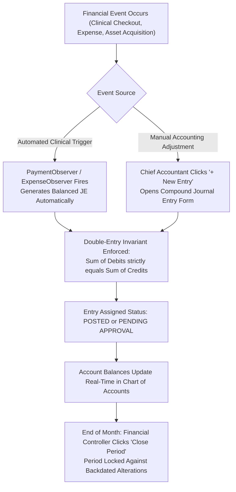

# Chart of Accounts, Journal Entries & Fiscal Periods

<span class="badge-role">ROLE GUARD: SUPERADMIN | ADMIN | super-admin | ACCOUNTS</span>

The **Chart of Accounts (COA) and General Ledger** subsystem is the foundational ledger of CoreHealth v2. It enforces standard 5-class financial categorization, guarantees the double-entry accounting equation ($\text{Assets} = \text{Liabilities} + \text{Equity}$), records automated and manual journal entries, and governs fiscal period closures.

---

## 1. Visual Tour: Chart of Accounts & General Ledger


> [!NOTE]
> The Chart of Accounts organizes 88 active accounts across 5 classes and 18 groups. Notice the real-time class counters, tree/table view switchers, and direct group management buttons.

---

## 2. Stepped General Ledger Flow



---

## 3. The 5-Class Chart of Accounts (COA) Architecture

CoreHealth v2 categorizes all hospital transactions into standard numerical account blocks:

| Account Code Block | Class Category | Normal Balance | Hospital Examples in CoreHealth v2 |
| :--- | :--- | :--- | :--- |
| **1000 – 1999** | **Assets** | **Debit (DR)** | `1010 Cash in Hand`, `1020 Zenith Bank`, `1031 MoniePoint POS 1`, `1120 HMO Receivables`, `1210 Pharmacy Inventory`, `1520 Medical Equipment` |
| **2000 – 2999** | **Liabilities** | **Credit (CR)** | `2010 Accounts Payable (Suppliers)`, `2050 Patient Deposits (Prepayment Liability)`, `2110 Statutory PAYE Tax Payable`, `2510 Bank Loans` |
| **3000 – 3999** | **Equity** | **Credit (CR)** | `3010 Retained Earnings`, `3020 Hospital Capital Reserve`, `3030 Owner's Equity` |
| **4000 – 4999** | **Revenue** | **Credit (CR)** | `4010 Laboratory Revenue`, `4020 Pharmacy Sales`, `4030 Consultation Fees`, `4040 Radiology Revenue`, `4050 Surgery Fees`, `4060 Bed Ward Fees` |
| **5000 – 5999** | **Expenses** | **Debit (DR)** | `5010 Cost of Goods Sold (Drugs)`, `5020 Medical Consumables`, `5030 Staff Salaries`, `5040 Generator Diesel & Power`, `5050 Equipment Depreciation` |

### Step-by-Step Account Setup
1. In the Accounting Dashboard, click **Chart of Accounts** (`/accounting/chart-of-accounts`).
2. To create a new sub-account (e.g. adding a dedicated POS terminal for the Emergency Ward):
   - Click the dark blue **`+ New Account`** button (`#btn-new-account`).
   - **Account Code (*Required)**: Enter a unique 4-digit code (e.g. `1033`).
   - **Account Name (*Required)**: Enter `Emergency POS - MoniePoint 3`.
   - **Class (*Required)**: Select `Assets (1000)`.
   - **Group (*Required)**: Select `Current Assets -> Bank Accounts`.
   - **Normal Balance**: Defaults to `Debit`.
   - **Is Bank/Cash Account**: Check this box so the Billing Workbench can select it as a payment destination.
3. Click **`Save Account`**. The new account appears in the tree hierarchy immediately.

---

## 4. Journal Entries & Double-Entry Ledger Inspection


### Following Patient Oladipo Amina's ₦250,000 Surgery Entry
When cashier *Blessing Okon* processed *Oladipo Amina's* bill, the system instantly created automated entry `JE-202611-0001`:

```
JOURNAL ENTRY: JE-202611-0001
Date: 09 Nov 2026 | Source: Payment #REC-202611-0492 | Status: POSTED
Description: Inpatient surgical settlement for Oladipo Amina (File: 14-32-97)

DEBIT LEGS (Assets & Receivables Received):
  DR 1010  Cash in Hand                             ₦10,000.00
  DR 1031  Bank - MoniePoint POS 1                  ₦20,000.00
  DR 2050  Patient Deposits Liability (Wallet)      ₦20,000.00
  DR 1120  HMO Receivables (PLASCHEMA Claim)       ₦150,000.00
  DR 1130  Corporate Receivables (NNPC Retainership)₦50,000.00

CREDIT LEGS (Clinical Revenue Earned):
  CR 4050  Surgery & Theatre Procedure Fees        ₦120,000.00
  CR 4020  Pharmacy & Dispensary Drug Sales         ₦50,000.00
  CR 4060  Inpatient Accommodation & Bed Stays      ₦30,000.00
  CR 4010  Laboratory Diagnostic Fees               ₦25,000.00
  CR 4040  Radiology & Scan Revenue                 ₦15,000.00
  CR 4030  Surgical Consultation Revenue            ₦10,000.00
---------------------------------------------------------------
TOTAL DEBITS: ₦250,000.00   |   TOTAL CREDITS: ₦250,000.00 (BALANCED)
```

### Creating a Manual Compound Journal Entry
For non-patient financial transactions (such as accruing monthly external audit fees of ₦50,000):
1. On the Journal Entries page, click **`+ New Entry`**.
2. **Entry Date**: Select today's date.
3. **Reference**: e.g. `ADJ-202611-AUDIT`.
4. **Description**: `Accrual of November statutory audit fee`.
5. **Add Line 1 (Debit)**:
   - Account: `5090 - Audit & Legal Professional Fees`
   - Debit: `₦50,000.00` | Credit: `₦0.00`
6. **Add Line 2 (Credit)**:
   - Account: `2030 - Accrued Expenses & Provisions`
   - Debit: `₦0.00` | Credit: `₦50,000.00`
7. Click **`Post Entry`**. The system validates that total debits match total credits before committing to the database.

---

## 5. Fiscal Periods & Period Locking


### Monthly Period Close & Anti-Fraud Locking
To prevent fraudulent backdating or modification of closed transactions:
1. Navigate to **Fiscal Periods** (`/accounting/periods`).
2. Locate the active month (e.g. *October 2026*).
3. Click **`Close Period`**.
4. The system validates that all journal entries for the month are approved and posted.
5. Once closed, the period status turns red (`CLOSED`). No cashier or clinician can create or void invoices dated within that month without executive board re-opening authorization.

### Annual Fiscal Year Close
1. At the conclusion of the 12th calendar month, click **`Close Fiscal Year`**.
2. The engine automatically aggregates all Revenue (4000s) and Expense (5000s) accounts to calculate Net Annual Profit.
3. It posts an automated Year-End Closing Journal Entry transferring net surplus into **`3010 - Retained Earnings`**, resetting all income and expense balances to ₦0.00 for the new financial year.

---

## 6. Opening Balances

For hospitals migrating from legacy paper ledgers or standalone software:
1. Open **Opening Balances** (`/accounting/opening-balances`).
2. Input verified starting figures for Cash at Bank, Inventory on Hand, Fixed Assets Net Book Value, and Outstanding Liabilities.
3. The balancing figure is allocated to **`3020 - Capital Reserve / Owner's Equity`**, establishing the verified opening balance sheet.

---

## Downstream Financial Impact
- **Trial Balance Integrity**: Every single transaction logged through the workbench updates the General Ledger in real time with zero discrepancy between debit and credit columns.
- **Auditor Verification**: External auditors can trace any balance on the Trial Balance directly back to its source patient receipt, vendor PO voucher, or payroll batch.

---

## Developer Reference
👉 **[Read Accounting Architecture & API Contracts](/developer/workbenches/accounting/api-contracts)**  
👉 **[Read Accounting Database Schema & Observers Reference](/developer/workbenches/accounting/database-and-models)**

