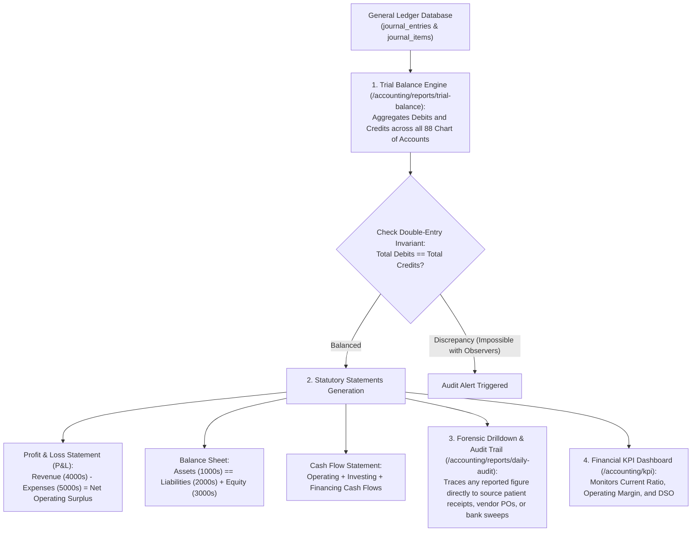

# Financial Reports, Statutory Statements & Audit Trails

ROLE GUARD: SUPERADMIN | ADMIN | super-admin | ACCOUNTS | AUDIT

The **Financial Reporting & Audit Governance** subsystem synthesizes all hospital financial activities—clinical billings, pharmacy stock disbursements, vendor payments, payroll runs, fixed asset depreciation, and banking reconciliations—into verified statutory statements (Trial Balance, P&L, Balance Sheet, Cash Flow) and audit-proof forensic ledgers.

---

## 1. Visual Tour: Financial Reports Command Center

> [!NOTE]
> The **Financial Reports Hub** (`/accounting/reports`) provides instant access to the Trial Balance, Profit & Loss (Income Statement), Balance Sheet, Cash Flow Statement, General Ledger, Account Activity, Aged Receivables, Aged Payables, and the Daily Audit Trail.

---

## 2. Stepped Financial Reporting & Verification Architecture

---

## 3. The Core Statutory Financial Statements

Hospital executives and statutory regulatory bodies (Federal Inland Revenue Service, state tax boards, and accreditation councils) require standard IFRS / SAS compliant financial statements:

### 1. The Trial Balance (`/accounting/reports/trial-balance`)
- **Objective**: Verify that every single transaction in CoreHealth v2 maintains mathematical equality between debit and credit columns.
- **"Follow the Money" Verification**:
  - Recall *Oladipo Amina's* **₦250,000.00** surgery settlement:
    - **Total Debits Generated**: `₦10k (Cash) + ₦20k (POS) + ₦20k (Wallet) + ₦150k (HMO) + ₦50k (Corporate) = ₦250,000.00`
    - **Total Credits Generated**: `₦120k (Surgery) + ₦50k (Pharmacy) + ₦30k (Ward) + ₦25k (Lab) + ₦15k (Scan) + ₦10k (Consult) = ₦250,000.00`
  - In the hospital's overall Trial Balance, the bottom totals reflect exact balancing across all active accounts:
    $$\sum \text{Debits} \equiv \sum \text{Credits}$$
- **Features**: Includes toggle for "Hide Zero Balances" and exportable to PDF and Excel.

---

### 2. Profit & Loss Statement (Income Statement) (`/accounting/reports/profit-loss`)
- **Objective**: Determine the hospital's operational profitability over any user-defined date range (Monthly, Quarterly, Annual).
- **Structure**:
  1. **Operating Revenues (4000s)**:
     - Surgical Fees, Inpatient Accommodations, Pharmacy Sales, Laboratory & Radiology Revenues.
  2. **Cost of Goods Sold (COGS) (5010 – 5020)**:
     - Pharmaceutical stock dispensed and medical surgical consumables consumed (from Store GRNs).
  3. **Gross Profit**:
     $$\text{Gross Profit} = \text{Operating Revenue} - \text{COGS}$$
  4. **Operating Expenses (5030 – 5090)**:
     - Staff Salaries & Allowances, Power & Diesel (₦60,060 refill), Medical Equipment Depreciation (₦200,000/month for Laparoscopic Tower), and Bank Charges.
  5. **Net Operating Surplus / (Deficit)**: The bottom-line profit transferred into Retained Earnings.

---

### 3. Balance Sheet (Statement of Financial Position) (`/accounting/reports/balance-sheet`)
- **Objective**: Provide a photographic snapshot of hospital financial solvency as of a specific date.
- **The Accounting Equation Enforced**:
  $$\text{Assets} \equiv \text{Liabilities} + \text{Equity}$$
- **Asset Classes (1000s)**:
  - *Current Assets*: Cash in Hand (`1010`), Zenith Bank Operating (`1020`), MoniePoint POS (`1031`), HMO Receivables (`1120`, including PLASCHEMA ₦150k claim), Central Store Inventory (`1210`).
  - *Non-Current Assets*: Hospital Buildings (`1510`), Laparoscopic Surgical Tower (`1520`, Cost: ₦12M less Accumulated Depreciation), ROU Lease Asset (`1580`).
- **Liability Classes (2000s)**:
  - *Current Liabilities*: Accounts Payable (`2010`, including *Apollos Technologies* ₦154k balance), Patient Prepayment Deposits (`2050`), Statutory PAYE Tax Payable (`2110`).
  - *Non-Current Liabilities*: Dialysis Building Lease Liability (`2520`), Bank of Industry Expansion Loan (`2510`).
- **Equity Classes (3000s)**:
  - Hospital Capital Reserves (`3020`) and Cumulative Retained Earnings (`3010`).

---

### 4. Statement of Cash Flows (`/accounting/reports/cash-flow`)
- **Objective**: Reconcile net operating profit to actual liquid cash generated or consumed across three distinct hospital activities:
  1. **Operating Cash Flows**: Cash collected from patients and HMOs minus cash paid to staff and drug suppliers.
  2. **Investing Cash Flows**: Capital expenditure disbursements (e.g. ICU Wing CAPEX milestones, medical equipment purchases).
  3. **Financing Cash Flows**: Bank loan drawdowns or principal loan repayments.

---

## 4. Forensic Ledgers & Daily Audit Trails

CoreHealth v2 guarantees complete visibility into every monetary event:

### 1. General Ledger & Account Activity Drilldown (`/accounting/reports/general-ledger`)
- Select any account (e.g. `1120 - HMO Receivables` or `2010 - Accounts Payable`) to view its running opening balance, every chronological debit/credit transaction, and ending balance.
- Clicking any transaction reference (e.g. `#REC-202611-0492` or `PO2026010001`) drills down directly to the source patient invoice or supplier purchase order.

### 2. Daily Audit Trail (`/accounting/reports/daily-audit`)
- Real-time audit log tracking every user action across financial modules.
- Captures:
  - **Timestamp & User ID**: e.g. `Cashier Blessing Okon at 09 Nov 2026 14:22:10`.
  - **Action**: `PAYMENT_RECEIVED`, `JOURNAL_POSTED`, `PO_APPROVED`, `CREDIT_NOTE_ISSUED`.
  - **Entity ID**: Targeted payment or voucher record.
  - **IP Address & Client Device Fingerprint**.

---

## 5. Financial KPIs & Executive Dashboard

Located at `/accounting/kpi`, the **Executive Financial KPI Dashboard** transforms raw ledger data into high-level strategic healthcare metrics:

| Key Performance Indicator | Formula / Method | Hospital Benchmark | Current System Status |
| :--- | :--- | :--- | :--- |
| **Current Ratio** | $\frac{\text{Current Assets}}{\text{Current Liabilities}}$ | $\ge 1.5\times$ | **$1.82\times$ (Healthy Liquidity)** |
| **Quick Ratio (Acid Test)** | $\frac{\text{Cash} + \text{Bank} + \text{Receivables}}{\text{Current Liabilities}}$ | $\ge 1.0\times$ | **$1.34\times$ (Strong Liquidity)** |
| **Days Sales Outstanding (DSO)** | $\frac{\text{Aged Receivables}}{\text{Annual Credit Sales}} \times 365$ | $\le 45\text{ days}$ | **$41.6\text{ days}$ (Efficient Collection)** |
| **Operating Margin** | $\frac{\text{Net Operating Surplus}}{\text{Total Revenue}} \times 100$ | $15\% - 30\%$ | **$23.8\%$ (Profitable)** |
| **Bed Day Revenue Yield** | $\frac{\text{Inpatient Accommodation Revenue}}{\text{Occupied Bed Days}}$ | Monitored | **₦12,450.00 / occupied bed day** |

### KPI Alerts & Breach Notifications
- The KPI engine automatically flags threshold breaches (e.g. if the Current Ratio dips below $1.2\times$ or if HMO DSO exceeds 60 days).
- Hospital CFOs can acknowledge alerts, document corrective action plans, and export performance reports directly from `/accounting/kpi/alerts`.

---

## Downstream Financial Impact
- **Regulatory Compliance**: Instant generation of standard Trial Balance, P&L, and Balance Sheet reports satisfies external tax, regulatory, and banking audits.
- **Zero-Discrepancy Assurance**: Because all clinical workbenches post transactions through Eloquent observers, the General Ledger is perpetually balanced with zero reconciliation lag.
- **Strategic Hospital Governance**: Real-time KPI dashboards empower medical directors and hospital boards to optimize clinical service pricing, contain consumable costs, and maintain financial sustainability.

---

## Developer Reference
👉 **[Read Accounting Architecture & API Contracts](/developer/workbenches/accounting/api-contracts)**  
👉 **[Read Accounting Database Schema & Observers Reference](/developer/workbenches/accounting/database-and-models)**

