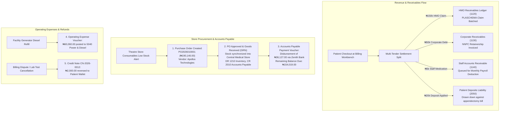

# Receivables, Payables, Store POs, Expenses & Patient Deposits

ROLE GUARD: SUPERADMIN | ADMIN | super-admin | ACCOUNTS | BILLER

The **Working Capital & Procurement Ledger** subsystem bridges patient billing, HMO claims, corporate retainerships, staff payroll deductions, vendor purchase orders, inventory receiving, operating expenses, customer prepayment deposits, and clinical credit reversals.

---

## 1. Visual Tour: Aged Receivables & Working Capital

> [!NOTE]
> The **Aged Receivables Report** displays over ₦12.6M in hospital debt categorized into aging buckets: Current (0–30 days), 31–60 days, 61–90 days, and Over 90 days. It segregates HMO schemes, corporate retainers, private patient overdrafts, and staff payroll advances.

---

## 2. Stepped Working Capital & Procurement Flow

---

## 3. Aged Receivables, Debtors & Claims Management

Hospitals manage diverse debtor profiles requiring distinct collection strategies:

### 1. Clinical & Operational Objective
Monitor and recover outstanding balances from private patient overdrafts, corporate retainerships, government HMO schemes, and internal staff advances before debts slip into bad debt provisions.

### 2. Exact UI Location / Where to Click
- Navigate to **Accounting** &rarr; **Reports** &rarr; **Aged Receivables** (`/accounting/reports/aged-receivables`).
- Filter by Debtor Category (`HMO`, `Corporate`, `Private Patient`, `Staff`).

### 3. Concrete "Follow the Money" Scenarios
1. **HMO Claims (PLASCHEMA)**:
   - *Oladipo Amina's* **₦150,000.00** surgical claim is placed in the Current (0–30 days) bucket under Pre-Authorization code `PAC-2026-99214`.
   - When PLASCHEMA remits payment with 5% withholding tax, the claims accountant posts receipt: `DR 1020 Zenith Bank (₦142,500.00)`, `DR 5095 WHT Receivable (₦7,500.00)`, `CR 1120 HMO Receivables (₦150,000.00)`.
2. **Corporate Retainership (NNPC Retainership)**:
   - Incurred **₦50,000.00** for *Oladipo Amina's* executive private room accommodation.
   - CoreHealth v2 generates a formal Corporate Debit Note / Statement of Account sent to the corporate sponsor at month-end.
3. **Staff Medical Benefit & Payroll Deductions**:
   - A hospital nurse purchases ₦5,000.00 prescription drugs under the "Bill to Staff" option.
   - Billed to `1140 - Staff Medical Receivables`. At month-end payroll execution, the payroll engine automatically deducts ₦5,000.00 from net salary: `DR 2120 Net Salaries Payable`, `CR 1140 Staff Receivables`.
4. **Private Patient Overdrafts**:
   - 135 emergency room admissions have temporary negative balances totaling ₦2.6M.
   - Credit controllers use automated SMS reminders and discharge locks until clearance.

---

## 4. Purchase Orders (POs) & Upstream Store Scaffolding

### Connecting to the Store Workbench
Hospital expenditures originate in the **Central Medical Store** when medical supplies, implants, and pharmaceuticals are ordered from verified suppliers:

### 1. Clinical & Operational Objective
Procure medical consumables, theatre packs, and pharmacy inventory through formal three-way matching (Purchase Order &rarr; Goods Receive Note GRN &rarr; Vendor Invoice), preventing unauthorized stock procurement.

### 2. Exact UI Location / Where to Click
- Navigate to **Store / Inventory** &rarr; **Purchase Orders** (`/inventory/purchase-orders`).
- Click the dark blue **`+ New Purchase Order`** button (`#btn-create-po` or `/inventory/purchase-orders/create`).

### 3. Step-by-Step Purchase Order Lifecycle
1. **Header Details**:
   - **Supplier (*Required)**: Select `Apollos Technologies`.
   - **Destination Store (*Required)**: Select `Central Medical Store`.
   - **Expected Delivery Date (*Required)**: Enter `12 Nov 2026`.
   - **Payment Terms**: `Net 30 Days`.
2. **Line Items (Canonical Order `PO2026010001`)**:
   - Line 1: `Laparoscopic Trocar 10mm` (10 units @ ₦8,500 = ₦85,000).
   - Line 2: `Vicryl 2-0 Sutures Box` (15 boxes @ ₦4,200 = ₦63,000).
   - Line 3: `Disposable Surgical Gowns Pack` (20 packs @ ₦2,107.30 = ₦42,146.00).
   - **Grand Total**: Exactly **`₦190,146.00`**.
3. **Approval & Submission**:
   - Store Manager submits the order (`Status: SUBMITTED`).
   - Medical Director and Chief Accountant click **`Approve PO`** (`/purchase-orders/{id}/approve`). Status updates to `APPROVED`.
4. **Receiving & Stock Sync (GRN)**:
   - When goods arrive at the loading bay, Store Officer clicks **`Receive Items`** (`/inventory/purchase-orders/{id}/receive`).
   - Verifies delivered batch numbers and expiry dates.
   - Clicking **`Process GRN`** instantly triggers two background actions:
     1. Inventory stock levels in `Central Medical Store` increment by ordered quantities.
     2. An Accounts Payable liability voucher is automatically created in Accounting:
        - **`DR 1210 Central Store Inventory`**: `₦190,146.00`
        - **`CR 2010 Accounts Payable (Apollos Technologies)`**: `₦190,146.00`

---

## 5. Accounts Payable (AP) & Supplier Disbursements

### "Follow the Money": Partial Payment to Apollos Technologies
Following delivery of `PO2026010001` (Total: **₦190,146.00**), the Finance Committee approves a partial milestone disbursement:

### 1. Clinical & Operational Objective
Track outstanding supplier obligations, enforce credit terms, schedule vendor payments, and generate authenticated payment vouchers with complete audit trails.

### 2. Exact UI Location / Where to Click
- Navigate to **Inventory** &rarr; **Purchase Orders** &rarr; **Accounts Payable** (`/inventory/purchase-orders/accounts-payable`).
- Locate supplier **`Apollos Technologies`** (Total Billed: `₦190,146.00`, Total Paid: `₦0.00`, Balance Due: `₦190,146.00`).
- Click the green **`Record Payment`** button (`/inventory/purchase-orders/{id}/payment`).

### 3. Payment Voucher Fields
- **Paying Bank (*Required)**: Select `1020 - Zenith Bank Operating`.
- **Payment Method (*Required)**: Select `Direct Bank Transfer (NIP)`.
- **Amount Paid (*Required)**: Enter **`₦36,127.00`**.
- **Payment Date (*Required)**: `09 Nov 2026`.
- **Reference / Cheque No (*Required)**: `ZEN-TX-99824102`.
- **Narration**: `Partial payment for Laparoscopic Trocar and Vicryl Sutures supply on PO2026010001`.

### 4. Downstream Double-Entry Impact
Upon clicking **`Process Payment`**:
- **`DR 2010 Accounts Payable (Apollos Technologies)`**: `₦36,127.00`
- **`CR 1020 Zenith Bank Operating`**: `₦36,127.00`
- The Accounts Payable ledger updates immediately:
  $$\text{Original Bill: } ₦190,146.00 - \text{Paid: } ₦36,127.00 = \mathbf{₦154,019.00 \text{ Outstanding Balance Due}}$$

---

## 6. Hospital Operating Expenses

Non-inventory operational expenditures (diesel, generator maintenance, software licenses, waste disposal) are managed via the Expense subsystem:

### 1. Clinical & Operational Objective
Record and authorize facility overhead expenses with departmental cost attribution and supporting document attachments.

### 2. Exact UI Location / Where to Click
- Navigate to **Inventory / Facility** &rarr; **Expenses** (`/inventory/expenses`).
- Click **`+ Add Expense`** (`#btn-create-expense` or `/inventory/expenses/create`).

### 3. Logging Facility Generator Diesel Refill (₦60,060.00)
- **Expense Category (*Required)**: Select `5040 - Power, Diesel & Utilities`.
- **Cost Center (*Required)**: Select `Facility & Biomedical Engineering`.
- **Payment Source (*Required)**: Select `1020 - Zenith Bank Operating`.
- **Amount (*Required)**: Enter `₦60,060.00` (500 Litres Automotive Gas Oil @ ₦1,201.20/L).
- **Vendor / Payee (*Required)**: `TotalEnergies Filling Station`.
- **Receipt Voucher (*Required)**: Attach scanned delivery waybill.
- **Approval Workflow**: Click **`Submit`**. The Medical Director approves the voucher, posting `DR 5040 Power & Diesel (₦60,060)`, `CR 1020 Zenith Bank (₦60,060)`.

---

## 7. Patient Deposits (Customer Prepayment Liabilities)

### 1. Clinical & Operational Objective
Manage advance prepayments and wallet balances deposited by patients prior to scheduled surgeries, maternity packages, or inpatient admissions. Because clinical services have not yet been rendered, deposits represent an accounting liability (`Class 2000`).

### 2. Exact UI Location / Where to Click
- Navigate to **Accounting** &rarr; **Patient Deposits** (`/accounting/patient-deposits`).
- Search by Patient Name or Hospital File Number (`14-32-97`).

### 3. Patient Deposit Lifecycle for Oladipo Amina
1. **Pre-Admission Deposit**:
   - Two days before surgery, *Oladipo Amina* deposited **₦20,000.00** at the Cashier desk.
   - Cashier selected `Deposit Top-up`:
     - **`DR 1010 Cash in Hand`**: `₦20,000.00`
     - **`CR 2050 Patient Deposits Liability`**: `₦20,000.00`
2. **Drawdown at Billing Checkout**:
   - During final surgery checkout, cashier selected payment tender `ACCOUNT / WALLET`.
   - The engine automatically extinguished the liability:
     - **`DR 2050 Patient Deposits Liability`**: `₦20,000.00`
     - **`CR 4050 Surgery Revenue`**: `₦20,000.00`
   - *Oladipo Amina's* remaining deposit wallet balance returned to **`₦0.00`**.

---

## 8. Clinical Credit Notes & Billing Reversals

When clinical services are cancelled or overbilled (e.g. patient discharged before scheduled second ultrasound):

### 1. Clinical & Operational Objective
Issue formal credit notes to reverse billed clinical revenues, adjust patient ledgers, and credit wallet balances or refund cash without violating double-entry invariants.

### 2. Exact UI Location / Where to Click
- Navigate to **Accounting** &rarr; **Credit Notes** (`/accounting/credit-notes`).
- Click the dark blue **`+ New Credit Note`** button (`#btn-create-credit-note`).

### 3. Issuing Credit Note `CN-2026-0012` (₦2,000.00)
- **Patient (*Required)**: Select `Oladipo Amina (File No: 14-32-97)`.
- **Original Payment Reference (*Required)**: Select `#REC-202611-0492`.
- **Reason (*Required)**: Select `Duplicate Billing / Service Not Rendered` (Post-op dressing kit billed twice).
- **Amount (*Required)**: Enter `₦2,000.00`.
- **Refund Destination (*Required)**: Select `Credit to Patient Wallet`.
- **Approval & Execution**: Internal Audit reviews and clicks **`Approve`** and **`Process`**.
  - **`DR 4050 Surgery & Dressing Revenue`**: `₦2,000.00` (Revenue reversed)
  - **`CR 2050 Patient Deposits Liability`**: `₦2,000.00` (Available wallet credit restored)

---

## Downstream Financial Impact
- **Procurement & Inventory Alignment**: Store PO receiving automatically creates AP vouchers, ensuring stock ledger and supplier liability stay in exact mathematical sync.
- **Cash Flow Predictability**: Aged Receivables buckets highlight overdue corporate and HMO debts, allowing targeted liquidity follow-up.
- **Deposit Liability Truth**: Advance surgical prepayments are segregated from earned revenue until clinical procedures are officially completed.

---

## Developer Reference
👉 **[Read Accounting Architecture & API Contracts](/developer/workbenches/accounting/api-contracts)**  
👉 **[Read Accounting Database Schema & Observers Reference](/developer/workbenches/accounting/database-and-models)**

