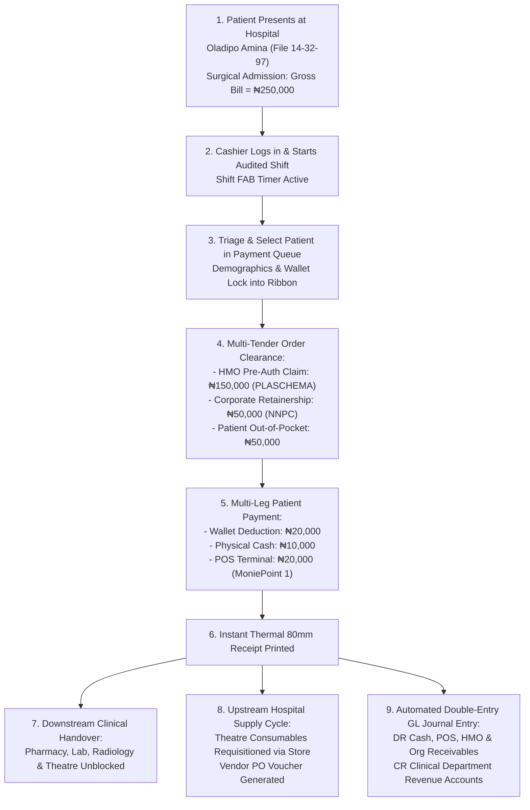

# Billing, Cashier & Revenue Cycle Workbench

ROLE GUARD: SUPERADMIN | ADMIN | ACCOUNTS | BILLER

The **Billing Workbench** is the financial engine of CoreHealth v2. It coordinates the hospital's point-of-sale revenue cycle, multi-tender settlements, corporate sponsor invoicing, staff medical billing, patient deposit wallets, and automated double-entry ledger integration.

---

## 1. Visual Tour: Cashier Cockpit

> [!NOTE]
> The Billing Workbench provides zero-latency access to pending clinical orders across Consultation rooms, Laboratories, Imaging suites, and Inpatient wards. The left panel shows real-time queue counts, while the central workspace displays active patient orders, pricing breakdowns, and checkout controls.

---

## 2. "Follow the Money" Master Storyboard

Every clinical order generated in CoreHealth v2 has an immediate financial counterparty. Below is the end-to-end journey of hospital funds from clinical initiation to General Ledger reconciliation:

---

## 3. Core Financial Workflows & Detailed Subpages

To explore the exact step-by-step instructions, UI buttons, and financial impacts for each operational phase, consult the dedicated subpages below:

### 1. Shift Initiation & Payment Queue Triage
👉 **[Read Guide: Shifts & Payment Queues](/user-guides/workbenches/billing/shifts-and-queues)**
- **Cashier Accountability**: Enforces mandatory rostered shift sessions (Morning 8AM–2PM, Afternoon 2PM–8PM, Night 8PM–8AM) with the floating shift timer FAB.
- **Queue Prioritization**: Triages pending payments into **🚨 Emergency**, **🟡 All Unpaid**, **🟢 HMO Items**, and **🟠 Credit Accounts**.
- **Patient Intake**: Locks demographics, insurance schemes, and live wallet balances into the cockpit header.

### 2. Multi-Tender Checkout & Split Payments
👉 **[Read Guide: Checkout & Split Payments](/user-guides/workbenches/billing/checkout-and-split-payments)**
- **Order Selection**: Selective item billing across Doctor consults, laboratory panels, imaging scans, and medications.
- **Corporate & Staff Billing**: Bill to Organization (corporate retainerships) and Bill to Staff (payroll deduction).
- **Split-Tender Engine**: Dividing single bills across physical Cash, POS terminals (with acquiring bank mapping), direct bank transfers, and patient deposit accounts.
- **Receipting**: Instant thermal 80mm slip printing and official itemized A4 invoices.

### 3. Patient Accounts, Prepayments & Wallet Deposits
👉 **[Read Guide: Patient Accounts & Deposits](/user-guides/workbenches/billing/patient-accounts-and-deposits)**
- **Pre-Funded Wallets**: Creating patient ledger accounts in `patient_accounts` to eliminate bad debts during major surgeries.
- **Cashier Deposits & Top-ups**: Inbound deposits with instant balance recalculation and formal deposit receipts.
- **Refunds & Adjustments**: Supervised post-discharge wallet refunds, credit offsets, and comprehensive statement of account exports.

### 4. Transactions Audit & Shift Reconciliation
👉 **[Read Guide: Transactions & Shift Reconciliation](/user-guides/workbenches/billing/transactions-and-reconciliation)**
- **My Transactions Console**: Reviewing 7 real-time telemetry cards (Cash in Till, POS receipts, Bank Transfers, Refunds).
- **Payment Method Reclassification**: Adjusting misallocated tender channels (e.g. Cash mistaken for POS) without voiding invoices.
- **Supervised Voiding**: Medico-legal reversals with mandatory supervisor justifications and reversing General Ledger entries.
- **Shift Turnover**: End-of-shift till balancing, handover report printing, and cash vault lodgements.

### 5. Walk-in Sales & Inpatient Admissions
👉 **[Read Guide: Walk-in POS & Inpatient Admissions](/user-guides/workbenches/billing/walkin-and-admissions)**
- **Direct Point-of-Sale**: Fast-track retail checkout for non-registered walk-in customers purchasing pharmacy drugs, OTC products, or direct lab tests.
- **Inpatient Ward Stays**: Tracking cumulative bed charges, nursing consumable kits, interim bill estimates, and final discharge clearance.

---

## 4. Downstream Clinical & Upstream Store Connection

The Billing Workbench sits at the exact crossroads of patient care and hospital supply chain:

1. **Downstream Clinical Care**:
   - Clearing a medication order instantly unblocks the **Pharmacy Workbench** dispense queue.
   - Clearing a laboratory test sends the order to the **Laboratory Information System (LIS)** with barcode accession for specimen collection.
   - Clearing an imaging requisition prompts the Radiographer's worklist.
2. **Upstream Store & Expense Scaffolding**:
   - Consumables dispensed during surgery or ward care originate from the **Store & Inventory Workbench**.
   - When the pharmacy or theatre stock reaches re-order levels, store managers generate **Purchase Orders (POs)** to approved pharmaceutical vendors.
   - Accounts Payable invoices stream into the Accounting module, closing the financial loop between revenue collected from patients and disbursements paid to suppliers.

---

## Developer Reference
👉 **[Read the Billing API Contracts](/developer/workbenches/billing/api-contracts)**  
👉 **[Read the Billing Database & Observers Reference](/developer/workbenches/billing/database-and-models)**
