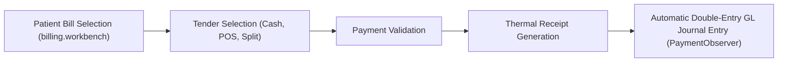

# Billing, Cashier & Revenue Cycle Workbench

ROLE GUARD: SUPERADMIN | ADMIN | ACCOUNTS | BILLER

The **Billing Workbench** is the financial cockpit of CoreHealth v2. It handles multi-tender point-of-sale checkout, split payment settlements across multiple electronic and cash channels, unlisted free-form services, patient deposits/withdrawals, transaction voiding, and automated double-entry revenue attribution.

---

## 1. Visual Tour: Cockpit Form Stacking Architecture

> [!TIP]
> Notice how the Current Balance card, deposit action buttons, and transaction filters are stacked cleanly above the telemetry grid without obscuring transaction records on 1366×768 displays.

---

## 2. Real Routes & Role Authorization

- **Primary Route**: `billing.workbench` (`/billing-workbench`)
- **Authoritative Role Guard**: Defined in `sidebar/_nav-billing.blade.php` as `@hasanyrole('SUPERADMIN|ADMIN|ACCOUNTS|BILLER')`.

---

## 3. Core Financial Capabilities

### 1. Split Payments Multi-Leg Ledger
A single clinical invoice can be divided across tender channels:
- Cash in till
- Electronic Point of Sale (POS) by terminal/bank
- Direct Bank Transfer
- Mobile Money
- Patient Deposit / Wallet (`PatientAccount`)

`PaymentObserver` guarantees that the sum of debit legs strictly equals the credit revenue legs, preserving General Ledger balance at all times.

### 2. Cockpit Account Form Stacking
The `#account-transaction-panel` (Deposit, Withdraw, Adjust) is docked between `#account-hero-balance` and `#account-stats-grid` with smooth slide-down accordion transitions, ensuring cashier inputs remain 100% visible on low-resolution laptop screens without pushing data tables out of the viewport.

### 3. Free-Form Unlisted Item Billing
Allows cashiers to bill ad-hoc clinical procedures (`is_free_form = 1`) with custom prices, displaying formatted names across thermal receipts without breaking hospital catalog pricing.

---

## 4. Cashier Checkout Flow

---

## 5. Cross-Module Data & Patient Flows

- **Doctor, Lab, Pharmacy & Nursing**: Unbilled orders from all departments stream into the Cashier's pending payment queue in real-time.
- **Accounting**: Observer events automatically post double-entry debits (Cash/Bank) and credits (Department Revenue) to the General Ledger (`chart_of_accounts`).

---

## Developer Reference
👉 **[Read the Billing & Payment Ledger Developer Reference](/developer/workbenches/billing)**
