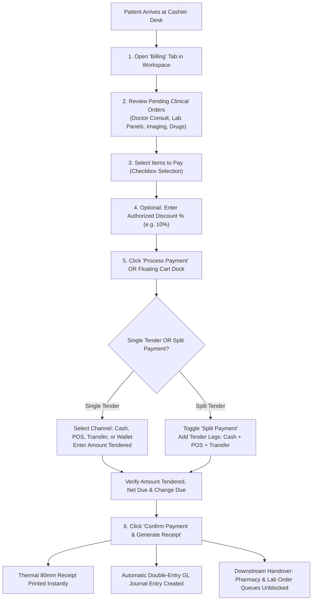

# Multi-Tender Checkout & Split Payments

ROLE GUARD: SUPERADMIN | ADMIN | ACCOUNTS | BILLER

The **Checkout & Split Payments** engine handles point-of-sale financial clearance across the hospital. It enables single-click full settlements, selective item billing, discretionary discount adjustments, and multi-leg split tenders across Cash, electronic POS terminals, direct bank transfers, and patient deposit accounts.

---

## 1. Visual Tour: Order Selection & Split Payment Engine

> [!TIP]
> Cashiers can filter items by category (e.g. *Laboratory*, *Pharmacy*, *Procedures*) or date range. Checking the **Select visible only** box computes instant totals for specific clinical departments without altering unbilled items.

---

## 2. Stepped Checkout & Split Payment Workflow

---

## 3. Step-by-Step Item Selection & Pricing Configuration

### Step 1: Filter and Select Unpaid Items
1. Click the **Billing** tab (`.workspace-tab[data-tab="billing"]`) in the workspace.
2. The data grid lists all unbilled items ordered for this patient:
   - **Date/Time**: When the requisition was initiated by the clinician.
   - **Item Name**: Catalog service or medication (e.g. *Full Blood Count*, *Ceftriaxone 1g Injection*, *Chest X-Ray PA View*).
   - **Category**: Clinical department attribution (*Laboratory*, *Radiology*, *Pharmacy*, *Consultation*, *Nursing*, *Admissions*).
   - **Price & Qty**: Unit price and ordered quantity.
   - **HMO Coverage**: Insurance tariff share vs patient out-of-pocket differential.
   - **Total**: Net amount payable by the patient.
3. Select items to bill:
   - Check the header box (`#select-all-billing-items`) to pay for all outstanding hospital services at once.
   - Or individually check specific rows if the patient is paying in stages.

### Step 2: Applying Authorized Discounts
1. In the **Discount %** column, enter an approved percentage reduction (e.g. `5` or `10`).
2. The system recalculates line totals, discounts, and net bill amounts dynamically.
3. Discretionary discounts exceeding staff authorization thresholds trigger supervisory approval prompts.

---

## 4. Multi-Tender & Split Payment Processing

### Step 1: Opening the Payment Processing Dialog
- Click the green **`Process Payment`** button in the header toolbar (`#process-payment-btn`).
- Alternatively, click the **Floating Cart Dock** (`#floating-cart`) in the bottom-right corner.
- The **Payment Processing Modal** displays the total amount due, patient details, and available payment channels.

### Step 2: Processing Single-Channel Payments
1. For standard single-channel settlements:
   - **Payment Method (*Required)**: Choose **`Cash`**, **`POS/Card`**, **`Bank Transfer`**, or **`Patient Account`**.
   - If **`POS/Card`**: Select the acquiring bank terminal (e.g. *MoniePoint POS 1*, *Stanbic POS*, *Zenith POS*).
   - If **`Bank Transfer`**: Enter the customer's transaction reference / session ID and select the receiving hospital bank account.
   - If **`Patient Account`**: The system validates that the patient's pre-funded wallet balance is sufficient.
2. **Amount Tendered**: Enter the amount handed over by the customer. The engine displays the calculated **Change Due** in real time.

### Step 3: Processing Multi-Leg Split Payments
When a patient settles a single hospital bill using multiple payment instruments (e.g. paying ₦5,000 in Cash, ₦15,000 via debit card POS, and deducting ₦10,000 from their deposit wallet):
1. Toggle the **`Split Payment`** switch (`#split-payment-toggle`).
2. The split payment ledger appears with dynamic tender rows:
   - **Leg 1**: Select `CASH` $\to$ Enter `₦5,000.00`.
   - **Leg 2**: Click **`+ Add Payment Method`** $\to$ Select `POS` $\to$ Select `MoniePoint POS 1` $\to$ Enter `₦15,000.00`.
   - **Leg 3**: Click **`+ Add Payment Method`** $\to$ Select `ACCOUNT` $\to$ Enter `₦10,000.00`.
3. The **Split Payment Summary** validates that:
   $$\sum \text{Tender Legs} \equiv \text{Net Invoice Amount}$$
4. If there is an unpaid balance remaining or overpayment, the confirm button remains disabled until exact mathematical balance is achieved.

### Step 4: Confirming Payment and Receipt Generation
1. Click **`Confirm Payment`** (`#confirm-payment-btn`).
2. The system registers the transaction, locks the billing items as paid, updates the till shift balance, and immediately launches the **Thermal Receipt Preview** (formatted for standard 80mm POS slip printers).
3. Click **Print Receipt** or press `Enter` to disburse the receipt to the patient.

---

## 5. Downstream Handover & Financial Ledger Impact

- **Dispensary Handover**: Prescriptions marked as paid appear immediately on the **Pharmacy Workbench Dispense Queue** with green payment clearance badges.
- **Laboratory & Phlebotomy Handover**: Diagnostic laboratory orders unblock for specimen collection and barcode label printing.
- **Radiology Handover**: Imaging scan orders appear on the Radiographer's worklist as cleared for acquisition.
- **General Ledger Double-Entry Invariant**:
  - The `PaymentObserver` triggers instant ledger balancing entries in the General Ledger:
    - **DR Cash / MoniePoint POS / Bank Transfer Account** (Asset accounts)
    - **CR Department Revenue** (e.g. *4010 - Laboratory Revenue*, *4020 - Pharmacy Sales*, *4030 - Consultation Fees*)
    - If split legs are used, each tender account is debited individually with zero out-of-balance variance.

---

## Developer Reference
👉 **[Read the Billing API Contracts](/developer/workbenches/billing/api-contracts)**  
👉 **[Read the Billing Database & Observers Reference](/developer/workbenches/billing/database-and-models)**

