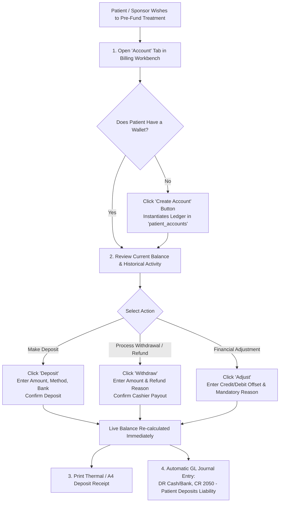

# Patient Accounts, Prepayments & Wallet Deposits

ROLE GUARD: SUPERADMIN | ADMIN | ACCOUNTS | BILLER

The **Patient Account & Wallet** subsystem manages patient prepayments, corporate credit balances, surgical advance deposits, and discretionary adjustments. Pre-funding accounts ensures continuous clinical care during prolonged inpatient admissions and intensive care stays without requiring frequent cash runs.

---

## 1. Visual Tour: Patient Wallet & Balance Hero Card

> [!NOTE]
> The Hero Balance card displays the live net position (**Current Balance**) alongside an automated status indicator (**Balanced**, **In Credit**, or **In Debt**). Notice the quick-action buttons for Deposits, Withdrawals, Adjustments, and Statement generation.

---

## 2. Stepped Patient Account Lifecycle

---

## 3. Step-by-Step Deposit & Wallet Operations

### Step 1: Navigating to the Patient Account View
1. Ensure the patient is active in the workbench.
2. In the workspace navigation tabs, click the **`Account`** tab (`.workspace-tab[data-tab="account"]`).
3. If the patient does not have an active wallet record, click the blue **`Create Account`** button (`#create-account-btn`). The system creates a dedicated ledger entry in `patient_accounts` linked to their hospital file.

### Step 2: Processing a Prepayment Deposit
1. In the Hero Balance card, click the white **`Deposit`** button (`#quick-deposit-btn`).
2. The **Make Deposit** form slides into view:
   - **Amount (*Required)**: Enter the prepayment sum (e.g. `₦50,000.00`).
   - **Payment Method (*Required)**: Select `CASH`, `POS`, `TRANSFER`, or `MOBILE`.
   - **Select Bank**: If paying via POS or Bank Transfer, select the destination hospital bank account.
   - **Description**: Add an optional memo (e.g. *Advance deposit for elective Caesarean Section*).
3. Review the **Balance Preview**:
   - Displays **Current Balance** vs **After Deposit** amount before final confirmation.
4. Click **`Confirm Deposit`** (`#transaction-submit-btn`).
5. The system saves the record, credits the patient's balance, and opens the **Deposit Receipt** dialog with options for 80mm thermal print or formal A4 hospital voucher.

### Step 3: Processing Patient Withdrawals & Payouts
When an inpatient is discharged and has excess funds remaining in their wallet:
1. Click the **`Withdraw`** button (`#quick-withdraw-btn`) on the Hero card.
2. Enter the amount to disburse (cannot exceed available credit balance).
3. Select the payout method (e.g. *Cash Payout* or *Bank Refund Transfer*).
4. Enter the **Mandatory Description** (e.g. *Post-discharge refund of unused theatre deposit*).
5. Click **`Confirm Withdrawal`**. The cashier disburses physical cash from the till, and the till ledger records an outbound disbursement voucher.

### Step 4: Discretionary Balance Adjustments
For accounting corrections, bad debt write-offs, or billing disputes:
1. Click the **`Adjust`** button (`#quick-adjust-btn`).
2. Specify the adjustment type:
   - **Credit Adjustment**: Increases the patient's wallet balance (e.g. waiving an errant lab charge).
   - **Debit Adjustment**: Decreases the balance (e.g. charging an unbilled emergency procedure).
3. Enter the **Mandatory Clinical & Audit Justification**.
4. Adjustments are logged with the initiating cashier's staff ID, timestamp, and audit trail.

---

## 4. Account Telemetry & Statement Generation

### 4-Metric Statistics Grid
Located directly beneath the transaction panel:
- **Total Deposits (`#total-deposits-stat`)**: Cumulative inflows credited to this patient wallet.
- **Total Withdrawals (`#total-withdrawals-stat`)**: Cumulative refunds disbursed or checkout bills deducted.
- **Pending Bills (`#pending-bills-stat`)**: Total outstanding unpaid orders waiting in other departments.
- **Transactions (`#tx-count-stat`)**: Lifetime count of deposits, debits, and adjustments.

### Generating Official Patient Statements
1. Click the yellow **`Print Statement`** button (`#print-statement-btn`).
2. Specify the date range or select *All Time*.
3. Click **Generate Statement**. The document renders a chronological statement of account featuring:
   - Hospital crest, license number, and tax registration.
   - Patient demographics and file number.
   - Itemized ledger lines with dates, references, descriptions, debits, credits, and running balance.
   - Cashier and Accounts Department verification stamp blocks.

---

## 5. Downstream Handover & Accounting Impact

- **Automatic Service Deduction**: When patients check out in the **Billing** tab, selecting `Patient Account` deducts funds from this wallet balance with zero cash handling.
- **Inpatient Ward Clearance**: Inpatient nurses can check the patient's hero balance ribbon at any time to verify that advance surgical deposits are active before escorting patients to Theatre.
- **General Ledger Liability Accounting**:
  - Deposits do NOT count as revenue immediately. The `PaymentObserver` credits **`2050 - Patient Deposits Liability`** (a balance sheet liability).
  - Only when items are consumed during checkout is revenue recognized:
    - **DR 2050 - Patient Deposits Liability**
    - **CR 4000 - Clinical Revenue Accounts**

---

## Developer Reference
👉 **[Read the Billing API Contracts](/developer/workbenches/billing/api-contracts)**  
👉 **[Read the Billing Database & Observers Reference](/developer/workbenches/billing/database-and-models)**

