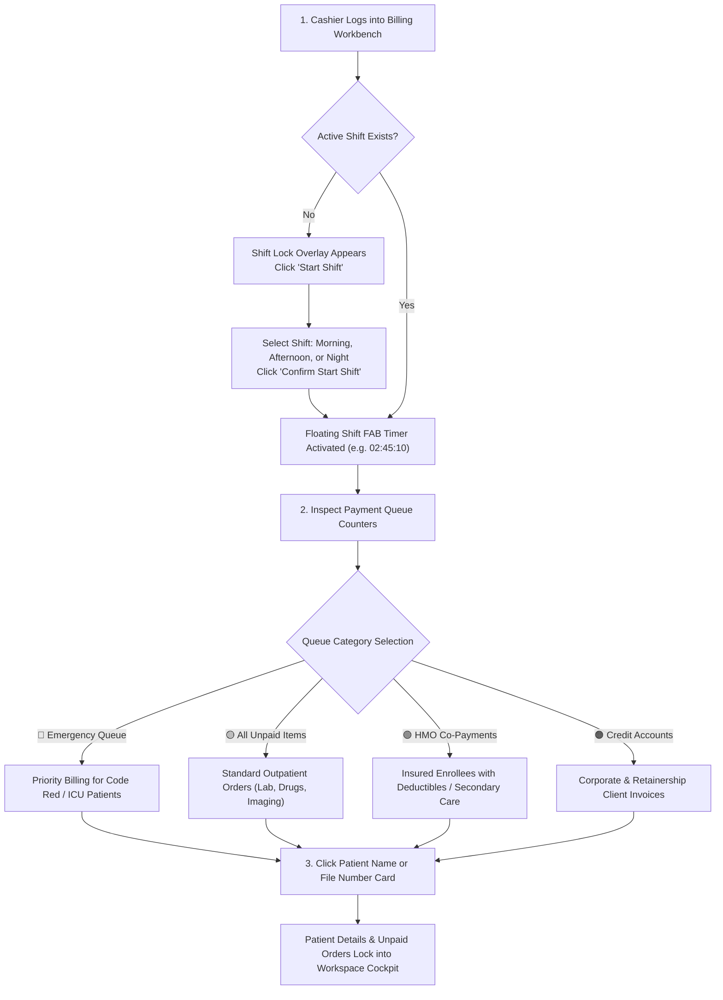

# Billing Shift Management & Payment Queue Triage

ROLE GUARD: SUPERADMIN | ADMIN | ACCOUNTS | BILLER

The **Shift Management and Queue Triage** subsystem establishes mandatory accountability over all hospital cashiers and guarantees that emergency patients, insured enrollees, and self-pay individuals are promptly billed without revenue loss.

---

## 1. Visual Tour: Payment Queue Cockpit

> [!IMPORTANT]
> The Payment Queue drawer groups patients by clinical urgency. Notice the red **EMERGENCY** badge for priority patients, followed by private and HMO clients.

---

## 2. Stepped Operational Storyboard

---

## 3. Step-by-Step Shift Management

### Step 1: Initiating an Audited Billing Shift
1. Upon navigating to the **Billing Workbench** (`/billing-workbench`), if you do not have an active session, the screen displays the **Workbench Lock Overlay**.
2. Click the green **`Start Shift`** button (`#start-shift-btn`).
3. In the **Start Billing Shift** dialog:
   - **Shift Type (*Required)**: Select your rostered schedule:
     - **Morning (8:00 AM – 2:00 PM)**
     - **Afternoon (2:00 PM – 8:00 PM)**
     - **Night (8:00 PM – 8:00 AM)**
4. Click **Confirm Start Shift** (`#confirm-start-shift-btn`).
5. The lock screen dissolves, and the **Floating Shift Timer** docks in the lower-right corner showing live elapsed hours and minutes.

### Step 2: Ending a Shift and Generating Till Reconciliation
1. At the end of your duty period, click the red stop icon on the floating timer dock (`#shift-fab-btn`).
2. The **End Billing Shift** modal displays a real-time summary:
   - Total Cash in Hand collected
   - Total Electronic POS receipts
   - Total Direct Bank Transfers confirmed
   - Total Vouchers / Refunds paid out
3. Verify physical cash against the system summary, confirm handover notes, and click **`Confirm End Shift`** (`#confirm-end-shift-btn`).

---

## 4. Payment Queue Triage & Patient Selection

### Step 1: Navigating Queue Categories
In the left sidebar, the **PAYMENT QUEUE** widget updates automatically with live badge counts:
- **🚨 Emergency (`#queue-emergency-count`)**:
  - Highlights patients undergoing immediate resuscitation, accident victims, or acute theatre admissions.
  - Cashiers prioritize these records to release blood bank units, anesthetic medications, and emergency lab panels without delays.
- **🟡 All Unpaid (`#queue-all-count`)**:
  - Outpatients dispatched from Doctor consultation rooms, Phlebotomy, or Radiology waiting for routine payments.
- **🟢 HMO Items (`#queue-hmo-count`)**:
  - Insured enrollees requiring secondary co-payments, excluded drug levies, or out-of-pocket procedure differentials.
- **🟠 Credit Accounts (`#queue-credit-count`)**:
  - Corporate clients, retainership employees, and pre-authorized organizational credit invoices.

### Step 2: Selecting a Patient into the Cockpit
1. Click any category pill or click **`Show All Queue`** (`#show-all-queue-btn`).
2. In the slide-out worklist, search by patient name or hospital file number.
3. Click the patient's card (e.g. *Kefas Zainab Simi - File 5524/26*).
4. The queue drawer closes automatically. The patient's verified demographics, photo avatar, insurance scheme, and live wallet balance immediately lock into the top persistent ribbon.

---

## 5. Downstream Handover & Clinical Impact

- **Emergency Resuscitation**: Clicking an emergency patient bypasses administrative delays, enabling instant point-of-sale clearance for life-saving interventions.
- **Cashier Accountability**: Every payment processed carries the unique `billing_shift_id`, preventing disputed cash handovers between morning, afternoon, and night shift staff.
- **Who Gets It Next**: Once selected, the patient's outstanding orders load into the **Billing Items Table** for multi-tender checkout.

---

## Developer Reference
👉 **[Read the Billing API Contracts](/developer/workbenches/billing/api-contracts)**  
👉 **[Read the Billing Database & Observers Reference](/developer/workbenches/billing/database-and-models)**
