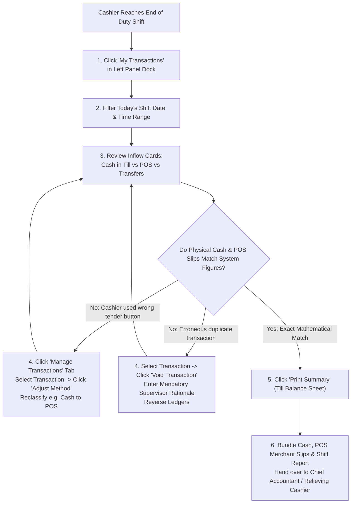

# Transactions Audit, Receipts & Shift Reconciliation

ROLE GUARD: SUPERADMIN | ADMIN | ACCOUNTS | BILLER

The **Transactions & Shift Reconciliation** console provides cashiers and accounting auditors with total operational oversight. It enables instant till balancing, payment instrument reclassification, supervised transaction voiding, thermal receipt reprinting, and shift turnover reconciliation.

---

## 1. Visual Tour: Cashier Transactions Console

> [!TIP]
> The **Transactions Console** displays 7 live financial telemetry cards breaking down collections by channel: Total Volume, Cash in Till, Refunds/Payouts, POS, Transfer, Mobile/Deposit, and Discounts/Splits.

---

## 2. Stepped Reconciliation Workflow

---

## 3. Step-by-Step Shift Balancing & Audit

### Step 1: Opening the Transactions Console
1. In the left panel under **QUICK ACTIONS**, click **`My Transactions`** (`#btn-my-transactions`).
2. The modal loads with two primary operational tabs:
   - **My Transactions**: Shows collections executed exclusively under your active user session.
   - **Manage Transactions**: (Available to supervisors and accountants) Allows hospital-wide auditing across all cashiers and wards.

### Step 2: Applying Shift Date & Department Filters
1. **From / To**: Set the exact start and end timestamps of your working shift.
2. **Cashier / Staff**: Defaults to the logged-in user (e.g. *System Admin*).
3. **Method**: Filter by specific tender (*Cash*, *POS*, *Transfer*, *Mobile*, *Deposit*) or leave as *All Methods*.
4. **Department**: Filter revenue generated for specific hospital zones (e.g. *Pharmacy*, *Laboratory*, *General Outpatient*).
5. Click **`Load Transactions`** to refresh data grids and rollup metrics.

### Step 3: Verifying Till Inflows & Outflows
Review the 7 KPI cards across the top:
- **Total Volume**: Net collection across all channels.
- **Cash in Till**: Physical bank notes and coins collected (must equal the physical count in your cash drawer).
- **Refunds / Payouts (Red Card)**: Outbound disbursements approved during the shift.
- **POS**: Card payments processed through electronic terminals (must match the total on your terminal's End-of-Day EOD settlement slip).
- **Transfer**: Direct electronic bank deposits confirmed via bank SMS/portal.
- **Mobile / Deposit**: Deductions from patient wallets.
- **Discounts / Splits**: Value of fee waivers and multi-instrument invoices.

---

## 4. Payment Adjustments & Supervised Voiding

### A. Reclassifying Payment Methods (Adjustments)
If a cashier accidentally recorded a POS card swipe as `CASH` or vice versa:
1. In the transaction row, click the blue **`Adjust`** button.
2. The **Adjust Payment Method** dialog appears:
   - **Current Method**: Displays original recorded channel (e.g. `CASH`).
   - **New Method**: Select corrected instrument (e.g. `POS`).
   - **Target POS Terminal / Bank**: Select the acquiring terminal.
   - **Reason for Adjustment (*Required)**: Document why the correction is needed (e.g. *Mistakenly selected Cash instead of MoniePoint POS*).
3. Click **Confirm Adjustment**.
4. The system updates the transaction without altering bill totals and posts an automated reclassification journal entry:
   - **DR MoniePoint POS Asset Account**
   - **CR Cash in Hand Asset Account**

### B. Supervised Transaction Voiding
When a service is canceled by the clinician before consumption or entered in error:
1. Click the red **`Void`** button on the transaction row.
2. The **Void Transaction Modal** opens:
   - **Refund Action**: Choose whether to refund as *Cash Payout*, credit to *Patient Wallet Balance*, or mark as *Accounting Reversal*.
   - **Supervisor Override PIN**: If configured, requires supervisor authorization.
   - **Mandatory Justification**: Document the clinical or administrative cancellation order.
3. Click **Confirm Void**.
4. The transaction is flagged with a red `VOIDED` watermark. Clinical items return to unbilled status, and the `PaymentObserver` issues reversing credit/debit entries.

---

## 5. Receipts Search, Reprinting & Export

### Historical Receipts Tab Operations
Located in the main workspace under the **`Receipts`** tab (`.workspace-tab[data-tab="receipts"]`):
1. **Date Range Filters**: Search historical receipts across any time horizon.
2. **Reprint Selected**: Check individual receipts and click **`Print Selected`** (`#print-selected-receipts`) to reprint lost patient dockets.
3. **Export**: Click **`Export`** (`#export-receipts`) to download the complete audit trail as an Excel spreadsheet or CSV file.

---

## 6. Downstream Handover & Financial Governance

- **End-of-Shift Cash Handover**:
  - The cashier prints the **Shift Summary Report** (`#print-summary-btn`).
  - Cash collected is counted in front of the relieving cashier or Finance Officer.
  - Both staff members sign the printed handover sheet.
- **Vault Deposit**:
  - The cash envelope is sealed and locked into the hospital main vault or dispatched for armored bank lodgement.
- **Accounting Reconciliation**:
  - The Accounts Department matches the printed cashier report against bank statements and General Ledger journals.

---

## Developer Reference
👉 **[Read the Billing API Contracts](/developer/workbenches/billing/api-contracts)**  
👉 **[Read the Billing Database & Observers Reference](/developer/workbenches/billing/database-and-models)**

