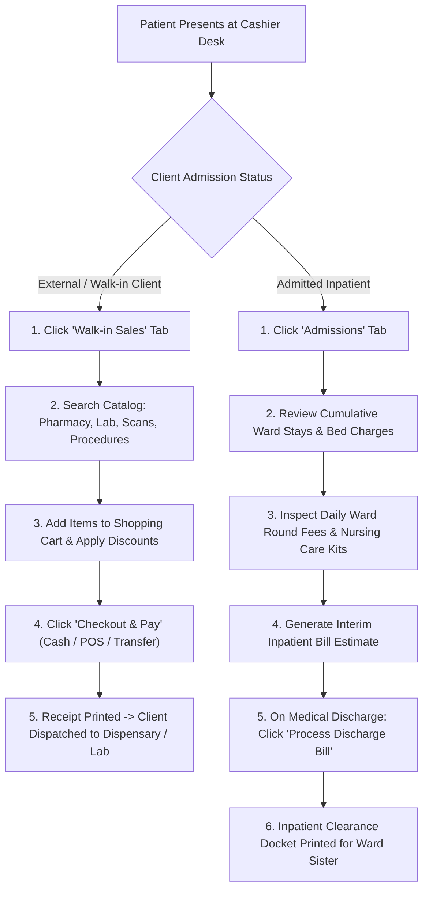

# Walk-in Retail Sales & Inpatient Admissions Billing

ROLE GUARD: SUPERADMIN | ADMIN | ACCOUNTS | BILLER

The **Walk-in Sales & Inpatient Admissions** module supports two vital billing modalities: instant retail point-of-sale checkout for external clients without clinical files, and longitudinal bed-stay and consumable billing for admitted ward patients.

---

## 1. Visual Tour: Walk-in POS & Inpatient Admissions

> [!TIP]
> The Walk-in Sales workspace enables fast item lookup across Laboratory, Imaging, Pharmacy, and Procedures with a live shopping cart, automated tariff selection, and immediate split checkout.

---

## 2. Stepped Operational Storyboard

---

## 3. Walk-in Retail Point-of-Sale (POS)

### Step 1: Navigating to the Walk-in Tab
1. If the client does not have a formal hospital folder number, click the **`Walk-in Sales`** tab (`.workspace-tab[data-tab="walkin"]`).
2. The interface presents a departmental catalog selector:
   - **Laboratory**: Diagnostic investigations (e.g. *Malaria Parasite MP*, *Widal Agglutination*, *Urinalysis*, *Lipid Profile*).
   - **Imaging / Radiology**: Radiography and Ultrasound scans (e.g. *Pelvic Scan*, *Obstetric Scan*, *Chest X-Ray*).
   - **Pharmacy**: Over-the-counter (OTC) medications, first aid items, and direct prescriptions.
   - **Procedures**: Minor clinical dressing, suturing, or cannulation fees.

### Step 2: Adding Items to the Cart & Checkout
1. Type the service or medication name in the product search bar.
2. Click **Add to Cart**. The item appears in the right-hand shopping cart pane.
3. Verify quantity, unit price, and subtotal.
4. Click **`Checkout & Pay`**.
5. Select the payment method (Cash, POS Terminal, or Bank Transfer), collect tender, and confirm payment.
6. The system generates an 80mm thermal receipt with a unique retail transaction number (e.g. `BIL-WALK-2026-0842`) and automatically decrements inventory from the retail pharmacy store.

---

## 4. Inpatient Admissions & Bed Stay Billing

### Step 1: Reviewing Inpatient Stay Parameters
When an admitted patient is selected in the Billing Workbench, click the **`Admissions`** tab (`.workspace-tab[data-tab="admissions"]`):
1. The admissions ledger aggregates all expenses incurred across their hospital stay:
   - **Accommodation & Bed Tariff**: Daily room charges calculated automatically based on admission and discharge timestamps (e.g. *General Ward @ ₦5,000/night*, *Semi-Private Ward @ ₦10,000/night*, *ICU Bed @ ₦35,000/night*).
   - **Ward Round Fees**: Daily consultant physician and pediatric specialist review fees.
   - **Nursing Care & Consumable Kits**: Syringes, cannulas, IV giving sets, and catheter packs logged by ward nurses.
   - **Pharmacy & Surgical Implants**: Medications and specialized implants dispensed to the ward.

### Step 2: Generating an Interim Bill Estimate
1. Family sponsors frequently request estimated costs before surgery or prolonged ICU treatment.
2. Click **`Print Interim Bill`** (`#print-admission-bill`).
3. The system prints a structured pro-forma breakdown showing accrued charges, advance wallet deposits made, and the net estimated balance due.

### Step 3: Medical Discharge Financial Clearance
1. When the attending physician marks the patient as clinically fit for discharge:
2. The cashier reviews the final itemized bill against the patient's advance deposits.
3. If an outstanding balance remains, collect payment via the standard checkout engine.
4. Once the net balance reaches **₦0.00**, click **`Approve Financial Clearance`**.
5. The system issues a stamped **Discharge Clearance Token**. The patient presents this token to the Ward Charge Nurse to unblock bed release and exit gate passes.

---

## 5. Downstream Handover & General Ledger Attribution

- **Pharmacy & Store Stock Sync**: Direct walk-in sales trigger automatic FIFO batch deductions from store inventory without clinician encounters.
- **Nursing Ward Sister Handover**: The Ward Sister checks the Inpatient Clearance status before removing telemetry monitors and discharging the patient folder.
- **Accounting Journal Entries**:
  - Bed charges credit **`4060 - Inpatient Accommodation Revenue`**.
  - Nursing consumable kits credit **`4070 - Nursing Services Revenue`** and debit **`5020 - Consumables Expense`** against inventory reductions.

---

## Developer Reference
👉 **[Read the Billing API Contracts](/developer/workbenches/billing/api-contracts)**  
👉 **[Read the Billing Database & Observers Reference](/developer/workbenches/billing/database-and-models)**

