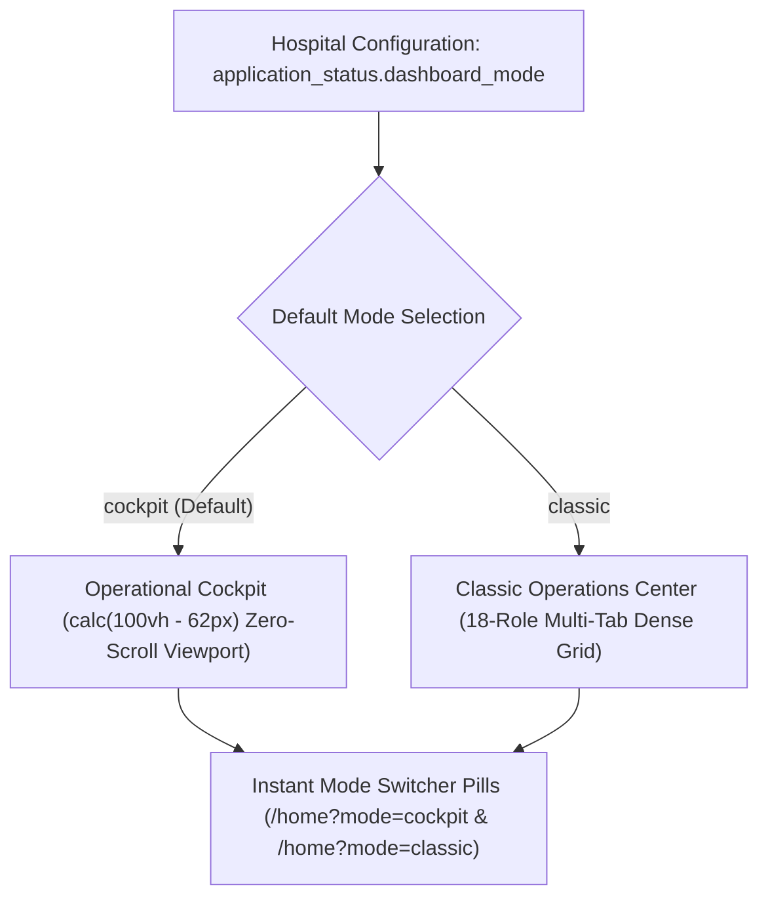

# Operational Cockpit & Executive Dashboard

ROLE GUARD: SUPERADMIN | ADMIN | ALL CLINICAL & ADMINISTRATIVE ROLES

The **Operational Cockpit** (`/home`) provides real-time operational telemetry for executive hospital leadership, department heads, and clinical supervisors. It supports instant switching between a modern **Operational Cockpit** and a restored **Condensed Classic Operations Center**.

---

## 1. Visual Tour: Real-Time Operational Cockpit

> [!TIP]
> The tri-column operational cockpit viewport is locked to `calc(100vh - 62px)` to prevent outer page scroll, organizing live department queues on the left, telemetry KPI sparklines in the center, and the real-time activity stream on the right.

---

## 2. Dual Dashboard Modes

### Tri-Column Operational Cockpit Division:
1. **Column 1: Intake & Department Pipeline (28%)**: Live queue counters for Outpatient Triage, Emergency, Doctors, Pharmacy, Lab, and Admissions.
2. **Column 2: Telemetry & KPI Matrix (44%)**: 2×3 high-density metric grid, sparkline charts (Hourly Patient Inflow & 7-Day Revenue), and operational insight strip.
3. **Column 3: Activity Ledger & 18-Role Launchpad (28%)**: Real-time cross-department event stream with 1-click deep links and a quick-launch dock for all 18 hospital workbenches.

---

## Developer Reference
👉 **[Read the Cockpit Telemetry Developer Reference](/developer/workbenches/cockpit)**

