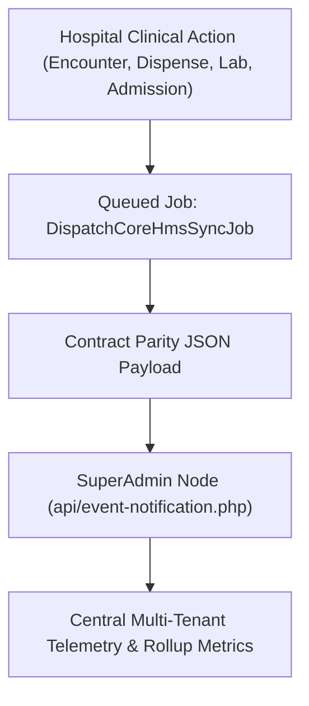

# CoreHMS SuperAdmin Central Monitoring

ROLE GUARD: SUPERADMIN | ADMIN

CoreHealth v2 acts as an autonomous clinical node integrated into the central **CoreHMS SuperAdmin** platform (`Corehealth-Super-Admin/`), providing multi-facility telemetry, retroactive data ingestion, and automated cloud backup streaming.

---

## 1. Central Telemetry & Non-Blocking Event Dispatch

### Key Capabilities:
- **Liveness & Health Endpoints**: Fast `/api/corehms/ping` and detailed `/api/corehms/health` monitoring database latency and queue health.
- **Idempotency & Deduplication Engine**: Enforces SHA1 event deduplication keys (`sha1(facility_id + ':' + event_type + ':' + source_id)`).
- **Automated Database Backups**: Endpoint `/api/corehms/backup` streams encrypted SQL database dumps directly to SuperAdmin storage.

---

## Developer Reference
👉 **[Read the CoreHMS SuperAdmin Sync Contracts Reference](/developer/workbenches/corehms)**

