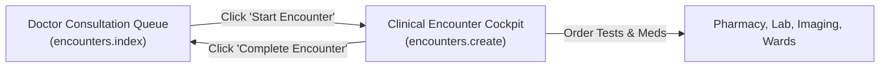
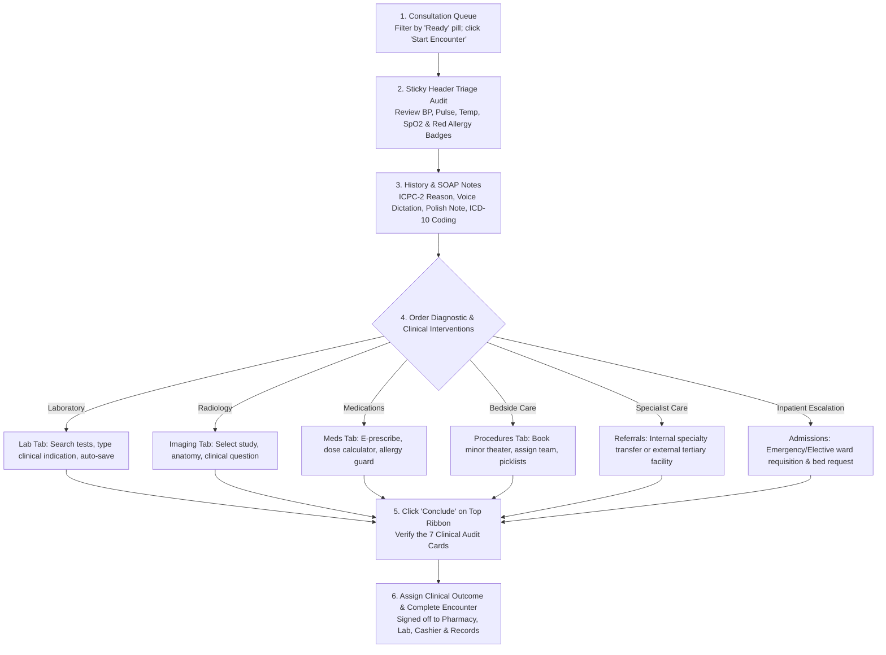

# Doctor Consultation & Clinical Encounter Guide

ROLE GUARD: SUPERADMIN | ADMIN | DOCTOR

The **Doctor Consultation Workbench** is the central clinical environment for Attending Physicians, Medical Officers, Residents, and Specialists. It coordinates the entire patient journey: evaluating waiting room queues, conducting physical examinations, capturing SOAP clinical notes, ordering laboratory and imaging diagnostics, issuing electronic prescriptions, coordinating specialist referrals or inpatient admissions, and executing final clinical dispositions.

---

## 1. Interface Architecture: The Two Primary Clinical Workspaces

Physicians operate across two synchronized, high-density workspaces:

1. **The Consultation Queue (`encounters.index`)**: Roster management screen displaying triage vitals, appointment schedules, and waiting room status. Clinicians review incoming patients and admit them into active consultation.
2. **The Clinical Encounter Cockpit (`encounters.create`)**: Active clinical charting surface featuring the persistent sticky patient header, longitudinal medical timeline, voice dictation, diagnostic ordering panels, and encounter finalization audit.

### A. The Consultation Queue Roster

### B. The Clinical Encounter Cockpit

> [!TIP]
> **Maximizing Charting Screen Space**:
> Click the **Details / Less** button on the right edge of the top patient ribbon. It shrinks the expanded demographic and vitals box from a large panel into a slim 45px strip, giving you maximum vertical room to type clinical notes and review multi-line laboratory panels without scrolling.

---

## 2. Queue Telemetry, Filters & Patient Intake Actions

### Top Ribbon Action Controls
- **`+ New Patient`**: Opens the standard demographic creation modal to register a new hospital file when reception has not completed enrollment.
- **`+ Register Walk-In`**: Initiates fast-track registration for unscheduled walk-in patients with automatic `DOC-` file prefixing.
- **`Emergency Intake` (Red Button)**: Instantiates an immediate casualty encounter for critically unstable patients who cannot await standard triage queues.
- **`Contacts`**: Opens the hospital intercom directory with direct extensions for nursing wards, phlebotomy, radiology, and on-call consultants.
- **`Price List`**: Launches the hospital service tariff lookup to check real-time costs for investigations, medicines, procedures, and bed deposits.

### Master Operational Tabs
- **`My Appt Calendar` (Tab 1, Default)**: The real-time clinic waiting room. Renders seven status-coded KPI metric cards (**Waiting**, **Vitals**, **Ready**, **In Consult**, **Scheduled**, **Completed**, and **Total Active**), calendar versus table view toggles, and instant status filter pills.
- **`Encounter Hist / Admissions` (Tab 2)**: Departmental administrative and inpatient census hub containing five subtabs:
  - **`Previous Encounters`**: Searchable repository of past consultations across all hospital clinics and date ranges.
  - **`My Admissions`**: Active census of inpatients currently hospitalized under your clinical care, showing ward name, bed number (e.g. `Bed 04`), length of stay, and daily ward round charting.
  - **`Other Admissions`**: Hospital-wide inpatient census of patients admitted under colleagues—essential for on-call duty, night coverage, and cross-ward consultations.
  - **`My Referrals`**: Incoming and outgoing specialist consultation tracker with direct actions to **Accept**, **Book into Clinic**, or **Decline**.
  - **`All Referrals`**: Facility-wide master referral ledger for medical directors and clinic coordinators.

### Patient Card Actions
- **`Start Encounter` (Green Button)**: Calls the patient into your consulting room, opens their electronic chart, and starts the consultation stopwatch.
- **`Resume Encounter` (Blue Button)**: Reopens an active encounter for a patient returning from radiology, phlebotomy, or a procedure room.
- **`Check-In` (Purple Button)**: Registers physical clinic arrival for scheduled appointment bookings, advancing them into the active waiting list.
- **`Blocked` (Disabled Grey Button)**: Indicates pending HMO secondary pre-authorization or outstanding cashier deposits. Hovering reveals the specific operational restriction.
- **Secondary Menu Actions**: Allows doctors to **Reschedule**, **Change Doctor**, **Cancel Appointment**, **Mark No-Show**, or preview **View Vitals** in a fast modal.

---

## 3. End-to-End Clinical Flow: From Intake to Final Disposition

### Phase 1: Calling the Patient & Initiating Encounter
Open the consultation queue and select the **Ready** status pill to isolate patients cleared through nursing triage. Locate the target patient card and click **Start Encounter**. The consultation cockpit loads with an active consultation timer tracking clinical duration.

### Phase 2: Telemetry Audit via Sticky Patient Header
Before eliciting history, glance at the top sticky header:
- **Demographics Block**: Verify patient name (including othername), age in years and months, gender, file number, and HMO insurance coverage.
- **Triage Vitals**: Inspect baseline vital signs recorded by nursing: Temperature, Blood Pressure, Heart Rate, Respiratory Rate, and Weight.
- **Safety Alerts & Allergies**: Check the allergies section. Active drug allergies display prominent red warnings (e.g. `Penicillin - Severe Anaphylaxis`). Click `+` to log any newly disclosed allergies.
- **Action Ribbon**: Immediate access to **Edit Patient**, **Admit / Discharge**, **Alerts**, **Report**, **Refer**, and **Conclude**.

### Phase 3: Eliciting History, SOAP Documentation & ICD-10 Coding
Navigate to the **Clinical Notes / Diagnosis** tab:
- **Presenting Complaint & History (HPI)**: Click **Start Dictation** (Beta) to activate hands-free clinical voice capture, or type directly into the rich text editor.
- **AI Note Polishing**: Click **Polish Note** to transform conversational or dictated speech into professional medical terminology, standardizing acronyms (`BP`, `ECG`), structured paragraphs, and dosage notations.
- **Full AI Scribe Mode**: Click **AI Scribe Mode** (or the purple AI FAB) to open the dual-pane ambient scribing studio with real-time waveform visualizer, multi-dialect recognition, Nigerian Clerking / SOAP taxonomy conversion, and automated catalog-grounded orders extraction.
- **Clinical Templates**: Click **Insert Template** to inject standardized departmental clinical templates (e.g. Antenatal Initial Booking, Hypertensive Review, Well-Child Examination).
- **ICPC-2 Reason for Encounter & ICD-10 Diagnosis**: Toggle **Diagnosis Applicable?** and search diagnostic codes. Flag diagnoses as **Confirmed** or **Provisional**. Frequently paired diagnoses can be saved or loaded using **Favorites**.

### Phase 4: Ordering Diagnostics, Pharmaceuticals & Procedures
- **Laboratory Services**: Switch to **Laboratory Services &rarr; New Lab Request**. Search test profiles (e.g. `Full Blood Count`, `Urinalysis`, `Electrolytes/Urea/Creatinine`). Enter explicit clinical indication notes for the laboratory scientist (e.g. *"Fever day 4, assess enteric fever vs severe malaria"*). Tests auto-save immediately.
- **Medications & Prescriptions**: Switch to **Medications &rarr; Add Prescription**. Search brand or generic drugs. Enter dosage, route (`Oral`, `IV`, `IM`), frequency (`OD`, `BD`, `TID`), and duration. The system automatically computes total dispensing quantity and HMO copays. For returning chronic patients, use the **Drug History** subtab to **Re-prescribe** past items with one click, or use **Re-prescribe from Encounter** to refill an entire previous clinic visit.
- **Imaging Services**: Switch to **Imaging Services &rarr; New Imaging Request**. Select requested studies (e.g. `Chest X-Ray PA`, `Abdominal Pelvic Ultrasound`). Specify anatomical region and clinical indications for the radiographer.
- **Procedures**: Switch to **Procedures &rarr; Request / Book Procedure** to schedule minor surgical interventions, configure consumable pick-lists (sutures, local anesthetics, dressing packs), and assign theater personnel.

### Phase 5: Specialist Transfer or Ward Admission
- **Specialist Referrals**: Click **Refer** on the top ribbon. Select `Internal (Within Hospital)` (specifying target department such as Cardiology or ENT) or `External (Outside Hospital)` (specifying receiving tertiary facility). Assign clinical urgency (`Routine`, `Urgent`, or `Emergency`).
- **Ward Admission**: Click **Admit** on the top ribbon. Select the destination ward (*Male Medical*, *Female Surgical*, *Paediatric*, *ICU*), designate admission priority (`Emergency` vs `Elective`), and enter immediate admitting orders, intravenous fluid protocols, and dietary instructions (`Strict NPO`, `Diabetic Protocol`).

### Phase 6: Encounter Finalization & Clinical Disposition
Click **Conclude** (<i class="fa fa-check-circle"></i>) on the top ribbon to open the encounter sign-off modal:
1. **Audit the 7 Live Summary Cards**: Review Diagnosis & Notes, Lab Requests, Imaging Requests, Prescriptions, Procedures, Specialist Referrals, and Care Plan / Non-Pharm.
2. **Assign Clinical Outcome**: Select from the 8 official dispositions:
   - `Consultation Finalized / Continuing Care`
   - `Discharged / Stable`
   - `Improved`
   - `Unimproved`
   - `Referred Out`
   - `Absconded / DAMA`
   - `Deceased (RIP)` *(reveals Date, Time, Primary Cause, and Certifying Doctor)*
   - `Brought In Dead (BID)`
3. **Follow-Up Scheduling**: Toggle **Schedule Follow-Up** to book the patient's next clinical review date, time slot, and priority.
4. **Complete Encounter**: Click **Complete Encounter**. The session closes, stopping the consultation timer, committing the encounter to the medical record, and dispatching all orders across hospital departments.

---

## 4. Downstream Clinical & Operational Handover Chain

| Hospital Department | Data Transmitted from Encounter | Operational Action Executed |
|:---|:---|:---|
| **Laboratory & Phlebotomy** | Electronic test requisitions with clinical notes and specimen specifications. | Phlebotomy desk draws blood/specimens, barcodes samples, marks `SAMPLE TAKEN`, and routes tubes to laboratory analyzers. |
| **Radiology & PACS** | Diagnostic imaging orders with anatomical views and clinical rationale. | Radiographer calls patient, executes imaging study, and transmits DICOM images to the PACS viewer. |
| **Pharmacy Dispensary** | Electronic prescriptions with dosage, route, frequency, and dispensing instructions. | Pharmacist performs clinical drug-drug checks, prints dosage labels, dispenses items, and deducts FIFO store stock. |
| **Inpatient Wards** | Ward admission requisition with admitting diagnosis and nursing directives. | Charge nurse allocates available physical bed (e.g. `Male Medical - Bed 04`) and activates the electronic MAR. |
| **Cashier / Billing Desk** | Itemized billing ledger with pre-calculated HMO co-pays or self-pay fees. | Cashier collects co-pays or outstanding deposits; HMO authorizations link automatically to billing claims. |
| **Medical Records** | Signed encounter SOAP note, ICD-10 codes, and clinical reports. | Archived into the patient's permanent longitudinal chart, accessible during future visits and audits. |

---

## 5. Doctor Deep-Dive Operational Subpages

For exhaustive field-by-field instructions, workflow parameters, and clinical configurations:
- 👉 **[Consultation Queue & Triage Filtering](/user-guides/workbenches/doctor/consultation-queue)** — Roster management, 7 KPI cards, multi-dimensional filters, calendar vs table view, and historical rosters.
- 👉 **[Active Clinical Intake & AI Notes](/user-guides/workbenches/doctor/clinical-encounter)** — Sticky patient header, 13 clinical tabs, voice dictation, SOAP documentation, and AI note polishing.
- 👉 **[Clinical AI Scribe Studio ("Full AI Mode")](/user-guides/workbenches/doctor/clinical-ai-scribe)** — Ambient voice scribing, real-time waveform visualizer, multi-taxonomy note structuring, and catalog-grounded order extraction.
- 👉 **[Multi-Department Diagnostic Orders & E-Prescriptions](/user-guides/workbenches/doctor/clinical-orders)** — Step-by-step guide to ordering lab panels, imaging studies, e-prescriptions, and bedside procedures.
- 👉 **[Clinical Referrals, Inpatient Admissions & Discharge](/user-guides/workbenches/doctor/referrals-and-discharge)** — Specialist transfers, inpatient admission orders, encounter sign-off audit, and discharge summaries.

---

## Technical Developer Reference
For developer route contracts, Eloquent observer triggers, database schemas, and JSON payloads:
👉 **[Read the Doctor Consultation Developer API Reference](/developer/workbenches/doctor)**
