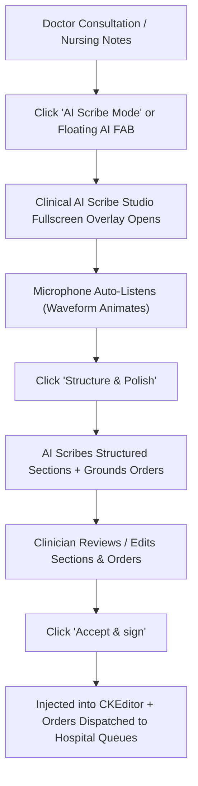

# Clinical AI Scribe Studio ("Full AI Mode") User Guide

**Date**: 2026-11-10  
**Git Release Tag**: `v2.6.0.68`  
**Domain**: Clinical AI, Voice-to-Text Dictation, Multi-Taxonomy Note Structuring, Closed-Loop Clinical Order Routing  
**Workbenches Supported**: Doctor New Encounter (`admin.doctors.new_encounter`), Nursing Workbench (`admin.nursing.workbench`), Maternity Workbench (`admin.maternity.workbench`)

---

## 1. Clinical Objective & Overview

In high-volume hospital outpatient departments (OPD), inpatient wards, and emergency suites, clinicians face severe cognitive overload balancing attentive patient engagement with rigorous, legally binding documentation. 

The **Clinical AI Scribe Studio ("Full AI Mode")** introduces an ambient clinical scribing studio embedded directly inside CoreHealth v2:
- **Ambient Voice Capture & Real-Time Waveform**: Clinicians speak naturally with patients or narrate findings. The microphone stream is visualized in real-time at 60 FPS using dynamic hospital branding (`var(--hospital-primary)`).
- **Multi-Dialect & Language Recognition**: Out-of-the-box support for Nigerian English (`en-NG`), Pidgin (`pcm-NG`), Hausa, Yoruba, Igbo, and all international hospital language files (`fr`, `es`, `ar`, `pt`, `nl`, `zh`).
- **Dynamic Taxonomy Switcher**: Adapts to physician, nursing, and obstetric practices:
  - **Physicians**: Traditional Nigerian Clinical Clerking (`[PC]`, `[HPC]`, `[ROS]`, `[PMH]`, `[Exam]`, `[Impression]`, `[Plan]`) as the default, with instant lossless conversion to `[SOAP]` or `[POMR]`.
  - **Nurses**: Focus `[DAR]` (Data, Action, Response) as the default, with pills for `[SBAR]` handover and NMCN `[SOAPIE]` nursing process.
  - **Maternity**: Journey-aware clinical headings (`Antenatal Care`, `Labor & Delivery`, `Postnatal Follow-up`, `Neonatal Assessment`).
- **Interactive Orders & Prescriptions Deck**: Real-time extraction of laboratory requests, imaging studies, pharmacy prescriptions, procedures, specialist referrals, and follow-up reviews grounded strictly in hospital catalog categories.
- **Human-in-the-Loop Sign-Off**: Explicit `Draft · clinician review required` governance ensures no medical note or bill is committed without clinician verification.
- **Continuous Background Auto-Save**: Persistent draft engine synchronizes every 500ms to `sessionStorage` and `localStorage`, timestamping progress (e.g. `Draft auto-saved at 00:33`) to ensure zero clinical data loss during network hiccups or tab switches.

### Live Consultation Walkthrough (Dual-Context & Order Grounding)
In the authentic clinical session shown above (`Patient: Nwosu Abel Ifeanyi · ID 21-26-48`):
1. **Existing Baseline Chart Ingestion**: The studio detects and displays pre-existing chart documentation (*"Patient is a known hypertensive on amlodipine. Reports mild epigastric discomfort since yesterday."*) in a dedicated **Prior Context** box at the top of the left pane.
2. **Ambient Voice Dictation**: Below the dashed **Live Voice Dictation Stream** divider, the clinician dictates new acute developments (*"Patient also reports severe right lower quadrant pain for 6 hours, vomiting twice, low grade fever. On exam tender McBurney point..."*).
3. **Cohesive Multi-Taxonomy Structuring**: Clicking **Structure & Polish** synthesizes both inputs into one unified note:
   - **Executive Title**: *"21-year-old female with acute appendicitis, presenting with severe right lower quadrant pain, vomiting, and low-grade fever."*
   - **`[PC] Presenting Complaint`**: *"Severe right lower quadrant pain."*
   - **`[HPC] History of Presenting Complaint`**: Merges acute RLQ pain and vomiting with the prior mild epigastric discomfort.
   - **`[PMH] Past Medical History`**: Seamlessly incorporates the known hypertension on amlodipine from the baseline note.
4. **Standardized Clinical Orders Deck**:
   - **Prescriptions Pipe Standard**: Medications follow the strict clinical regimen format: `<dose> | <frequency> | <duration> | <route>` (e.g. `FLAGYL 200MG TAB. (metronidazole)` &rarr; `500mg | STAT | 1 dose | IV`).
   - **Spacious Editing Fields**: Inline inputs provide spacious widths and proper contextual placeholders (`e.g. Fasting sample / Stat / Pelvic prep`) without artificial mock values.

---

## 2. Exact UI Location / Where to Click

1. **Doctor New Encounter**:
   - Navigate to **Consultations $\to$ Consultation Queue** and select a waiting patient.
   - In the **Clinical Notes** tab, locate the toolbar above the diagnosis box (`doctor_diagnosis_text`).
   - Click the black & gold button: **`AI Scribe Mode`** (or click the floating purple AI FAB button on the bottom right of the screen).
2. **Nursing Workbench**:
   - Open **Nursing Workbench $\to$ Notes History $\to$ Add Note**.
   - In the note header toolbar, click **`AI Scribe Mode`**.
3. **Maternity Workbench**:
   - Open **Maternity Workbench $\to$ Antenatal Visits** or **Postnatal Care**.
   - Click **`AI Scribe Mode`** from the clinical notes action bar.

---

## 3. Required vs Optional Fields, Types & Variations

| Element / Action | Type | Obligation | Description & Clinical Rules |
| :--- | :--- | :--- | :--- |
| **Language Select** | Dropdown | Optional | Defaults to `Nigerian English (en-NG)`. Switch to British, American, Pidgin, Hausa, Yoruba, Igbo, French, Spanish, Arabic, or Chinese. |
| **Taxonomy Switcher Pill** | Button Pill | Optional | Click to toggle format. For doctors: `Clerking (Default)`, `SOAP`, or `POMR`. For nurses: `Focus DAR (Default)`, `SBAR`, `SOAPIE`. Losslessly converts text. |
| **Microphone Stream** | Audio Stream | Required (Voice) | Real-time speech input captured via browser Web Speech API and 60 FPS Web Audio Analyser. |
| **Existing Editor Content**| Text | Optional | Any notes already in the CKEditor are automatically ingested as baseline context so no prior typing is discarded. |
| **Section In-Place Edit** | Text Field | Optional | Click `Edit` to activate inline editing on any structured section card before sign-off. |
| **Orders Inclusion Toggle**| Checkbox `[x]` | Optional | Checked orders are dispatched to hospital queues. Uncheck any test or medication you wish to omit. |
| **Dosage & Instructions** | Inline Input | Optional | Clinicians can adjust drug doses (e.g. `1g TDS x 3/7`) and clinical instructions directly in the table. |
| **Accept & Sign** | Commit Button | **Mandatory** | Commits the verified note to the patient's record, dispatches orders, and records audit history. |

---

## 4. Downstream Handover (Who Gets It Next and What They Do)

When the attending clinician reviews the draft and clicks **`✓ Accept & sign`**, CoreHealth v2 executes closed-loop routing:

1. **Active Clinical Note Replacement & Orders Manifest**:
   - The contents of the active CKEditor (`doctor_diagnosis_text` for doctors, `#nursing-note-editor` for nurses) are completely replaced with the unified polished note.
   - Appended below an `
` dividing rule is a comprehensive manifest: **`Dispatched Clinical Orders & Requests`** detailing all prescribed medications (with strict pipe-separated dosages), diagnostic procedures, laboratory tests, and specialist consultations.
   - Triggers the workbench autosave engine (`autosavenotes()`), committing the record immediately to the EHR.
2. **Medical Laboratory (LIS)**:
   - Approved tests (e.g. *Full Blood Count*, *Urinalysis*, *Malaria Parasite*) route to `lab_service_requests`.
   - The lab phlebotomy and bench workbenches immediately receive the patient order in their active intake queues.
3. **Pharmacy & Dispensary**:
   - Prescribed medications route directly to `product_requests` (`dispensing_queue`).
   - Pharmacists view the drug, dose, frequency, duration, and doctor's instructions for immediate dispensing or bill staging.
4. **Specialist Referrals & Reception Follow-up**:
   - Referrals route to `specialist_referrals` with priority level and clinical justification.
   - Clinic review dates route to `doctor_appointments` (`QueueStatus::SCHEDULED`), appearing on reception desk reminder lists.
5. **Regulatory Audit Trail**:
   - An immutable record is created in `ai_scribe_audits` capturing the clinician ID, timestamp, original dictation, baseline text, structured JSON, and model identifier for medico-legal verification.

