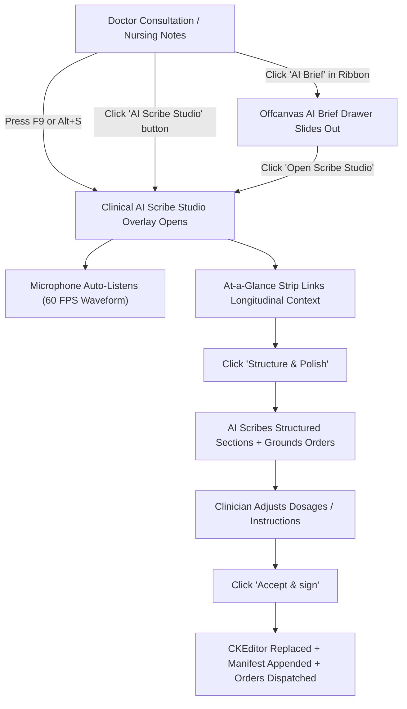

# Clinical AI Scribe Studio ("Full AI Mode") User Guide

**Date**: 2026-11-10  
**Git Release Tag**: `v2.6.0.68`  
**Domain**: Clinical AI, Voice-to-Text Dictation, Multi-Taxonomy Note Structuring, Closed-Loop Clinical Order Routing  
**Workbenches Supported**: Doctor New Encounter (`admin.doctors.new_encounter`), Nursing Workbench (`admin.nursing.workbench`), Maternity Workbench (`admin.maternity.workbench`)

---

## 1. Clinical Objective & Overview

In high-volume hospital outpatient departments (OPD), inpatient wards, and emergency suites, clinicians face severe cognitive overload balancing attentive patient engagement with rigorous, legally binding documentation. 

The **Clinical AI Scribe Studio ("Full AI Mode")** introduces an ambient clinical scribing studio embedded directly inside CoreHealth v2:
- **Streamlined Clinical AI Architecture**: Replaces confusing multi-button bars and bouncing FABs with a clean 3-button note toolbar: `[Insert Template]`, `[✦ AI Scribe Studio (F9)]`, and `[🪄 Quick Polish]`.
- **Longitudinal AI Patient Briefing**:
  - The sticky patient ribbon features a rectangular `[✦ AI Brief]` button (border-radius: 6px matching `Alerts`, `Report`, `Refer`, and `Conclude`).
  - Proactively pre-fetches the patient's longitudinal EHR synthesis in the background on page load with a subtle toastr notification (`Longitudinal AI Patient Brief synthesized`).
  - Clicking `[✦ AI Brief]` smoothly slides out a sleek, high-density offcanvas drawer on the right with synthesized clinical sections, audio narration controls, and an "Open Scribe Studio (F9)" button.
- **Ambient Voice Capture & Real-Time Waveform**: Clinicians speak naturally with patients or narrate findings. The microphone stream is visualized in real-time at 60 FPS using dynamic hospital branding (`var(--hospital-primary)`).
- **Multi-Dialect & Language Recognition**: Out-of-the-box support for Nigerian English (`en-NG`), Pidgin (`pcm-NG`), Hausa, Yoruba, Igbo, and all international hospital language files (`fr`, `es`, `ar`, `pt`, `nl`, `zh`).
- **At-a-Glance Longitudinal Context Strip**:
  - Embedded at the top of the Scribe Studio, linking the patient's active allergies, chronic history, and vitals.
  - Expands inline on demand without navigating away from dictation.
  - Passed to the LLM as background intelligence to guide abbreviations and clinical impressions without echoing or regurgitating historical facts into the acute consultation note.
- **Permanent Master Action Controls in Header Ribbon**:
  - `[Accept & sign]` (with live `+N orders` badge counter), `[Edit]`, and `[Discard]` buttons are permanently anchored in the sticky header ribbon (`.scribe-studio-header`).
  - Clinicians can sign off, edit, or discard drafts at any time regardless of card folding, scrolling, or active cockpit steps. Synchronized quick-commit buttons are also present inside the Note card and Orders Deck.
- **Dynamic Taxonomy & Clerking Selector Inside Dictate Card**: Adapts to physician, nursing, and obstetric practices right inside the Voice Dictation card:
  - **Physicians**: Traditional Nigerian Clinical Clerking (`[PC]`, `[HPC]`, `[ROS]`, `[PMH]`, `[Exam]`, `[Impression]`, `[Plan]`) as the default, with instant lossless conversion to `[SOAP]` or `[POMR]`.
  - **Nurses**: Focus `[DAR]` (Data, Action, Response) as the default, with pills for `[SBAR]` handover and NMCN `[SOAPIE]` nursing process.
  - **Maternity**: Journey-aware clinical headings (`Antenatal Care`, `Labor & Delivery`, `Postnatal Follow-up`, `Neonatal Assessment`).
- **Multi-Tier Deterministic Catalog Grounding Engine**:
  - Automatically resolves service categories from hospital `appsettings()`: Laboratory (`investigation_category_id`, default 2), Radiology & Imaging (`imaging_category_id`, default 6), Procedures (`procedure_category_id`, default 8), Nursing (`nursing_service_category`, default 4), and Specialist Consultations (`consultation_category_id`, default 1).
  - Pre-compresses active hospital services into token-dense representations (~3 tokens per item) so large hospital catalogs (e.g. 200+ imaging protocols or 500+ lab tests) never cause token explosion or truncation.
  - Dynamically expands clinical acronyms and synonyms (`CXR` &rarr; Chest X-Ray, `FBC` &rarr; Full Blood Count, `USS` &rarr; Ultrasound, `E/U/Cr` &rarr; Electrolytes/Urea/Creatinine, `I&D` &rarr; Incision & Drainage) to guarantee 100% deterministic candidate retrieval.
  - Extracts pharmaceuticals directly from the hospital's live `products` inventory.
- **Interactive Orders & Prescriptions Deck with Catalog Grounding & Deduplication**:
  - Real-time extraction of laboratory requests, imaging studies, pharmacy prescriptions, procedures, specialist referrals, and follow-up reviews.
  - Grounded items display green check badges with exact database IDs (`#ID`).
  - Rare non-catalog requests are prominently flagged with an amber **`[FREE-FORM]`** warning badge and a top notification banner so clinicians verify before dispatching.
  - **Interactive Catalog Matcher**: Clinicians can click **`[Match Catalog]`** on any free-form item to search the hospital's live `services` and `products` catalog in real-time, instantly linking the order to an official catalog ID, department queue, and HMO/cash tariff price.
  - Dispatched orders display a prominent `✓ DISPATCHED` badge and lock their controls to prevent duplicate billing upon subsequent notes sign-off.
- **4 Persistent & Foldable Cockpit Pillars (Zero-Scroll Master Viewport)**:
  - **Pillar 1 (Patient Longitudinal Summary Deck)**: First in chronological flow at the top of the studio. Foldable and dockable to a 42px minimal ticker bar, expandable to 240px for deep history review, or maximizable to 58vh when focusing on Step 1. Includes built-in Text-to-Speech audio narration (`[Listen]` / `[Stop]`).
  - **Pillar 2 (Voice Dictation)**: Ambient audio waveform, live streaming transcript, and embedded Clerking Method selector. Can be focused or folded to a compact 46px rail.
  - **Pillar 3 (Structured Clinical Note)**: Real-time structured sections with inline editing and safety warnings. Can be focused or folded to a 46px rail.
  - **Pillar 4 (Orders Deck)**: Docked by default in a sleek 42px bottom bar with counter badges and preview ticker (`Amoxicillin, FBC, CXR · Click to expand`), expanding to 240px for review, or maximizing to 58vh when focusing on order staging. All 4 sections remain present and visible at all times so nothing is pushed off-screen or forgotten.
- **Workflow Step Navigation (`1. Summary` &rarr; `2. Dictate` &rarr; `3. Note` &rarr; `4. Orders` &rarr; `Split`)**: Whichever section the clinician is actively working on expands to take the most screen space while preserving a visible, minimal footprint for the others.
- **Human-in-the-Loop Sign-Off**: Explicit `Draft · clinician review required` governance ensures no medical note or bill is committed without clinician verification.
- **Continuous Background Auto-Save**: Persistent draft engine synchronizes every 500ms to `sessionStorage` and `localStorage`, timestamping progress (e.g. `Draft auto-saved at 00:33`) to ensure zero clinical data loss during network hiccups or tab switches.

---

## 2. Exact UI Location / Where to Click

1. **Doctor New Encounter (`http://localhost:8000/encounters/create?patient_id=X`)**:
   - **Keyboard Shortcut**: Press `F9` or `Alt+S` anywhere on the page to toggle the Studio open or closed; press `Escape` to close.
   - **Note Toolbar**: Directly above the diagnosis box (`#doctor_diagnosis_text`), click **`✦ AI Scribe Studio (F9)`** for ambient dictation or **`🪄 Quick Polish`** to instantly polish existing text.
   - **Sticky Patient Ribbon**: In both compact and expanded headers, click the rectangular cyan button **`✦ AI Brief`** to open the longitudinal clinical drawer.
2. **Nursing Workbench (`/nursing-workbench`)**:
   - Open **Nursing Notes History $\to$ Add Note**.
   - In the note header toolbar, click **`✦ AI Scribe Studio (F9)`** or press `F9`.
3. **Maternity Workbench (`/maternity-workbench`)**:
   - Open **Antenatal Visits**, **Labor Progress**, or **Postnatal Care**.
   - Click **`✦ AI Scribe Studio (F9)`** from the clinical notes action bar.

---

## 3. Required vs Optional Fields, Types & Variations

| Element / Action | Type | Obligation | Description & Clinical Rules |
| :--- | :--- | :--- | :--- |
| **Language Select** | Dropdown | Optional | Defaults to `Nigerian English (en-NG)`. Switch to British, American, Pidgin, Hausa, Yoruba, Igbo, French, Spanish, Arabic, or Chinese. |
| **Taxonomy Switcher Pill** | Button Pill | Optional | Click to toggle format. For doctors: `Clerking (Default)`, `SOAP`, or `POMR`. For nurses: `Focus DAR (Default)`, `SBAR`, `SOAPIE`. Losslessly converts text without losing data. |
| **Step Navigator** | Button Group | Optional | Switch between `1. Summary`, `2. Dictate`, `3. Note`, `4. Orders`, and `Split` to dynamically focus the primary operational phase. |
| **Summary Deck Controls** | Deck Controls | Optional | Toggle between `Docked` (42px preview ticker), `Expanded` (240px summary view), and `Focus / Maximized` (58vh deep history review). Click `[Listen]` for Text-to-Speech narration. |
| **Card Focus & Fold** | Header Buttons | Optional | Click `Focus` to expand the pane to 68% width; click `Fold` to collapse the card into a sleek 46px vertical rail. |
| **Orders Deck Dock/Max** | Deck Controls | Optional | Toggle between `Docked` (42px preview bar), `Expanded` (240px table), and `Focus / Maximized` (58vh deep order review). |
| **Catalog Matcher** | Modal Dialog | Optional | Click `[Match Catalog]` on any `[FREE-FORM]` order to search hospital services and medications live, linking to official tariffs. |
| **Longitudinal Brief Strip**| Collapsible Bar | Informational | Displays at-a-glance patient chronic history and vitals. Click `Details` to view full EHR synthesis inline. |
| **Microphone Stream** | Audio Stream | Required (Voice) | Real-time speech input captured via browser Web Speech API and 60 FPS Web Audio Analyser. |
| **Existing Editor Content**| Text | Optional | Any notes already in the CKEditor are automatically ingested as baseline context so prior typing is never discarded. |
| **Section In-Place Edit** | Text Field | Optional | Click `Edit` to activate inline editing on any structured section card before sign-off. |
| **Orders Inclusion Toggle**| Checkbox `[x]` | Optional | Checked orders are dispatched to hospital queues. Dispatched items show `✓ DISPATCHED` with locked checkboxes. |
| **Dosage & Instructions** | Inline Input | Optional | Clinicians can adjust drug doses (e.g. `500mg \| TID \| 3 days \| Oral`) and instructions directly in the table. |
| **Accept & Sign** | Commit Button | **Mandatory** | Commits the verified note to the patient's record, dispatches pending orders, and records audit history. |

### Hospital Configuration & System Prompts
Administrators configure system prompts in **Hospital Configuration $\to$ Clinical AI & LLM Settings**:
- `clinical_scribe`: Governs ambient voice parsing, role perspective, prescription syntax (`<dose> | <frequency> | <duration> | <route>`), order categorization, and strict non-regurgitation of longitudinal background.
- `convert_taxonomy`: Directs lossless translation between clinical taxonomies (SOAP, Traditional Nigerian Clerking, POMR, Focus DAR, SBAR, SOAPIE).
- Managed via database migration `2026_11_10_020000_update_clinical_scribe_prompts_in_application_status.php`.

---

## 4. Downstream Handover (Who Gets It Next and What They Do)

When the clinician clicks **`✓ Accept & sign`**, CoreHealth v2 executes closed-loop routing:

1. **Active Clinical Note Replacement & Orders Manifest**:
   - The contents of the active CKEditor (`doctor_diagnosis_text` for doctors, `#nursing-note-editor` for nurses) are completely replaced with the unified polished note.
   - Appended below an `
` dividing rule is a comprehensive manifest: **`Dispatched Clinical Orders & Requests`** detailing all prescribed medications (with strict pipe-separated dosages), diagnostic procedures, laboratory tests, and specialist consultations.
   - Triggers the workbench autosave engine (`autosavenotes()`), committing the record immediately to the EHR.
2. **Medical Laboratory (LIS)**:
   - Approved tests (e.g. *Full Blood Count*, *Urinalysis*, *Malaria Parasite*) route via `POST /encounters/{id}/add-lab` (`window.setSearchValSer`) directly to `lab_service_requests` (`lab_queue`), immediately updating `#selected-services` and reloading `#investigation_history_list`.
3. **Radiology & Diagnostic Imaging (RIS)**:
   - Imaging scans (e.g. *Chest X-Ray*, *Abdominal Ultrasound*, *Brain CT*) route via `POST /encounters/{id}/add-imaging` (`window.setSearchValImaging`) to `lab_service_requests` with `is_imaging = true` (`imaging_queue`), immediately updating `#selected-imaging-services` and reloading `#imaging_history_list`.
4. **Clinical & Surgical Procedures Suite**:
   - In-office or surgical procedures (e.g. *Wound Dressing*, *Catheterization*, *Appendectomy*) route via `POST /encounters/{id}/add-procedure` to `procedures` (`procedure_queue`), updating `#selected-procedures` and reloading `#procedure_history_list`.
5. **Pharmacy & Dispensary**:
   - Prescribed medications route via `POST /encounters/{id}/add-prescription` (`window.setSearchValProd`) directly to `product_requests` (`dispensing_queue`), updating `#selected-products` and reloading `#presc_history_list`.
   - Pharmacists view the drug, dose, frequency, duration, and doctor's instructions for immediate dispensing or bill staging.
6. **Specialist Referrals & Reception Follow-up**:
   - Referrals route to `specialist_referrals` with priority level and clinical justification.
   - Clinic review dates route to `doctor_appointments` (`QueueStatus::SCHEDULED`), appearing on reception desk reminder lists.
7. **Regulatory Audit Trail**:
   - An immutable record is created in `ai_scribe_audits` capturing the clinician ID, timestamp, original dictation, baseline text, structured JSON, and model identifier for medico-legal verification.
