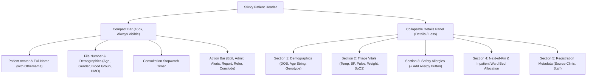
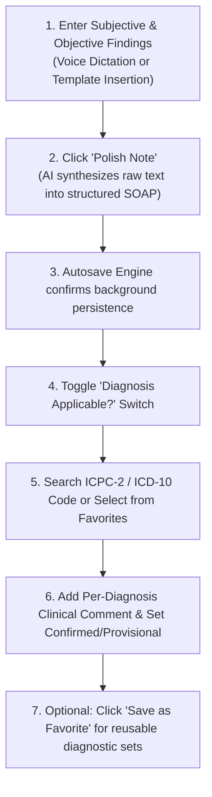
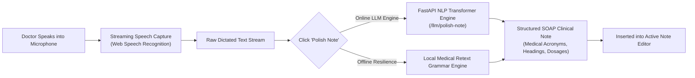

# Active Clinical Intake & AI Notes Documentation

ROLE GUARD: SUPERADMIN | ADMIN | DOCTOR

The **Active Clinical Intake Cockpit** is the physician's core consultation charting environment. It unifies patient telemetry, longitudinal electronic health records, AI-assisted clinical note polishing, hands-free voice dictation, and ICD-10 diagnostic coding into an efficient clinical workspace.

---

## 1. Visual Tour: Intake Cockpit & Notes Workspace

### Active Intake Cockpit (Expanded Header View)

### Clinical Notes & Diagnosis Workspace (Compact Header View)

> [!TIP]
> **Collapsing Header for Maximum Typing Space**:
> Clicking the **Details / Less** button on the right edge of the top blue header bar shrinks the expanded demographic and vitals box into a slim 45px strip. This keeps patient identity and emergency actions visible while unlocking maximum vertical space for charting.

---

## 2. Persistent Sticky Patient Header Architecture

The persistent consultation header remains pinned at the top of the viewport across all tabs, ensuring clinicians never lose sight of critical safety telemetry:

### The 5 Sections of the Expanded Details Panel
1. **Patient Demographics**: Displays date of birth, formatted age string (e.g., `26 Yrs 4 Mos 12 Days`), gender, blood group, genotype (e.g., `AA`, `AS`), and primary HMO insurance provider.
2. **Triage Vital Signs**: Real-time readings recorded by nursing triage: Temperature, Blood Pressure (e.g., `120/80 mmHg`), Heart Rate, Respiratory Rate, and Weight.
3. **Safety Allergies**: Red warning badges displaying documented drug and food allergies. Clinicians can click the `+` button to log newly disclosed allergies on the spot.
4. **Next-of-Kin & Ward Status**: Displays emergency contact name, relationship, and telephone number, along with current admission status (`Not Admitted`, `Pending Bed`, `Admitted (Bed 04)`). Includes a direct link to **View Old Records** (scanned paper archives).
5. **Registration Metadata**: Details originating clinic source (e.g., `From: Reception`), check-in date/time, and registering staff member.

### Action Ribbon Controls
- **`Edit Patient` (<i class="mdi mdi-pencil"></i>)**: Opens the demographic editor to update phone numbers, home address, or next-of-kin details without closing the encounter.
- **`Admit / Discharge` (<i class="fa fa-bed"></i>)**: Submits an emergency or elective inpatient ward bed requisition. If the patient is already hospitalized, this button dynamically converts to **Discharge** to initiate the inpatient discharge protocol.
- **`Alerts` (<i class="mdi mdi-alert-octagon"></i>)**: Manages critical safety alerts (e.g., fall precautions, infection control, bleeding tendencies) that broadcast across nursing and medical workbenches.
- **`Report` (<i class="mdi mdi-file-document"></i>)**: Launches the Report Builder to compile official medical reports, sick leave certificates, or fitness-for-duty evaluations.
- **`Refer` (<i class="mdi mdi-account-switch"></i>)**: Opens the Specialist Referrals docket to initiate internal clinic transfers or external tertiary hospital handovers.
- **`Conclude` (<i class="fa fa-check-circle"></i>)**: Opens the final encounter audit window featuring 7 live clinical summary cards before signing off.
- **`Details v / Less ^`**: Toggles the top header between the expanded 5-section panel and the compact 45px strip.

---

## 3. The 13 Organized Clinical Tabs

The encounter workspace provides 13 organized clinical tabs accessible via the left navigation drawer:

| Clinical Tab | Primary Capability & Purpose |
|:---|:---|
| **1. Treatment Plans** | Longitudinal chronic disease care pathways (e.g., Hypertension, Diabetes) tracking target clinical metrics and staged interventions. |
| **2. Clinical Story** | Unified chronological timeline aggregating all previous hospital encounters, nursing entries, lab results, and diagnostic scans. |
| **3. Vitals / Allergies** | Graphical trend analysis of vital signs over time, highlighting abnormal parameters, with dedicated allergy management. |
| **4. Nurse Charts** | Displays inpatient nursing documentation: Medication Administration Records (MAR), Fluid Intake/Output, Solid Intake/Output, and Nursing Notes. |
| **5. Inj / Imm History** | Complete historical registry of administered vaccinations, immunization schedules, and bedside therapeutic injections. |
| **6. Clinical Notes / Diagnosis** | Primary clinical documentation surface for presenting complaints, physical examination, and ICD-10 diagnostic coding. |
| **7. Laboratory Services** | Full LIS ordering interface, specimen collection tracking, and historical pathologist-validated test reports. |
| **8. Imaging Services** | Diagnostic radiology ordering across X-ray, Ultrasound, CT, and MRI modalities with PACS diagnostic reports. |
| **9. Medications** | Electronic prescribing engine with automated dosage calculations, HMO formulary verification, and one-click refills. |
| **10. Care Plan / Non-Pharm** | Non-pharmacological orders, lifestyle counsel, dietary guidelines, and nursing care directives. |
| **11. Procedures** | Requisitioning and theater booking for minor surgical interventions, suturing, wound debridement, and consumable picklists. |
| **12. Admission History** | Full archive of previous inpatient ward hospitalizations, admitting diagnoses, and discharge summaries. |
| **13. Referrals** | Registry of internal specialist consults and external tertiary referral transfers. |

---

## 4. Clinical Notes Documentation & ICD-10 Diagnosis

The **Clinical Notes / Diagnosis** tab standardizes medical documentation into the SOAP (Subjective, Objective, Assessment, Plan) model:

### Note Editor & Clinical Dictation Tools
- **Rich-Text SOAP Note Editor**: Dedicated documentation area supporting formatted paragraphs, bulleted examination findings, and clinical tables.
- **Autosave Engine**: Displays a live autosave indicator (`Autosave enabled`), saving modifications automatically in the background every 15 seconds to prevent data loss.
- **`Insert Template`**: Opens the clinical template browser, allowing physicians to inject pre-configured documentation templates (e.g., *Antenatal Booking*, *General Medical Review*, *Hypertension Follow-Up*).
- **`See Patient Profiles` Accordion**: Allows clinicians to view past specialized questionnaires or click **`+ Fill New Patient Profile`** to capture structured specialty clinical forms.

### Diagnostic Coding Engine (ICPC-2 & ICD-10)
- **`Diagnosis Applicable?` Toggle**: When switched on, unlocks official diagnostic coding fields.
- **Search Diagnosis Catalog**: Enter at least two characters (code or description, e.g., `A03`, `Hypertension`, `Malaria`) to search the international classification database.
- **`Favorites` Dropdown**: Frequently paired clinical diagnoses (e.g., *Hypertension + Type 2 Diabetes*) can be loaded with one click.
- **Per-Diagnosis Clinical Comments**: Each selected diagnosis provides a dedicated text field for clinical staging or qualifying notes (e.g., *"Stage 2 essential hypertension, poorly controlled"*).
- **`Save as Favorite`**: Save the currently selected diagnoses as a named personal favorite set for rapid re-use in future encounters.

---

## 5. Voice Dictation & AI Clinical Scribe

To minimize typing fatigue and streamline documentation, the workbench embeds native speech recognition and clinical language processing:

### A. Hands-Free Voice Dictation
- Click **Start Dictation** (Beta badge) on the dictation toolbar.
- A full-screen audio capture capsule displays real-time audio waveforms and captured speech transcripts.
- **Language Selector**: Choose between `English (US)`, `English (UK)`, `English (NG)`, `Español`, and `Français`.
- Speak naturally including clinical terms and punctuation commands ("period", "comma", "new line"). Click the stop button on the capsule bar when complete.

### B. AI Note Polishing (`Polish Note`)
- Dictate or type unstructured clinical observations and click **Polish Note** (<i class="fa fa-magic"></i>).
- The language engine analyzes the raw text and restructures it into professional clinical prose:
  - Organizes findings into Subjective, Objective, Assessment, and Plan sections.
  - Automatically capitalizes medical acronyms (e.g., `BP`, `ECG`, `HbA1c`, `CXR`).
  - Converts colloquial dosage expressions into standardized notation (e.g., "five hundred milligrams twice daily" &rarr; `500mg BD`).
- **Offline Resilience**: If an internet interruption prevents cloud communication, an offline local NLP grammar scribe automatically formats sentence capitalization and spacing.

### C. Clinical Patient Summary (`AI Summary`)
- Click **AI Summary** (<i class="fa fa-file-text-o"></i>) on the dictation bar.
- The system reviews the patient's longitudinal record—past encounters, chronic illnesses, recurring prescriptions, and allergies—synthesizing an executive briefing before the physical examination begins.

---

## 6. Downstream Clinical Handover

- **Official Medical Record**: Completed SOAP notes and ICD-10 diagnostic entries commit to the patient's permanent electronic health record upon encounter conclusion.
- **Nursing Station Handover**: Diagnostic impressions and clinical notes immediately sync to ward nursing charts and triage history for future hospital admissions.
- **Billing & HMO Validation**: Confirmed ICD-10 codes attach directly to pharmacy, laboratory, and procedure invoices to satisfy insurer claims validation.

---

## Navigation & Next Steps
- 👉 **[Multi-Department Diagnostic Orders & E-Prescriptions](/user-guides/workbenches/doctor/clinical-orders)** — Ordering lab panels, imaging studies, and e-prescriptions.
- 👉 **[Clinical Referrals, Inpatient Admissions & Discharge](/user-guides/workbenches/doctor/referrals-and-discharge)** — Specialist transfers, inpatient admissions, and encounter closure.
- 👉 **[Consultation Queue & Triage Filtering](/user-guides/workbenches/doctor/consultation-queue)** — Roster management and queue triage.
