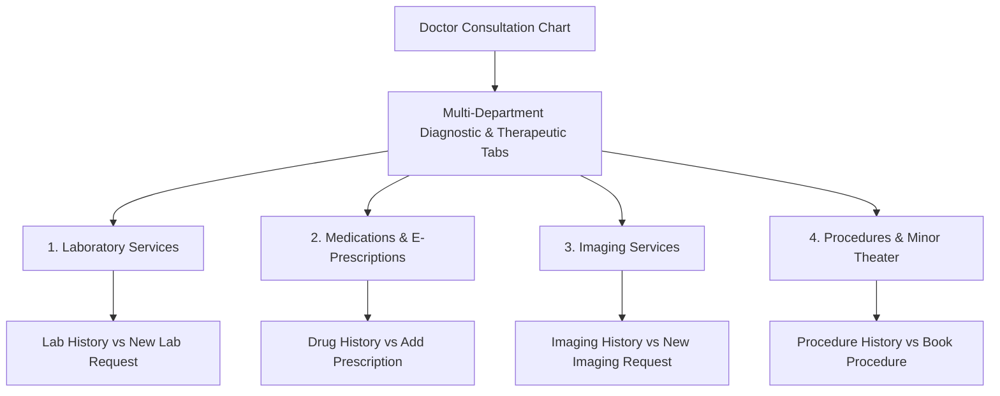

# Multi-Department Diagnostic Orders & E-Prescriptions

ROLE GUARD: SUPERADMIN | ADMIN | DOCTOR

The **Doctor Consultation Workbench** features an integrated multi-department order entry engine. Within a single clinical session, attending doctors can review past investigations, issue new laboratory test panels, request radiology imaging studies, prescribe medications, and order bedside surgical procedures without leaving the patient's chart.

> [!NOTE]
> Every order is verified in real time against hospital stock availability, HMO pre-authorization tariffs, and patient allergy profiles. Billable items automatically post pending charges to the cashier desk without bypassing General Ledger double-entry observers.

---

## 1. Laboratory Services: Step-by-Step Guide

The **Laboratory Services** tab coordinates all clinical pathology workflows, split into **Lab History** (reviewing past and pending tests) and **New Lab Request** (ordering new investigations).

### A. Reviewing Lab History & Accessing Results
- **Exact UI Location**: In the left encounter navigation sidebar, click **Laboratory Services**, then click the **Lab History** sub-tab button.
- **Card Telemetry**: Displays historical investigation cards (e.g., `24HR URINE CALCIUM`, `MALARIA PARASITE (MP) MICROSCOPY`), requisition dates, requesting clinicians, specimen status, and assigned lab numbers (e.g., `LAB26-11626`).
- **Understanding Status Badges**:
  - `BILLED` (Blue): Fee settled at cashier or validated against active HMO coverage.
  - `SAMPLE TAKEN` / `NOT TAKEN`: Indicates whether phlebotomy has drawn and barcoded the specimen.
  - `AWAITING RESULTS` (Grey): Specimen currently in analyzer run or culture incubation.
  - `RESULT AVAILABLE` / `VALIDATED` (Teal/Green): Testing complete; signed off by the consultant pathologist.
- **Actions on History Cards**:
  - **View**: Opens the complete pathologist report with numeric values, reference ranges, and critical flag indicators (High/Low).
  - **Print**: Generates the formal hospital pathology laboratory sheet.
  - **Re-order**: Duplicates the test directly into today's active requisition.

### B. Ordering New Laboratory Investigations
- **Exact UI Location**: In the **Laboratory Services** tab, click the **New Lab Request** sub-tab button.
- **Workflow & Fields**:
  1. **Search Catalog**: In the **Search services...** box, type test name or acronym (e.g., `FBC`, `Urinalysis`, `Creatinine`, `EUC`). Click the matching test from the autocomplete list.
     - *Not in Catalog? Click **+ Not listed? Add free-form** to type an unlisted or specialized referral test.*
  2. **Selected Services Table**: The test instantly populates the table showing test name, unit price, and clinical notes input.
  3. **Mandatory Clinical Indication Notes**: In the **Clinical Notes** column, provide clinical context (e.g., *"Persistent fever day 4, assess enteric fever vs severe malaria"*, *"Type 2 DM annual renal review"*). Pathology scientists rely on this guidance during specimen evaluation.
  4. **Instant Auto-Save**: Orders save asynchronously without requiring manual submission. A green status indicator confirms dispatch to the phlebotomy queue.
  5. **Save as Template**: To preserve a frequently used combination of tests (e.g., *Diabetic Annual Workup*, *Antenatal Booking Panel*), click **Save as Template** to create a personal reusable bundle.

---

## 2. Medications & E-Prescriptions: Step-by-Step Guide

The **Medications** tab manages electronic prescribing, structured dosage formatting, HMO formulary checks, and one-click chronic refills. It is organized into **Drug History** and **Add Prescription**.

### A. Reviewing Drug History & One-Click Re-Prescribing
- **Exact UI Location**: In the left encounter navigation sidebar, click **Medications**, then click the **Drug History** sub-tab button.
- **Card Telemetry**: Displays past prescriptions (e.g., `10% MANITOL 500MLS`, `ANATE 1-6yr Artesunate (50mg) + Amodiaquine (150MG)`), dates prescribed, prescribing clinician, billed amount, and dispensary status (`READY TO DISPENSE`, `UNBILLED`, `DISMISSED`, `DISPENSED`).
- **One-Click Re-Prescribe**: For returning outpatients on stable maintenance regimens, click the blue **Re-prescribe** button on any drug card. The product, strength, dosage, route, and frequency copy into today's visit in under one second.
- **Re-Prescribe Entire Encounter**: To duplicate all medications from a previous hospital visit at once, click the **Re-prescribe from Encounter** dropdown at the top, select the past encounter date, and all drugs populate simultaneously.

### B. Prescribing New Medications
- **Exact UI Location**: In the **Medications** tab, click the **Add Prescription** sub-tab button.
- **Workflow & Fields**:
  1. **Dose Mode Toggle**:
     - **Structured Dose** (Default): Precise controls for amount, unit, route, frequency, duration, and calculated quantity.
     - **Simple Note**: Free text input (e.g. *"500mg BD x 5 days"*) for complex tapering doses or specialized pediatric suspensions.
  2. **Search Pharmacy Inventory**: In the **Search products...** box, type brand or generic drug name (e.g., `Paracetamol`, `Ciprofloxacin`, `Artemether`). Select the matching formulation from the dropdown list.
     - *Not in Inventory? Click **+ Not listed? Add free-form** to prescribe unlisted or specialized medications.*
  3. **Configure Dosing Parameters**:
     - **Dose & Unit**: Specify quantity and unit (e.g., `500mg`, `10 mL`, `2 tablets`).
     - **Route**: Select administration path (`Oral`, `Intravenous (IV)`, `Intramuscular (IM)`, `Subcutaneous`, `Topical`, `Inhalation`, `Eye Drops`).
     - **Frequency**: Select dosing interval (`OD` - once daily, `BD` - twice daily, `TID` - three times daily, `QID` - four times daily, `PRN` - as needed, `Stat` - immediate single dose).
     - **Duration**: Specify duration in days or weeks (e.g., `7 days`, `30 days`).
  4. **Automated Quantity & Copay Calculation**: The system automatically computes total quantity to dispense (e.g., 1 tablet BD for 30 days = 60 tablets) and calculates total price alongside patient HMO co-pay deductibles.
  5. **Doctor's Dispensing Notes**: Add explicit instructions for the pharmacist and patient label (e.g., *"Take with or immediately after food"*, *"Complete full 5-day course"*).
  6. **Allergy Guardian Safeguard**: If a prescribed drug belongs to a class documented in the patient's allergy profile (e.g., Penicillins, Sulfa drugs), the system displays a high-priority red alert modal and halts the prescription.
  7. **Save as Template**: Click **Save as Template** to save frequently ordered drug combinations as a reusable clinic pack.

---

## 3. Imaging & Radiology Services: Step-by-Step Guide

The **Imaging Services** tab interfaces with the hospital's radiology information system and PACS image archive, split into **Imaging History** and **New Imaging Request**.

### A. Reviewing Imaging History
- **Exact UI Location**: In the left encounter navigation sidebar, click **Imaging Services**, then click the **Imaging History** sub-tab button.
- **Telemetry & Scans**: Displays previous X-rays, Ultrasounds, CT scans, and MRI acquisitions (e.g., `ULTRASOUND SCANNING - ABDOMINOPELVIC SCAN`).
- **Status Indicators**:
  - `BILLED` / `UNBILLED`: Billing clearance state.
  - `AWAITING RESULTS`: Examination scheduled or scan under review by the consultant radiologist.
- **Actions on History Cards**:
  - **View**: Opens the consultant radiologist's formal diagnostic report or launches the PACS DICOM viewer.
  - **Print**: Generates the formal radiology report document.
  - **Re-order**: Duplicates the imaging study requisition into today's visit.

### B. Ordering New Imaging Studies
- **Exact UI Location**: In the **Imaging Services** tab, click the **New Imaging Request** sub-tab button.
- **Workflow & Fields**:
  1. **Search Catalog**: In the **Search imaging services...** box, type requested study (e.g., `Chest X-Ray`, `Abdominal Pelvic Ultrasound`, `Brain CT Scan`). Select from the dropdown list.
     - *Not in Catalog? Click **+ Not listed? Add free-form** to type specialized external imaging.*
  2. **Clinical Notes & Anatomic Specification**: In the **Clinical Notes** column, provide clinical rationale and required views (e.g., *"PA view — 3-week productive cough, night sweats, rule out pulmonary tuberculosis"*, *"Pelvic USS — Assess viability and crown-rump length"*). Radiographers rely on this indication to execute the scan safely.
  3. **Instant Auto-Save**: Study orders save automatically and route to the radiology scheduling desk.

### B. Ordering New Imaging Studies
- **Exact UI Location**: In the **Imaging Services** tab, click the **New Imaging Request** sub-tab button.
- **Workflow & Fields**:
  1. **Search Catalog**: In the **Search imaging services...** box, type requested study (e.g., `Chest X-Ray`, `Abdominal Pelvic Ultrasound`, `Brain CT Scan`). Select from the dropdown list.
     - *Not in Catalog? Click **+ Not listed? Add free-form** to type specialized external imaging.*
  2. **Clinical Notes & Anatomic Specification**: In the **Clinical Notes** column, provide clinical rationale and required views (e.g., *"PA view — 3-week productive cough, night sweats, rule out pulmonary tuberculosis"*, *"Pelvic USS — Assess viability and crown-rump length"*). Radiographers rely on this indication to execute the scan safely.
  3. **Instant Auto-Save**: Study orders save automatically and route to the radiology scheduling desk.

---

## 4. Bedside Procedures & Minor Theatre Booking

The **Procedures** tab manages minor surgical interventions, wound debridement, catheterization, and dressing changes, split into **Procedure History** and **Request / Book Procedure**.

### A. Reviewing Procedure History
- **Exact UI Location**: In the left encounter navigation sidebar, click **Procedures**, then click the **Procedure History** sub-tab button.
- **Telemetry & Records**: Displays previous bedside and theater interventions (e.g., `BREECH DELIVERY (BOOKED)`, `Wound Debridement`), requisition timestamps, requesting doctor, and status badges (`REQUESTED`, `SELF-PAY`, `PAID`, `COMPLETED`).
- **Actions**:
  - **Details**: Opens the procedure summary modal displaying scheduled dates, assigned theater room, procedure team members, and pre/post-op notes.
  - **Delete**: Cancels an unexecuted procedure request (subject to role permissions).
  - **Refresh History**: Reloads the procedure log table from the server.

### B. Booking & Requesting New Procedures
- **Exact UI Location**: In the **Procedures** tab, click the **Request / Book Procedure** sub-tab button.
- **Workflow & Fields**:
  1. **Search Procedure Catalog**: Enter procedure name or indication (e.g., `Wound Dressing`, `Laceration Suturing`, `Foley Catheterization`, `Incision & Drainage`, `Excision Biopsy`) in the search bar.
  2. **Configure Booking Card**:
     - **Date & Scheduled Time**: Set planned operation or procedure appointment.
     - **Theater / Room**: Select destination (e.g., *Minor Theater*, *GOPD Dressing Room*, *Casualty Procedure Room*).
     - **Clinical Indication**: Document procedural indication (e.g., *"Clean-contaminated laceration left forearm, secondary to glass cut"*).
     - **Billing Configuration**: Choose whether to apply standard procedure base fee billing immediately or defer billing to the Procedure Workbench following consumable reconciliation.
  3. **Assign Procedure Team**: Click the team configuration button to open the **Procedure Team Modal**. Assign participating staff members, their roles (*Lead Surgeon*, *Assistant Surgeon*, *Scrub Nurse*, *Anesthetist*), and specific duties.
  4. **Procedure Clinical Notes**: Click **Procedure Notes** to document pre-operative assessments, operative findings, suture types/counts, and postoperative wound care instructions.

### B. Booking & Requesting New Procedures
- **Exact UI Location**: In the **Procedures** tab, click the **Request / Book Procedure** sub-tab button.
- **Workflow & Fields**:
  1. **Search Procedure Catalog**: Enter procedure name or indication (e.g., `Wound Dressing`, `Laceration Suturing`, `Foley Catheterization`, `Incision & Drainage`, `Excision Biopsy`) in the search bar.
  2. **Configure Booking Card**:
     - **Date & Scheduled Time**: Set planned operation or procedure appointment.
     - **Theater / Room**: Select destination (e.g., *Minor Theater*, *GOPD Dressing Room*, *Casualty Procedure Room*).
     - **Clinical Indication**: Document procedural indication (e.g., *"Clean-contaminated laceration left forearm, secondary to glass cut"*).
     - **Billing Configuration**: Choose whether to apply standard procedure base fee billing immediately or defer billing to the Procedure Workbench following consumable reconciliation.
  3. **Assign Procedure Team**: Click the team configuration button to open the **Procedure Team Modal**. Assign participating staff members, their roles (*Lead Surgeon*, *Assistant Surgeon*, *Scrub Nurse*, *Anesthetist*), and specific duties.
  4. **Procedure Clinical Notes**: Click **Procedure Notes** to document pre-operative assessments, operative findings, suture types/counts, and postoperative wound care instructions.

---

## 5. Care Plan & Non-Pharmacological Directives

The **Care Plan / Non-Pharm** tab captures critical lifestyle, dietary, and bedside nursing instructions:
- **Nutritional Directives**: Low sodium cardiac protocol, diabetic carbohydrate counting, renal protein restriction.
- **Lifestyle Counseling**: Exercise regimens, smoking cessation protocols, alcohol abstinence guidelines.
- **Nursing Care Orders**: 2-hourly vital sign monitoring, limb elevation, bed-rest restrictions, fall precautions.
- All care plan items summarize automatically on the patient's discharge paperwork and the final Conclude Consultation audit screen.

---

## 6. Downstream Handover & Departmental Flow

| Order Type | Downstream Department | Operational Action Required |
|:---|:---|:---|
| **Laboratory Panel** | Phlebotomy Station & Pathology Lab | Phlebotomist collects specimens, scans barcode, and marks `SAMPLE TAKEN`. Pathologist runs analysis and validates reports. |
| **Diagnostic Imaging** | Radiology Desk & Radiographers | Radiography team calls patient, acquires views, and uploads DICOM scans to PACS viewer. |
| **Medication Prescription** | Outpatient Pharmacy Dispensary | Pharmacist conducts clinical review, dispenses drugs, prints instruction labels, and deducts FIFO inventory. |
| **Bedside Procedure** | Minor Theater / Nursing Staff | Theater nurse prepares sterile consumable packs, schedules session, and participates in procedure team. |
| **Unbilled Order Fees** | Cashier / HMO Desk | Self-pay invoices generate for cashier collection; HMO authorizations automatically attach to claim dockets. |

---

## Navigation & Next Steps
- 👉 **[Clinical Referrals, Inpatient Admissions & Discharge](/user-guides/workbenches/doctor/referrals-and-discharge)** — Specialist transfers, inpatient admissions, and encounter closure.
- 👉 **[Active Clinical Intake & AI Notes](/user-guides/workbenches/doctor/clinical-encounter)** — Clinical notes, voice dictation, and SOAP structure.
- 👉 **[Consultation Queue & Triage Filtering](/user-guides/workbenches/doctor/consultation-queue)** — Roster management and queue triage.
