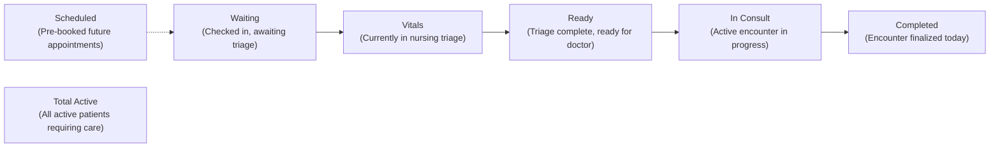
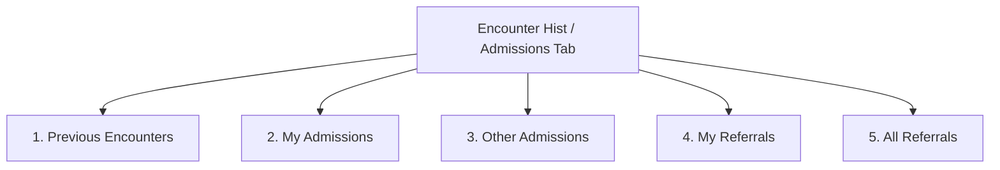

# Doctor Consultation Queue & Triage Filtering

ROLE GUARD: SUPERADMIN | ADMIN | DOCTOR

The **Doctor Consultation Queue** is the clinical reception and patient flow command center for attending physicians. It unifies walk-in arrivals, triaged outpatients, pre-booked appointments, inpatient admissions, and specialist referrals into a single responsive operational interface.

---

## 1. Interface Architecture: The Waiting Room & Clinical Roster

The queue interface coordinates daily clinic volume without full-page reloads, automatically synchronizing as reception registers new arrivals, nurses complete triage vitals, and colleagues conclude consultations.

### Top Action Ribbon Controls
Located in the upper right header, these five quick-access buttons support emergency and administrative needs during clinic hours:
- **`+ New Patient`**: Opens the standard patient demographic registration modal, enabling clinicians to enroll new patients immediately if reception has not yet created a record.
- **`+ Register Walk-In`**: Initiates fast-track registration tailored for outpatient walk-ins, automatically prefixing the hospital file number with `DOC-`.
- **`Emergency Intake` (Red Button)**: Instantly opens an emergency casualty file for acute, unstable trauma or resuscitation patients requiring immediate bedside care before registration.
- **`Contacts`**: Opens the internal hospital phonebook with extensions for nursing stations, intensive care units, laboratory scientists, radiographers, and on-call consultants.
- **`Price List`**: Launches the master hospital tariff directory, allowing physicians to verify real-time costs for blood tests, diagnostic scans, drugs, procedures, and ward bed deposits.

---

## 2. Queue Telemetry: The 7 KPI Metric Cards

Directly below the top navigation, seven high-contrast metric cards summarize departmental patient flow across critical stages of clinical care:

1. **`Waiting` (Amber)**: Outpatients who have checked in at reception but have not yet had baseline vital signs recorded by nursing.
2. **`Vitals` (Cyan)**: Patients currently positioned at the nursing triage desk undergoing blood pressure, pulse, temperature, and weight measurements.
3. **`Ready` (Blue)**: Clinically cleared patients whose vital signs are recorded and who are seated in the waiting area ready for immediate consultation.
4. **`In Consult` (Green)**: Patients currently inside a physician's consulting room with an active encounter underway.
5. **`Scheduled` (Purple)**: Patients with pre-booked appointments scheduled for today or upcoming calendar dates.
6. **`Completed` (Grey)**: Outpatient visits that have been signed off, finalized, and discharged today.
7. **`Total Active` (Dark)**: The cumulative sum of all active patients currently navigating the facility's clinical care pipeline today.

---

## 3. Multi-Dimensional Filter Toolbar

The filter bar enables physicians to narrow down high-volume outpatient queues using clinical and administrative parameters:

| Filter Control | Where to Find It | Available Options | Clinical & Operational Objective |
|:---|:---|:---|:---|
| **From / To Dates** | Date pickers | Date selectors (defaults from today to +30 days) | Restricts queue roster to today's arrivals or broadens to review upcoming clinic appointments. |
| **Source** | Source dropdown | `All Sources`, `Scheduled`, `Walk-in`, `Emergency`, `Follow-up`, `Referral` | Isolates walk-in acute visits from routine scheduled checkups or specialist referrals. |
| **Priority** | Priority dropdown | `All Priorities`, `Emergency`, `Urgent`, `Routine` | Elevates red-flagged emergencies and high-acuity cases to the top of the clinical list. |
| **Clinic** | Clinic dropdown | Dynamic list of assigned hospital clinics | Filters between General Outpatient (GOPD), Paediatrics, Cardiology, ENT, Eye Clinic, etc. |
| **Sort By** | Sort dropdown | `Time (Newest First)`, `Time (Oldest First)`, `Patient (A-Z)`, `Patient (Z-A)`, `Priority (Highest)` | Orders cards chronologically by arrival time, alphabetical name, or acuity triage level. |
| **Fetch** | Blue button (<i class="mdi mdi-magnify"></i>) | Click trigger | Executes the query and updates cards instantly. |

---

## 4. Single-Click Status Filter Pills

Directly beneath the filter bar, the **Status Pill Bar** allows instantaneous switching between operational patient lists:

- **`All`**: Displays every queued patient assigned to the clinic regardless of current processing stage.
- **`Waiting` (Amber)**: Restricts view to patients awaiting nursing triage.
- **`Vitals` (Cyan)**: Shows patients actively at the nursing vital signs station.
- **`Ready` (Blue)**: Shows triage-cleared patients awaiting physician consultation—**the primary operational filter for calling patients into your room**.
- **`In Consultation` (Green)**: Lists patients currently undergoing clinical consultation across doctor rooms.
- **`Scheduled` (Purple)**: Displays upcoming pre-booked specialist appointments.
- **`Completed` (Grey)**: Shows patients who have already been evaluated, treated, and discharged.

---

## 5. Patient Card Architecture & Clinical Telemetry

Patients are rendered as structured, high-density clinical cards designed for rapid clinical decision-making:

### Card Visual Elements
1. **Avatar Initials Badge**: Circular monogram with uppercase patient initials (e.g., `AR`), bordered with a status ring indicating current queue condition (Green = Ready/Waiting, Blue = Vitals/In Consult, Purple = Scheduled).
2. **Demographic Block**: Full name including othername, age in years/months, gender, Medical Record Number (`MRN`), and payment scheme (`Private Self-Pay` or HMO Provider name).
3. **Source & Priority Badges**:
   - Source indicators: `WALK-IN`, `SCHEDULED`, `FOLLOW-UP`, `REFERRAL`, `EMERGENCY`.
   - Priority indicators: High-priority warning badge (<i class="mdi mdi-alert text-warning"></i>) or emergency bolt (<i class="fa fa-bolt text-danger"></i>).
   - Pre-paid indicator badge (<i class="mdi mdi-cash-check text-success"></i>) indicating the patient has pre-settled consultation charges at the cashier.
4. **Encounter Telemetry Line**: Physical arrival timestamp (`09:15 AM`), assigned clinic (`Ear, Nose & Throat`), and booking staff member.
5. **Live Consultation Mini-Timer**: For cards in `In Consultation` status, an embedded timer tracks total elapsed consultation time (`00:12:45`), flashing softly when paused.

### Primary Action Buttons
- **`Start Encounter` (Green Button with Walking Icon)**: Calls the patient into your office, transitions the queue status to `In Consultation`, initializes the consultation stopwatch, and opens the active electronic medical chart.
- **`Resume Encounter` (Blue Button)**: Reopens the charting session for a patient who briefly stepped out for an ultrasound, X-ray, or phlebotomy blood draw.
- **`Check-In` (Purple Button on Scheduled Cards)**: Registers the patient's physical arrival at the hospital, moving their status from `Scheduled` to `Waiting` or `Ready`.
- **`Blocked` (Disabled Grey Button)**: Appears when administrative prerequisites remain unfulfilled (e.g., HMO secondary pre-authorization required, or cashier deposit pending). Hovering reveals the barrier explanation.

### Secondary Actions Menu (Three-Dot Dropdown)
- **`Reschedule`**: Moves an appointment to a future clinic date or different time slot.
- **`Change Doctor`**: Reassigns the patient to another physician or specialist currently on duty.
- **`Cancel`**: Cancels a booked appointment with mandatory audit reason logging.
- **`No-Show`**: Marks scheduled patients who failed to present to clinic by the end of the shift.
- **`View Vitals`**: Opens a fast popup previewing baseline triage vitals without leaving the queue.

---

## 6. Table View vs Calendar View

Clinicians can toggle between tabular and calendar perspectives using the view toggle buttons:
- **Table View (Default)**: Optimized for fast outpatient clinic turnover, sorting by arrival timestamp, and rapid patient intake.
- **Calendar View**: Renders day, week, month, and agenda timelines powered by FullCalendar. Ideal for specialist appointment scheduling, surgical booking reviews, and workload balancing.

---

## 7. Tab 2: Encounter Hist / Admissions & The 5 Subtabs

Switching to the **Encounter Hist / Admissions** tab provides access to past clinical archives, inpatient ward rosters, and specialist referral registries:

### Subtab 1: Previous Encounters
Historical consultation repository across all hospital clinics:
- **Filter Parameters**: `From` and `To` date pickers (defaults to last 7 days), `Clinic` selector, `HMO` selector, and sort ordering.
- **Card Telemetry**: Patient demographics, file number, date/time, consulting physician, and primary ICD-10 diagnosis.
- **Actions**:
  - **`View Details`**: Opens the historical encounter record displaying SOAP notes, vital sign graphs, and original test results.
  - **`Print Summary`**: Generates an official signed encounter report for legal or insurance documentation.

### Subtab 2: My Admissions
Active census of all inpatients hospitalized under your primary clinical custody:
- **Filter Parameters**: Date range selectors, HMO filter, and sorting.
- **Card Telemetry**: Patient demographics, ward location (e.g., *Male Medical Ward*), allocated bed number (e.g., `Bed 04`), length of stay in days, and admitting diagnosis.
- **Admission Status Badges**: Displays `ADMITTED` (green) or `DISCHARGE REQUESTED` (orange).
- **Actions**:
  - **`Open Inpatient Chart`**: Launches the patient's full inpatient file with nursing notes and fluid balance sheets.
  - **`Ward Round Note`**: Opens a streamlined documentation window to enter daily round assessments and treatment plan adjustments.
  - **`Order Inpatient Meds / Labs`**: Issues ongoing inpatient pharmaceutical doses or monitoring lab requests.
  - **`Discharge`**: Initiates the formal inpatient discharge protocol, opening the discharge summary screen.

### Subtab 3: Other Admissions
Hospital-wide inpatient census of patients admitted under other attending physicians:
- **Clinical Value**: Critical for on-call teams, night duty medical officers, and weekend coverage physicians.
- **Filter Parameters**: Filter by attending doctor to inspect any colleague's current inpatients.
- **Actions**:
  - **`View Chart`**: Inspects recent treatment plans and nursing notes during cross-coverage without altering primary orders.
  - **`Record On-Call Review Note`**: Documents urgent reviews, nocturnal clinical interventions, or change-of-status assessments.
  - **`Stat Dose Order`**: Issues emergency one-time pharmaceutical orders (e.g., STAT IV antihypertensives or analgesics).

### Subtab 4: My Referrals
Tracks all specialist cross-consultations involving your clinical practice:
- **Direction Filter**:
  - `Sent by Me`: Outgoing referrals initiated by you requesting specialist evaluation for your patients.
  - `Targeted at Me`: Incoming referrals directed to your subspecialty clinic by general medical officers or colleagues.
- **Urgency Categories**: `Routine` (green), `Urgent` (yellow), or `Emergency` (red).
- **Actions**:
  - **`Accept Referral`**: Acknowledges the incoming case and confirms clinical acceptance.
  - **`Book into Clinic`**: Schedules the referred patient into your upcoming clinic session.
  - **`Decline Referral`**: Rejects an inappropriate referral with mandatory justification (e.g., redirecting a neurosurgical condition).
  - **`View Referral Letter`**: Displays the formatted transfer summary and diagnostic history.

### Subtab 5: All Referrals
Facility-wide master referral ledger for medical directors, clinic managers, and department heads:
- **Operational Value**: Ensures zero clinical drops across hospital handovers, monitors departmental referral backlogs, and tracks external transfers to tertiary teaching institutions.

---

## 8. Downstream Handover & Patient Flow Impact

| Action Executed in Queue | System State Transition | Downstream Department Handover |
|:---|:---|:---|
| **Click `Start Encounter`** | Queue status updates to `In Consultation`. Stopwatch timer starts. | Triage waiting screen displays patient being attended in room. |
| **Click `Check-In` on Appointment** | Status advances from `Scheduled` to `Waiting` or `Ready`. | Nursing triage desk receives notification to record baseline vitals. |
| **Accept Inpatient Ward Round Order** | Inpatient census reflects daily review timestamp. | Ward charge nurse MAR activates today's medication adjustments. |
| **Accept Specialist Referral** | Patient added to specialist's active clinic appointment roster. | Reception desk receives booking confirmation to notify the patient. |

---

## Navigation & Next Steps
- 👉 **[Active Clinical Intake & AI Notes](/user-guides/workbenches/doctor/clinical-encounter)** — Examine the sticky patient header, 13 clinical tabs, voice dictation, and SOAP notes.
- 👉 **[Multi-Department Diagnostic Orders & E-Prescriptions](/user-guides/workbenches/doctor/clinical-orders)** — Step-by-step guide to lab tests, imaging studies, and electronic prescribing.
- 👉 **[Clinical Referrals, Inpatient Admissions & Discharge](/user-guides/workbenches/doctor/referrals-and-discharge)** — Specialist transfers, inpatient admissions, and encounter closure.
