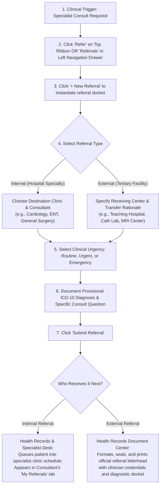
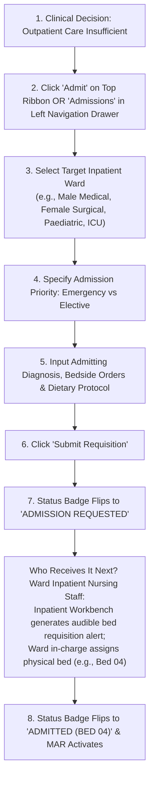
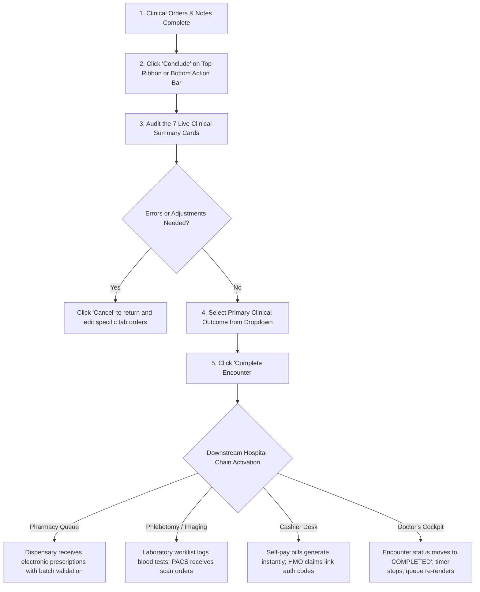

# Clinical Referrals, Inpatient Admissions & Encounter Finalization

*An operational clinical manual for Medical Officers, Residents, Consultants, and Specialty Registrars.*

The terminal phase of an outpatient consultation transitions the patient along their clinical pathway. Depending on clinical severity and diagnostic findings, the physician must either:
1. **Transfer specialized clinical care** to an internal departmental subspecialty or external tertiary medical center.
2. **Escalate to inpatient admission** for continuous hemodynamic monitoring, intravenous pharmacotherapy, or emergency surgical preparation.
3. **Conclude and finalize the consultation** with validated ICD-10 coding, multi-department order reconciliation, and safe outpatient discharge.

This guide details **what each tool is, clinical indications, how to operate the interface, required fields, and downstream clinical/billing handovers**.

---

## 1. Interface Overview: Specialist Referrals & Conclude Cockpit

### A. Specialist Referrals Workbench

### B. Consultation Audit & Encounter Finalization Modal

---

## 2. Specialist Referrals: Indications, Workflow & Impact

### Clinical Objective & Overview
The **Specialist Referral** subsystem governs formal clinical handovers from general outpatient or initial triage to specialized medical and surgical disciplines. It preserves clinical continuity, diagnostic reasoning, and medico-legal accountability across care boundaries.

### Step-by-Step Referral Execution

#### Step 1: Open the Referral Interface
- In the active consultation cockpit, click the blue **Refer** button (<i class="mdi mdi-account-switch"></i>) on the top persistent patient ribbon.
- Alternatively, select the **Referrals** tab in the clinical left-hand drawer navigation.
- If the referral entry form is collapsed, click the blue **`+ New Referral`** button.

#### Step 2: Configure Clinical Parameters & Required Fields
- **Referral Type (*Required)**:
  - **`Internal (Within Hospital)`**: For intra-facility cross-specialty reviews where the patient remains under the hospital's governance. *Example: Transferring a newly diagnosed Type 2 Diabetic with proliferative retinopathy to the Eye Clinic, or seeking an Orthopaedic consult for a closed distal radius fracture.*
  - **`External (Outside Hospital)`**: For inter-facility transfers where the patient requires tertiary subspecialty care, advanced diagnostic imaging (e.g., 3T MRI, PET-CT), cardiac catheterization, or pediatric intensive care not available in the current facility.
- **Urgency Level (*Required)**:
  - **`Routine` (🟢 Green)**: Non-emergent, chronic, or baseline evaluations. *Target consult window: 7 to 14 days.*
  - **`Urgent` (🟡 Yellow)**: Rapidly progressive non-immediately life-threatening conditions requiring specialist review within 24 to 48 hours. *Example: Uninvestigated unilateral lymphadenopathy, post-menopausal uterine bleeding, or refractory hypertension.*
  - **`Emergency` (🔴 Red)**: Critical, time-sensitive pathology. Selecting **Emergency** broadcasts an audible alarm and high-priority visual banner at the Health Records and Triage desks to bypass outpatient scheduling and expedite immediate physician handover. *Example: Impending spinal cord compression, acute neurovascular compromise, or acute abdomen.*
- **Target Clinic (*Required for Internal Referrals)**:
  - Select the destination department from the dropdown (e.g., *Cardiology*, *Gastroenterology*, *Orthopaedics*, *General Surgery*, *Paediatrics*, *Obstetrics & Gynaecology*, *Ophthalmology*, *ENT*, *Psychiatry*).
- **Target Doctor (Optional)**:
  - Select a specific consultant by name if personal continuity or subspecialty expertise is required. Otherwise, retain the default **`-- Any Available Doctor --`** to distribute the referral to the specialty's general intake pool.
- **Provisional Diagnosis (*Required)**:
  - Enter your clinical diagnostic impression and corresponding ICD-10 description (e.g., *"Suspected acoustic neuroma (ICD H93.3)"* or *"Severe Carpal Tunnel Syndrome (ICD G56.0)"*).
- **Clinical Summary & Relevant Findings (Recommended)**:
  - Provide concise synopsis of presenting complaints, pertinent positive physical examination findings, baseline vital signs, and immediate interventions initiated.
- **Specific Reason for Referral (*Required)**:
  - Detail your explicit consultation objective or clinical question. *Examples: "For slit-lamp biomicroscopy and dilated fundoscopy", "Consult for surgical excision biopsy", or "Optimize failing anti-arrhythmic therapy."*

#### Step 3: Save and Transmit
- Click **Submit Referral**. The system runs instantaneous field validation and displays a green confirmation notification.

### Downstream Handover & Operational Impact
- **Internal Referral Pathway**:
  - The patient appears instantly on the **Health Records & Reception** desk under Pending Referrals. Records officers allocate the patient to the target clinic's roster for today or book a future clinic slot.
  - The receiving specialist sees the patient listed in their Doctor Workbench under the **Encounter Hist / Admissions &rarr; My Referrals** tab.
  - For HMO/insured patients, internal referrals maintain claim continuity without requiring duplicate card validation.
- **External Referral Pathway**:
  - The referral routes to the **Health Records Document Center**.
  - Health Records staff click **Print Referral Letter** to generate an official hospital transfer document bearing the facility letterhead, patient MRN, timestamp, doctor's registration number, ICD-10 diagnosis, and attached lab/imaging results for physical handover to the receiving tertiary institution.

---

## 3. Inpatient Ward Admission: Workflow & Care Escalation

### Clinical Objective & Indications
Initiate an **Inpatient Ward Admission** when clinical stabilization cannot be managed safely in an ambulatory outpatient setting. Indications include:
- Severe acute hemodynamic compromise (e.g., hypovolemic shock, sepsis, decompensated heart failure).
- Requirement for continuous intravenous drug titration, blood component transfusion, or fluid resuscitation.
- Post-operative recovery or pre-operative surgical optimization.
- Acute respiratory insufficiency requiring continuous oxygen or nebulization.
- High-frequency clinical monitoring (e.g., neurological Glasgow Coma Scale evaluations every 1–2 hours).

### Step-by-Step Admission Execution

#### Step 1: Open the Inpatient Requisition Form
- Click the **Admit** button (<i class="fa fa-bed"></i>) in the persistent top consultation ribbon.
- Alternatively, select the **Admissions** tab in the clinical drawer.

#### Step 2: Complete the Admission Order Set
- **Target Inpatient Ward (*Required)**:
  - Choose the appropriate ward: *Male Medical Ward*, *Female Medical Ward*, *Male Surgical Ward*, *Female Surgical Ward*, *Paediatric Ward*, *Maternity / Labour Ward*, *Postnatal Ward*, or *Intensive Care Unit (ICU)*.
- **Admission Type (*Required)**:
  - **`Emergency`**: For immediate clinical transfers from outpatient or casualty to bedside stabilization. Triggers priority nursing triage and bed readiness.
  - **`Elective`**: For planned admissions (e.g., scheduled elective surgical operations, planned intravenous iron infusions, or specialized diagnostic workups).
- **Admitting Diagnosis (*Required)**:
  - Enter the primary pathological condition requiring inpatient admission (e.g., *"Community-Acquired Pneumonia with Severe Hypoxemia (CURB-65 = 3)"*).
- **Admitting Physician's Orders (*Required)**:
  - Document explicit, unambiguous directives for the inpatient nursing care team:
    - *Monitoring frequency*: e.g., *"Strict 2-hourly vital signs, neurological GCS, and oxygen saturation charting."*
    - *Parenteral therapy*: e.g., *"Secure 18G IV line. Infuse 1000 mL Normal Saline IV over 6 hours, followed by 5% Dextrose Saline at 80 mL/hr."*
    - *Immediate STAT interventions*: e.g., *"Administer IV Ceftriaxone 2g STAT after blood cultures drawn."*
    - *Oxygen therapy*: e.g., *"Maintain $SpO_2 \ge 94\%$ via nasal cannula at 3 L/min."*
- **Dietary & NPO Instructions (*Required)**:
  - Define the nutritional regimen:
    - **`Strict NPO (Nil Per Os)`**: For impending surgical interventions or acute gastrointestinal emergencies.
    - **`Cardiac / Low Sodium`**: For congestive cardiac failure or hypertensive emergencies.
    - **`Diabetic Protocol (1800 kcal)`**: For inpatient glycaemic control.
    - **`Clear Fluids Only`** or **`Normal Diet as Tolerated`**.

#### Step 3: Transmit Admission Requisition
- Click **Submit Requisition**.
- The patient banner immediately reflects a pulsating status badge: **`ADMISSION REQUESTED`**.

### Downstream Handover & Inpatient Workflow
- **Ward Nursing Interface**: The requisition routes to the **Inpatient Nursing Workbench** on the target ward. An auditory chime and badge alert notify the charge nurse.
- **Physical Bed Allocation**: The ward nurse reviews bed occupancy in the ward grid and allocates an available bed (e.g., `Male Medical - Bed 04`).
- **Real-Time Synchronization**: Once the bed is allocated, the consultation header updates to **`ADMITTED (BED 04)`**.
- **Electronic MAR Activation**: All inpatient medications and IV fluids ordered by the doctor automatically populate the patient's **Medication Administration Record (MAR)** on the ward nursing station.

---

## 4. Consultation Finalization & Encounter Conclude

### Clinical Objective & Audit Governance
The **Conclude Consultation** modal serves as the legal and operational sign-off for the clinical encounter. It executes three functions:
1. **Clinical Audit**: Aggregates all clinical notes, diagnoses, laboratory requests, imaging requisitions, drug orders, and procedures for physician verification before releasing the patient.
2. **Reconciliation & Error Prevention**: Allows one-click cancellation or editing if an incorrect dosage, unneeded investigation, or contradictory diagnosis was entered.
3. **Clinical Disposition Assignment**: Assigns the final patient outcome and triggers automated billing, pharmacy dispensing, and phlebotomy workflows.

### Step-by-Step Conclude Procedure

#### Step 1: Open the Conclude Modal
- Click the green **Conclude** button (<i class="fa fa-check-circle"></i>) on the top consultation ribbon.
- Alternatively, click the **Conclude Encounter** button at the footer of any clinical tab.

#### Step 2: Verify the 7 Clinical Audit Cards
Before clicking finalize, verify the 7 live summary cards:
1. 🩺 **Diagnosis & Clinical Notes**: Confirms primary ICD-10 illness, secondary comorbidities, and verifies that the SOAP clinical note has autosaved successfully.
2. 🧪 **Laboratory Requisitions**: Displays all requested haematology, biochemistry, and microbiology tests along with their real-time billing status (`BILLED`, `SAMPLE TAKEN`, `PENDING PAYMENT`).
3. 🔬 **Imaging & Radiology Requisitions**: Confirms X-ray, Ultrasound, CT, or MRI requisitions.
4. 💊 **Prescription Roster**: Audits all prescribed pharmaceuticals, drug formulations, strengths, dosing frequencies, and durations.
5. 🩹 **Clinical Procedures & Interventions**: Confirms minor surgery, wound debridement, catheterization, or bedside procedures with recorded consumable allocations.
6. 👥 **Specialist Referrals**: Summarizes internal or external referral destinations and urgency categories.
7. ❤️ **Care Plan & Follow-Up**: Lists lifestyle interventions, dietary advice, and scheduled follow-up revisit dates.

> [!TIP]
> If any item is missing or miscalculated, click **Cancel** to return to the encounter cockpit, correct the item in the respective tab, and reopen the Conclude modal.

#### Step 3: Set Primary Clinical Outcome & Optional Follow-Up
Select the definitive disposition from the **Clinical Outcome** dropdown:
- **`Consultation Finalized / Continuing Care`**: Standard outpatient outcome where the patient completes visit requirements and continues outpatient management.
- **`Discharged / Stable`**: Patient has achieved clinical stability and is formally discharged from clinic care.
- **`Improved`**: Clinical condition shows measurable improvement.
- **`Unimproved`**: Clinical condition remains refractory or unchanged.
- **`Referred Out`**: Confirms transfer of primary clinical custody to an external healthcare institution.
- **`Absconded / DAMA`**: Discharged Against Medical Advice (DAMA) or patient left clinic premises without authorization.
- **`Deceased (RIP)`**: Mortality occurring during active consultation or emergency resuscitation.
- **`Brought In Dead (BID)`**: Patient arrived at the facility with no vital signs; confirmed dead on arrival.

> [!IMPORTANT]
> **Death Notification Protocol**:
> Selecting **Deceased (RIP)** or **Brought In Dead (BID)** automatically reveals the **Death Notification Info** section. The clinician must complete mandatory legal documentation:
> - **Date of Death (*Required)**: Calendar date of clinical demise.
> - **Time of Death (*Required)**: Exact wall-clock timestamp of declared death.
> - **Primary Cause of Death (*Required)**: Immediate physiological cause (e.g., *"Cardiogenic shock secondary to acute anterior ST-elevation myocardial infarction"*).
> - **Certified By**: Automatically populates the certifying doctor's legal name and professional credentials.

#### Step 4: Schedule Outpatient Follow-Up (Optional)
If continuing outpatient review is needed, enable the **Schedule a follow-up appointment for this patient** switch:
- **Follow-Up Date**: Select the revisit date (enforces minimum +1 day from today).
- **Time Slot**: Select available clinic session slot.
- **Priority**: Designate `Routine` or `Urgent`.
- **Follow-Up Notes**: Enter clinical review objectives (e.g., *"Review repeat fasting lipid profile and renal function"*).
- **Pre-Paid Checkbox**: Check **Pre-paid (skip billing at check-in)** if follow-up review is complimentary or pre-settled under hospital policy.

#### Step 5: Finalize the Encounter
- Click **Complete Encounter**.
- The system commits all transactions to the clinical audit trail.

---

## 5. Downstream Clinical & Financial Handover Chain

| Department | What They Receive | Operational Action Required |
| :--- | :--- | :--- |
| **Pharmacy Dispensary** | Electronic prescription roster with drug IDs, dosages, and substitution permissions. | Pharmacist dispenses items, completes allergy checks, prints label instructions, and deducts FIFO inventory batches. |
| **Laboratory Phlebotomy** | Test requisitions with pre-assigned accession numbers and specimen container requirements. | Phlebotomist calls patient, scans wristband barcode, collects venous/capillary samples, and marks `SAMPLE TAKEN`. |
| **Radiology / Imaging** | Scan requests with clinical indication notes and modality specifications (e.g., Chest X-Ray PA view). | Radiographer calls patient, performs acquisition, and uploads DICOM images to PACS. |
| **Cashier / Billing Desk** | Itemized invoice for self-pay patients; claim batch for HMO/NHIA patients. | Self-pay patients settle charges via POS/cash before collection; HMO authorizations attach to claims. |
| **Doctor Workbench** | Encounter status updates to `COMPLETED`; consultation duration timer halts. | Physician returns to the waiting room queue to click **Start Encounter** on the next pending patient. |

---

## Technical Developer Reference
For developer route contracts, runtime triggers, observer hooks, and JSON payloads governing referrals, admissions, and encounter closure:
👉 **[Read the Doctor Consultation Developer API Reference](/developer/workbenches/doctor/api-contracts)**
