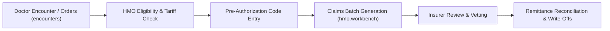

# HMO & Health Insurance Workbench

ROLE GUARD: SUPERADMIN | ADMIN | HMO EXECUTIVE

The **HMO Workbench** streamlines managed healthcare claims: verifying secondary pre-authorization codes, enforcing per-provider tariff matrices, generating claims batches, and reconciling insurer remittances.

---

## 1. Visual Tour: HMO Claims & Tariffs

> [!TIP]
> The HMO Workbench segregates primary claims from secondary pre-authorizations, allowing executives to bulk-vet batches before insurer submission.

---

## 2. Real Routes & Role Authorization

- **Primary Route**: `hmo.workbench` (`/hmo/workbench`)
- **Authoritative Role Guard**: Defined in `sidebar/_nav-hmo.blade.php` as `@hasanyrole('SUPERADMIN|ADMIN|HMO Executive')`.

---

## 3. HMO Claims Lifecycle

---

## 4. Cross-Module Data & Patient Flows

- **Reception (`reception.workbench`)**: Validates patient insurance cards and enrollee numbers upon intake.
- **Billing (`billing.workbench`)**: Automatically calculates co-payments and generates insurance claim receivables.
- **Accounting**: Observer actions tag revenue to Accounts Receivable - HMO.

---

## Developer Reference
👉 **[Read the HMO Tariffs & Claims Developer API Reference](/developer/workbenches/hmo)**
